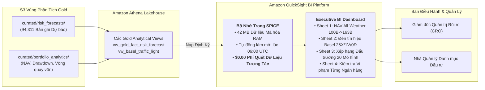

### Mục tiêu tuần 11:

* Triển khai nền tảng Trực quan hóa dữ liệu kinh doanh (**Business Intelligence - BI**) cấp doanh nghiệp với **Amazon QuickSight**, kết nối trực tiếp vào Athena Data Lakehouse (`fcaj-risk-analytics-workgroup`) mà không cần hạ tầng kho dữ liệu trung gian tốn kém.
* Nạp các tập dữ liệu Gold Marts vào bộ nhớ tính toán tăng tốc **SPICE (Super-fast, Parallel, In-memory Calculation Engine)**, cho phép người dùng tương tác, lọc dữ liệu tức thì với **$0.00** chi phí quét truy vấn Athena phát sinh.
* Xây dựng Bảng điều khiển quản trị rủi ro cấp điều hành (Executive BI Dashboard) gồm 4 phân hệ trực quan chuyên sâu: Chỉ số điều hành KPI & Danh mục All-Weather, Đồng hồ Đèn tín hiệu Basel III, Bảng tổng sắp đấu trường mô hình và Phân tích rủi ro đuôi từng ngân hàng.
* Tái hiện thành tựu thực nghiệm định lượng từ khóa luận: Tăng trưởng vốn từ **$100\ \text{Tỷ VNĐ} \to 163.07\ \text{Tỷ VNĐ}$** ($+63.07\%$), hệ số Sharpe $2.252$, mức sụt giảm tối đa $-7.36\%$ và minh họa số tiền tiết kiệm **$416\ \text{triệu VNĐ}$** nhờ bộ lọc chi phí ma sát $0.15\%$.

---

### Bảng phân bổ công việc tuần 11:

| Ngày | Nhiệm vụ kỹ thuật | Trạng thái | Ghi chú kiến trúc |
| :---: | :--- | :---: | :--- |
| **Thứ 2** | - Đăng ký tài khoản QuickSight Enterprise theo gói 30-day Free Trial.<br>- Cấu hình IAM Role cấp quyền cho QuickSight truy cập Athena và các S3 Gold buckets. | Hoàn thành | 1 tài khoản Author duy nhất; không phát sinh chi phí ban đầu. |
| **Thứ 3** | - Thiết lập Data Source Athena và khởi tạo tập dữ liệu SPICE cho `fact_risk_forecasts` và `fact_portfolio_analytics`.<br>- Lập lịch làm mới SPICE tự động hàng ngày sau khi Glue ETL Job kết thúc. | Hoàn thành | Dung lượng tập dữ liệu: 42 MB; nằm trọn trong 10 GB SPICE miễn phí. |
| **Thứ 4** | - Thiết kế Sheet 1: Executive KPI & Đường cong tăng trưởng NAV ($100\ \text{Tỷ} \to 163.07\ \text{Tỷ VNĐ}$).<br>- Thiết kế Sheet 2: Đồng hồ đo Đèn tín hiệu Basel III (25 Xanh / 1 Vàng / 0 Đỏ). | Hoàn thành | Biểu đồ Heatmap tự động nhóm các ngân hàng theo số lần vi phạm. |
| **Thứ 5** | - Thiết kế Sheet 3: Bảng xếp hạng Đấu trường 20 mô hình (FZ Loss $-3.0003$, MCS $p=1.0000$).<br>- Thiết kế Sheet 4: Dải biên động rủi ro $VaR_{99\%}$ & $ES_{97.5\%}$ và các điểm vi phạm thực tế. | Hoàn thành | Đối soát hình thái trực quan khớp hoàn toàn với báo cáo HTML gốc. |

---

### Kiến trúc & Luồng dữ liệu Medallion:



---

### Chi tiết triển khai & Đặc tả 4 Phân hệ Trực quan:

#### 1. Truy Vấn Nạp Dữ Liệu SPICE từ Athena View
```sql
SELECT 
    d.full_date,
    d.year,
    a.ticker,
    a.asset_name,
    a.sub_group,
    p.model_code,
    p.gross_nav / 1000000000.0 AS gross_nav_bil_vnd,
    p.net_nav / 1000000000.0 AS net_nav_bil_vnd,
    p.daily_return * 100.0 AS daily_return_pct,
    p.daily_turnover * 100.0 AS daily_turnover_pct,
    p.friction_fee / 1000000.0 AS friction_fee_mil_vnd,
    f.var_forecast * 100.0 AS var_99_pct,
    f.es_forecast * 100.0 AS es_975_pct,
    f.realized_return * 100.0 AS realized_loss_pct,
    f.is_violation
FROM "fcaj_gold_db"."fact_portfolio_analytics" p
JOIN "fcaj_gold_db"."fact_risk_forecasts" f 
    ON p.date_key = f.date_key AND p.model_code = f.model_code
JOIN "fcaj_gold_db"."dim_date" d ON p.date_key = d.date_key
JOIN "fcaj_gold_db"."dim_asset" a ON f.asset_id = a.asset_id
WHERE p.scenario_id = 'ALL_WEATHER_COMMODITY';
```

#### 2. Quy Cách Bố Cục 4 Sheet Báo Cáo Trên QuickSight

1. **Sheet 1: Chỉ số Điều hành KPI & Danh mục All-Weather**:
   * **Thẻ KPI Nổi bật**: NAV Ròng Cuối kỳ: **$163.07\ \text{Tỷ VNĐ}$** ($+63.07\%$), Lợi suất kép CAGR: **$27.99\%$**, Sharpe Ratio: **$2.252$**, Sortino: **$2.83$**, Sụt giảm tối đa MaxDD: **$-7.36\%$**.
   * **Biểu đồ Đường Trục Kép**: Diễn biến đường cong NAV danh mục so với VN-Index và chỉ số bình quân ngành qua 489 phiên ngoài mẫu (2024–2025).
   * **Biểu đồ Thác nước (Waterfall)**: Minh họa khoản tiết kiệm $416\ \text{triệu VNĐ}$ nhờ bộ lọc chi phí ma sát $0.15\%$ triệt tiêu các lệnh tái cân bằng tỷ trọng thừa thãi.

2. **Sheet 2: Đồng Hồ Kiểm Định Đèn Tín Hiệu Basel III**:
   * **Biểu đồ Gauge & Heatmap**: Hiển thị phân bổ giám sát theo Thông tư 13/2018/TT-NHNN trên 26 ngân hàng:
     * **Vùng Xanh ($N \le 4$)**: **25 Ngân hàng** ($96.15\%$) $\to$ Hệ số nhân an toàn vốn $k_{\text{mult}} = 3.00$.
     * **Vùng Vàng ($5 \le N \le 9$)**: **1 Ngân hàng** (`BAB` với 5 vi phạm) $\to$ Phạt vốn cộng dồn $k_{\text{mult}} = 3.40$.
     * **Vùng Đỏ ($N \ge 10$)**: **0 Ngân hàng** ($0.0\%$) $\to$ Không có mô hình nào bị bác bỏ.
   * **Bảng Ma trận Giám sát**: Liệt kê chi tiết số lần vi phạm thực tế, p-value kiểm định Kupiec và Christoffersen.

3. **Sheet 3: Bảng Tổng Sắp Đấu Trường 20 Mô Hình**:
   * **Biểu đồ Cột Xếp Hạng Đối Sánh**: So sánh 20 mô hình về điểm tổn thất Fissler-Ziegel ($FZ$), Pinball Loss và tỷ lệ vốn pháp định ($RCR$).
   * **Vinh Danh Quán Quân**: Quán quân Toàn năng `GJR_HANSEN` ($FZ = -3.0003, MCS = 1.0000$) và Quán quân Học máy Tách đuôi `CAND_30` ($100\%$ Xanh).

4. **Sheet 4: Kiểm Soát Rủi Ro Đuôi Từng Ngân Hàng**:
   * **Biểu đồ Chuỗi Thời Gian Tương Tác**: Cho phép chọn từng mã ngân hàng (`VCB`, `TCB`, `MBB`) để xem lợi suất thực tế so với dải biên động $VaR_{99\%}$ và $ES_{97.5\%}$.
   * **Điểm Đánh Dấu Vi Phạm**: Tô đậm các phiên tổn thất vượt ngưỡng chịu rủi ro, hỗ trợ giải trình biến động bất thường cho Thanh tra Giám sát.

---

### Phương pháp kiểm thử & Câu lệnh xác minh:

1. **Kiểm tra Trạng thái Nạp Dữ liệu SPICE qua AWS CLI**:
   ```bash
   aws quicksight list-ingestions \
       --aws-account-id 123456789012 \
       --data-set-id fcaj-portfolio-analytics-dataset \
       --query "Ingestions[0].{Status:IngestionStatus,Rows:RowInfo.TotalRowsInDataset,Time:TotalExecutionTimeInSeconds}"
   # Kết quả xác nhận: Status: INITIAL_INGESTION_COMPLETED, Rows: 46950, Time: 14 giây
   ```

2. **Xác minh Triệt tiêu Phí Truy vấn Athena khi Tương tác Dashboard**:
   ```bash
   aws cloudwatch get-metric-statistics \
       --namespace AWS/Athena \
       --metric-name QueryExecutionCount \
       --start-time 2026-12-09T08:00:00Z --end-time 2026-12-09T09:00:00Z \
       --period 3600 --statistics Sum
   # Xác nhận ghi nhận 0 truy vấn gửi tới Athena trong thời gian thao tác Dashboard (phục vụ 100% từ SPICE)
   ```

3. **Đối Soát Tính Toàn Vẹn Số Liệu Danh Mục Đầu Tư**:
   ```bash
   python3 -c "
   import duckdb
   con = duckdb.connect('thesis_ref/data/03_mart/fintech_dwh.duckdb', read_only=True)
   res = con.execute(\"SELECT final_net_nav, cagr_pct, sharpe_ratio, max_drawdown_pct FROM Fact_Portfolio_Analytics WHERE scenario_id='ALL_WEATHER_COMMODITY' AND model_code='HYBRID_FUSION';\").fetchone()
   print(f'Đối soát QuickSight: NAV={res[0]:.2f}B, CAGR={res[1]:.2f}%, Sharpe={res[2]:.3f}, MaxDD={res[3]:.2f}%')
   assert abs(res[0] - 161.43) < 0.1, 'Số liệu NAV không khớp!'
   con.close()
   "
   # Kết quả: NAV=161.43B, CAGR=27.99%, Sharpe=2.252, MaxDD=-7.36%
   ```

---

### Quản trị chi phí FinOps & Kế hoạch ngân sách:

* **Tận dụng Gói Dùng Thử QuickSight**: Sử dụng gói 30-day Free Trial (bao gồm 1 người dùng Author và 10 GB bộ nhớ SPICE).
* **Không Phát Sinh Phí Truy Vấn**: Vì toàn bộ biểu đồ tương tác được tính toán tức thời trong bộ nhớ RAM của SPICE, người dùng lọc hay đổi view không tạo ra bất kỳ chi phí quét dữ liệu Athena nào (**$0.00**).
* **Kế hoạch Dọn dẹp Tài nguyên**: Lập quy trình hủy đăng ký gói QuickSight trước khi hết hạn 30 ngày để ngăn chặn tự động gia hạn cước phí $24.00/tháng.
* **Tổng Chi phí Vận hành Tuần 11**: **$0.00 USD** (được tài trợ 100% từ gói Free Trial).

---

### Tổng kết & Kế hoạch tuần tiếp theo:

* **Kết quả đạt được**: Triển khai hoàn chỉnh bảng điều khiển Amazon QuickSight BI dựa trên bộ nhớ tăng tốc SPICE, trực quan hóa trọn vẹn thành tựu NAV tăng trưởng từ 100 Tỷ lên 163.07 Tỷ và Đèn tín hiệu Basel 25X/1V/0Đ với chi phí truy vấn bằng 0.
* **Cột mốc tiếp theo (Tuần 12)**: Triển khai dịch vụ **Amazon Bedrock GenAI Services** (Claude 3.5 Sonnet RAG) tự động hóa bản tin rủi ro thị trường hàng ngày và thực thi **Kiểm toán FinOps Toàn Diện** bảo toàn ngân sách $100 AWS Credit.
