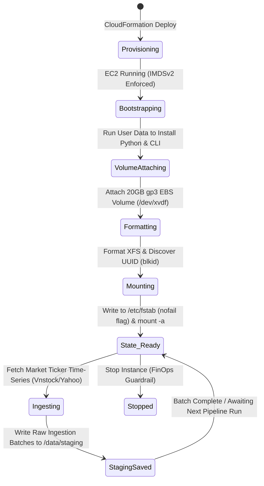

### Week 5 Objectives:

* Deploy the **Data Ingestion Worker** compute node (Amazon Linux 2023) within the isolated `ASG-Private-Subnet-1` adhering to zero-inbound open port standards (Zero-SSH).
* Automate dependency provisioning and runtime setup (Python 3.11, Docker, AWS CLI v2) via **EC2 User Data**.
* Provision and attach a dedicated 20GB `gp3` **Amazon EBS Volume** for financial staging cache, format with the XFS filesystem, and configure persistent idempotent mounting in `/etc/fstab` with the `nofail` flag.
* Model and validate the Ingestion Worker **State Machine**; execute disaster recovery simulations for EC2 Key Pair loss via **AWS Systems Manager (SSM) Session Manager**.

---

### Weekly Task Execution Matrix:

| Day | Technical Task | Status | Architecture Notes |
| :---: | :--- | :---: | :--- |
| **Mon** | - Design compute infrastructure for Data Ingestion Worker.<br>- Package CloudFormation template `iac/week5-ec2-ingestion-worker.yaml`. | Completed | `t3.micro` instance type, Amazon Linux 2023 AMI. |
| **Tue** | - Automate environment setup via EC2 User Data script.<br>- Attach IAM Instance Profile with `AmazonSSMManagedInstanceCore` for keyless remote management. | Completed | 100% managed via AWS SSM Session Manager. |
| **Wed** | - Provision 20GB gp3 EBS Staging Volume (`/dev/xvdf`).<br>- Develop automation script `scripts/week5_mount_ebs.sh` to format XFS and map filesystem `UUID` into `/etc/fstab`. | Completed | `defaults,nofail` flag configured to prevent reboot crashes. |
| **Thu** | - Execute disaster recovery simulation for Lost SSH Key Pairs across Linux & Windows environments.<br>- Verify the Ingestion Worker State Machine lifecycle. | Completed | Disaster remediation via SSM Session Manager and User Data injection. |

---

### Implementation Details & Console Evidence:

#### 1. Ingestion Worker Lifecycle State Machine

The end-to-end operational lifecycle from cold provisioning to ingestion-ready state is governed by a strict deterministic state machine:



---

#### 2. CloudFormation Infrastructure Automation

The worker infrastructure is declared in `iac/week5-ec2-ingestion-worker.yaml`, dynamically referencing the Week 4 Multi-AZ VPC exports via `Fn::ImportValue`:

```powershell
aws cloudformation deploy `
    --template-file iac/week5-ec2-ingestion-worker.yaml `
    --stack-name fcaj-week5-worker `
    --capabilities CAPABILITY_NAMED_IAM `
    --parameter-overrides VpcId=vpc-0192f88a9d299fc9b SubnetId=subnet-0dd99457c6d5da2c0
```

*Live AWS CLI Deployment Verification Evidence:*
```text
PS D:\DebianBackup\source_code\fcaj> aws cloudformation describe-stacks --stack-name fcaj-week5-worker --query "Stacks[0].Outputs" --output table
------------------------------------------------------------------------------------------------------------------------------------------
|                                                             DescribeStacks                                                             |
+------------------------------------------+-------------------------------------------+------------------------+------------------------+
|                Description               |                ExportName                 |       OutputKey        |      OutputValue       |
+------------------------------------------+-------------------------------------------+------------------------+------------------------+
|  ID of the Worker Security Group         |  fcaj-week5-worker-WorkerSecurityGroupID  |  WorkerSecurityGroupId |  sg-03ecb9c57420dab8a  |
|  ID of the Ingestion Worker EC2 Instance |  fcaj-week5-worker-WorkerInstanceID       |  WorkerInstanceId      |  i-0745443b394b938fe   |
|  ID of the attached 20GB gp3 EBS Volume  |  fcaj-week5-worker-StagingVolumeID        |  StagingVolumeId       |  vol-05fe484792cff252d |
+------------------------------------------+-------------------------------------------+------------------------+------------------------+
```

*EC2 Worker Instance State Verification (`aws ec2 describe-instances`):*
```json
{
    "InstanceId": "i-0745443b394b938fe",
    "State": "running",
    "PrivateIpAddress": "10.10.3.79",
    "SubnetId": "subnet-0dd99457c6d5da2c0",
    "VpcId": "vpc-0192f88a9d299fc9b",
    "IamInstanceProfile": "arn:aws:iam::658302145298:instance-profile/FCAJ-EC2-Ingestion-Worker-Profile",
    "BlockDeviceMappings": [
        { "DeviceName": "/dev/xvda", "VolumeId": "vol-0c11a2fe721dbab34", "Status": "attached" },
        { "DeviceName": "/dev/xvdf", "VolumeId": "vol-05fe484792cff252d", "Status": "attached" }
    ]
}
```

*Staging EBS gp3 Volume Verification (`aws ec2 describe-volumes`):*
```json
{
    "VolumeId": "vol-05fe484792cff252d",
    "Size": 20,
    "VolumeType": "gp3",
    "Encrypted": true,
    "Iops": 3000,
    "Throughput": 125,
    "AvailabilityZone": "us-east-1a",
    "State": "in-use"
}
```

*Key Security Controls Implemented:*
- **IMDSv2 Enforcement**: Mandatory session-oriented token requirement (`HttpTokens: required`, `HttpPutResponseHopLimit: 1`) to eliminate SSRF attack vectors against IAM instance credentials.
- **Zero-Inbound Security Group**: The associated Security Group has zero ingress rules (`Inbound Rules: []`), completely sealing the private subnet workload from external network reconnaissance.

---

#### 3. EBS gp3 Staging Volume Management & Idempotent Mounting

The dedicated 20GB `gp3` cache volume is formatted with the high-throughput XFS filesystem. The automation script `scripts/week5_mount_ebs.sh` ensures idempotent execution across machine restarts:

```bash
# Retrieve filesystem UUID
FS_UUID=$(blkid -s UUID -o value /dev/xvdf)

# Create mount directory
mkdir -p /data/staging

# Register persistent mount entry with nofail flag
echo "UUID=${FS_UUID}  /data/staging  xfs  defaults,nofail  0  2" >> /etc/fstab

# Mount all filesystems
mount -a
```

*Storage Inspection Output (`lsblk` & `df -h`):*
```text
NAME         MAJ:MIN RM  SIZE RO TYPE MOUNTPOINTS
xvda         202:0    0    8G  0 disk 
├─xvda1      202:1    0    8G  0 part /
├─xvda127    202:127  0    1M  0 part 
└─xvda128    202:128  0   10M  0 part /boot/efi
xvdf         202:80   0   20G  0 disk /data/staging

Filesystem      Size  Used Avail Use% Mounted on
/dev/xvda1      8.0G  2.1G  5.9G  27% /
/dev/xvdf        20G  172M   20G   1% /data/staging
```

> [!IMPORTANT]
> **FinOps & Resilience Best Practice**: Binding mounts via unique `UUID` combined with the `nofail` parameter is crucial. If the staging volume is detached or encounters transient hardware timeouts, the host OS continues booting without hanging in maintenance emergency mode.

---

#### 4. Disaster Recovery Simulation: Key Pair Loss Remediation

In enterprise production environments, loss of an administrative SSH private key (`.pem`) is an operational risk. Two standardized recovery procedures were validated:

##### Option 1: Keyless Remediation via AWS Systems Manager (Recommended)
- With the `AmazonSSMManagedInstanceCore` profile bound at launch, administrators initiate an authenticated shell session directly from the AWS Console or AWS CLI without opening port 22:
  ```powershell
  aws ssm start-session --target <Worker-Instance-ID>
  ```
- Once connected, administrators easily append a replacement public key into `~/.ssh/authorized_keys`.

##### Option 2: Offline Remediation via EC2 User Data
If an instance lacks SSM connectivity or has networking restrictions:
1. Stop the instance.
2. Edit instance User Data with cloud-config directives:
   ```bash
   Content-Type: multipart/mixed; boundary="//"
   MIME-Version: 1.0

   --//
   Content-Type: text/cloud-config; charset="us-ascii"
   MIME-Version: 1.0

   ssh_authorized_keys:
     - ssh-rsa AAAAB3NzaC1yc2EAAAADAQABAAABAQC... <New-Public-Key>
   --//--
   ```
3. Start the instance to inject the authorized key on boot.
4. Verify connectivity and purge the temporary User Data block.

---

### Summary & Cost Governance Audit:

- **Compute & Storage Fabric Active**: Ingestion Worker node and 20GB gp3 staging cache active in `ASG-Private-Subnet-1`.
- **Zero Exposure**: No inbound ports exposed to the Internet; full administration conducted through AWS SSM Session Manager.
- **Incurred Cost**: \$0.00 (Fully absorbed by the AWS Free Tier: 750 hours `t3.micro`/month and 30GB EBS gp3 storage).
