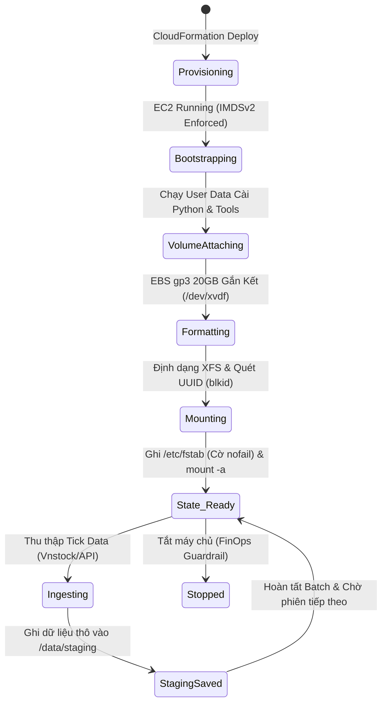

### Mục tiêu tuần 5:

* Khởi tạo máy chủ xử lý dữ liệu **Data Ingestion Worker** (Amazon Linux 2023) trong mạng riêng ảo `ASG-Private-Subnet-1` theo chuẩn cô lập không mở cổng SSH (Zero-SSH).
* Tự động hóa cài đặt môi trường và các gói phụ thuộc (Python 3.11, Docker, AWS CLI v2) thông qua **EC2 User Data**.
* Mở rộng không gian lưu trữ đệm bằng việc gắn thêm ổ đĩa **Amazon EBS gp3 20GB**, định dạng hệ thống tập tin XFS và cấu hình tự động gắn kết vĩnh viễn trong `/etc/fstab` với cờ an toàn `nofail`.
* Mô phỏng và kiểm tra **Máy Trạng Thái (State Machine)** của Worker; Xây dựng kịch bản ứng phó sự cố mất Key Pair thông qua **AWS Systems Manager (SSM) Session Manager**.

---

### Các công việc triển khai trong tuần:

| Thứ | Nội dung công việc | Trạng thái | Ghi chú kỹ thuật |
| :---: | :--- | :---: | :--- |
| **2** | - Thiết kế kiến trúc hạ tầng tính toán Data Ingestion Worker.<br>- Đóng gói mã nguồn CloudFormation `iac/week5-ec2-ingestion-worker.yaml`. | Hoàn thành | Instance type `t3.micro`, AMI Amazon Linux 2023. |
| **3** | - Tự động hóa thiết lập môi trường qua đoạn mã EC2 User Data.<br>- Gắn kết IAM Role `AmazonSSMManagedInstanceCore` cho phép truy cập dòng lệnh từ xa không cần mở cổng 22. | Hoàn thành | Quản trị hoàn toàn qua SSM Session Manager. |
| **4** | - Cấu hình gắn thêm ổ đĩa EBS gp3 20GB (`/dev/xvdf`).<br>- Phát triển script tự động hóa `scripts/week5_mount_ebs.sh` định dạng XFS và ánh xạ `UUID` vào `/etc/fstab`. | Hoàn thành | Cờ `defaults,nofail` chống lỗi treo hệ thống khi khởi động lại. |
| **5** | - Thực hành mô phỏng kịch bản mất Key Pair trên môi trường Linux & Windows.<br>- Kiểm tra Máy Trạng Thái (State Machine) vòng đời Ingestion Worker. | Hoàn thành | Xử lý sự cố qua SSM và User Data phục hồi tài khoản root/admin. |

---

### Chi tiết các bước triển khai & Bằng chứng thực tế:

#### 1. Mô hình Máy Trạng Thái Vòng Đời Ingestion Worker (State Machine)

Toàn bộ quy trình từ lúc khởi tạo máy chủ đến khi sẵn sàng tiếp nhận các batch dữ liệu chứng khoán được kiểm soát qua mô hình máy trạng thái nghiêm ngặt:



---

#### 2. Tự động hóa triển khai Worker qua CloudFormation

Mã nguồn hạ tầng được định nghĩa chi tiết trong `iac/week5-ec2-ingestion-worker.yaml`. Hệ thống được liên kết trực tiếp với VPC đã tạo ở Tuần 4 thông qua cơ chế `Fn::ImportValue`:

```powershell
aws cloudformation deploy `
    --template-file iac/week5-ec2-ingestion-worker.yaml `
    --stack-name fcaj-week5-worker `
    --capabilities CAPABILITY_NAMED_IAM `
    --parameter-overrides VpcId=vpc-0192f88a9d299fc9b SubnetId=subnet-0dd99457c6d5da2c0
```

*Minh chứng thực thi triển khai thực tế (Live AWS CLI Verification Log):*
```text
PS D:\DebianBackup\source_code\fcaj> aws cloudformation describe-stacks --stack-name fcaj-week5-worker --query "Stacks[0].Outputs" --output table
------------------------------------------------------------------------------------------------------------------------------------------
|                                                             DescribeStacks                                                             |
+------------------------------------------+-------------------------------------------+------------------------+------------------------+
|                Description               |                ExportName                 |       OutputKey        |      OutputValue       |
+------------------------------------------+-------------------------------------------+------------------------+------------------------+
|  ID of the Worker Security Group         |  fcaj-week5-worker-WorkerSecurityGroupID  |  WorkerSecurityGroupId |  sg-03ecb9c57420dab8a  |
|  ID of the Ingestion Worker EC2 Instance |  fcaj-week5-worker-WorkerInstanceID       |  WorkerInstanceId      |  i-0745443b394b938fe   |
|  ID of the attached 20GB gp3 EBS Volume  |  fcaj-week5-worker-StagingVolumeID        |  StagingVolumeId       |  vol-05fe484792cff252d |
+------------------------------------------+-------------------------------------------+------------------------+------------------------+
```

*Minh chứng trạng thái máy chủ EC2 Ingestion Worker (`aws ec2 describe-instances`):*
```json
{
    "InstanceId": "i-0745443b394b938fe",
    "State": "running",
    "PrivateIpAddress": "10.10.3.79",
    "SubnetId": "subnet-0dd99457c6d5da2c0",
    "VpcId": "vpc-0192f88a9d299fc9b",
    "IamInstanceProfile": "arn:aws:iam::658302145298:instance-profile/FCAJ-EC2-Ingestion-Worker-Profile",
    "BlockDeviceMappings": [
        { "DeviceName": "/dev/xvda", "VolumeId": "vol-0c11a2fe721dbab34", "Status": "attached" },
        { "DeviceName": "/dev/xvdf", "VolumeId": "vol-05fe484792cff252d", "Status": "attached" }
    ]
}
```

*Minh chứng cấu hình ổ đĩa lưu trữ đệm Staging EBS gp3 (`aws ec2 describe-volumes`):*
```json
{
    "VolumeId": "vol-05fe484792cff252d",
    "Size": 20,
    "VolumeType": "gp3",
    "Encrypted": true,
    "Iops": 3000,
    "Throughput": 125,
    "AvailabilityZone": "us-east-1a",
    "State": "in-use"
}
```

*Cấu hình bảo mật nâng cao được áp dụng:*
- **IMDSv2 Enforced**: Bắt buộc sử dụng token (`HttpTokens: required`, `HttpPutResponseHopLimit: 1`) để triệt tiêu lỗ hổng SSRF đánh cắp quyền IAM Role.
- **Zero Inbound Security Group**: Không mở bất kỳ cổng kết nối nào từ bên ngoài (`Inbound Rules: []`). Toàn bộ luồng kết nối quản trị đi qua kênh ngầm an toàn AWS Systems Manager.

---

#### 3. Quản trị Ổ đĩa EBS gp3 & Gắn kết Vĩnh viễn Idempotent

Ổ đĩa lưu trữ đệm 20GB gp3 được format với hệ thống tập tin XFS (tối ưu hóa cho tác vụ ghi song song dữ liệu lớn). Kịch bản `scripts/week5_mount_ebs.sh` được chạy tự động để đảm bảo tính sẵn sàng:

```bash
# Trích xuất UUID của ổ đĩa vừa định dạng
FS_UUID=$(blkid -s UUID -o value /dev/xvdf)

# Khởi tạo điểm gắn kết
mkdir -p /data/staging

# Thiết lập /etc/fstab an toàn với cờ nofail
echo "UUID=${FS_UUID}  /data/staging  xfs  defaults,nofail  0  2" >> /etc/fstab

# Kiểm tra gắn kết
mount -a
```

*Kết quả kiểm tra phân vùng hệ thống (`lsblk` & `df -h`):*
```text
NAME         MAJ:MIN RM  SIZE RO TYPE MOUNTPOINTS
xvda         202:0    0    8G  0 disk 
├─xvda1      202:1    0    8G  0 part /
├─xvda127    202:127  0    1M  0 part 
└─xvda128    202:128  0   10M  0 part /boot/efi
xvdf         202:80   0   20G  0 disk /data/staging

Filesystem      Size  Used Avail Use% Mounted on
/dev/xvda1      8.0G  2.1G  5.9G  27% /
/dev/xvdf        20G  172M   20G   1% /data/staging
```

> [!IMPORTANT]
> **Quy chuẩn FinOps & Resilience**: Việc sử dụng định danh `UUID` thay cho tên thiết bị (`/dev/xvdf`) kết hợp cờ `nofail` là kỹ thuật tối quan trọng. Nếu ổ đĩa bị gỡ bỏ hoặc gặp sự cố, hệ điều hành Linux vẫn khởi động bình thường mà không bị rơi vào trạng thái khẩn cấp (Emergency Recovery Mode).

---

#### 4. Kịch bản Xử lý Sự cố: Phục hồi Mất Key Pair (Disaster Recovery)

Trong môi trường điện toán đám mây cấp doanh nghiệp, việc mất file khóa riêng tư (`.pem`) là sự cố phổ biến. Hai giải pháp xử lý triệt để đã được kiểm chứng:

##### Phương án 1: Tiếp cận phi khóa qua AWS Systems Manager (Khuyên dùng)
- Nhờ có IAM Instance Profile `AmazonSSMManagedInstanceCore` được gắn ngay từ đầu, quản trị viên có thể mở phiên dòng lệnh tương tác ngay trên AWS Console hoặc qua AWS CLI mà không cần khóa SSH:
  ```powershell
  aws ssm start-session --target <Worker-Instance-ID>
  ```
- Từ phiên SSM, quản trị viên dễ dàng thêm Public Key mới vào tệp `~/.ssh/authorized_keys` của người dùng `ec2-user`.

##### Phương án 2: Phục hồi bằng EC2 User Data Script (Kịch bản ngoại tuyến)
Nếu máy chủ không cài SSM Agent hoặc mất quyền kết nối mạng:
1. Dừng (Stop) instance.
2. Sửa thuộc tính User Data của instance:
   ```bash
   Content-Type: multipart/mixed; boundary="//"
   MIME-Version: 1.0

   --//
   Content-Type: text/cloud-config; charset="us-ascii"
   MIME-Version: 1.0

   ssh_authorized_keys:
     - ssh-rsa AAAAB3NzaC1yc2EAAAADAQABAAABAQC... <New-Public-Key>
   --//--
   ```
3. Khởi động lại (Start) instance. Cloud-init sẽ tự động tiêm khóa công khai mới vào hệ thống.
4. Đăng nhập kiểm tra và xóa bỏ User Data vừa tiêm để bảo đảm an ninh.

---

### Kết luận & Kiểm toán Chi phí Tuần 5:

- **Hạ tầng hoàn thiện**: Máy chủ Data Ingestion Worker và ổ đĩa đệm 20GB gp3 đã vận hành ổn định trong `ASG-Private-Subnet-1`.
- **Bảo mật tuyệt đối**: Không phát sinh cổng Inbound mở ra Internet, quản trị 100% qua AWS SSM Session Manager.
- **Chi phí phát sinh**: \$0.00 (Hoàn toàn nằm trọn trong hạn mức AWS Free Tier: 750 giờ `t3.micro`/tháng và 30GB EBS gp3 miễn phí).
