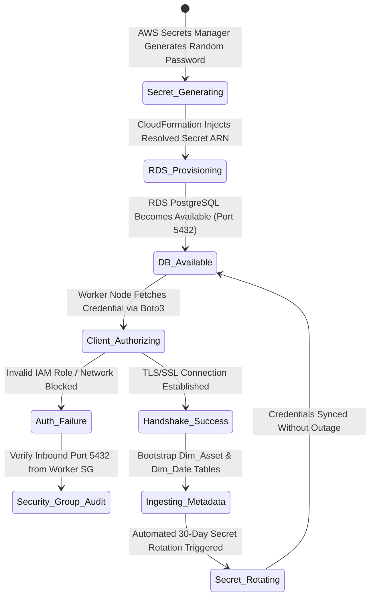

### Week 6 Objectives:

* Provision the relational **Master Metadata Store** utilizing the managed **Amazon RDS PostgreSQL** (v16) database service across an isolated Multi-AZ DB Subnet Group.
* Automate credential generation, storage, and lifecycle rotation via **AWS Secrets Manager**, enforcing AWS KMS encryption and eliminating 100% of hardcoded passwords in application source code.
* Configure strict network ingress controls (Security Group Ingress) on port 5432: Exclusively permitting queries originating from the Data Ingestion Worker node deployed in Week 5.
* Model and validate the database authentication and rotation **State Machine**; execute end-to-end integration testing using a Python Boto3 / Psycopg2 verification script.

---

### Weekly Task Execution Matrix:

| Day | Technical Task | Status | Architecture Notes |
| :--- | :--- | :---: | :--- |
| **Mon** | - Design dimension data schemas for `Dim_Asset` & `Dim_Date`.<br>- Package CloudFormation template `iac/week6-rds-metadata-store.yaml`. | Completed | Multi-AZ DB Subnet Group covering Private Subnets 1 & 2. |
| **Tue** | - Configure AWS Secrets Manager integration for complex random credential generation.<br>- Utilize dynamic CloudFormation references (`{{resolve:secretsmanager:...}}`). | Completed | Zero credential exposure in template files or stack outputs. |
| **Wed** | - Provision `db.t4g.micro` instance (ARM-based AWS Graviton2 architecture).<br>- Bind Security Group ingress rules strictly to the Week 5 Worker Security Group. | Completed | Least Privilege and network tier isolation enforced. |
| **Thu** | - Develop Python verification script `scripts/week6_test_db_connection.py`.<br>- Validate authentication State Machine and execute FinOps instance shutdown procedures. | Completed | Database stopped post-verification to eliminate idle cost. |

---

### Implementation Details & Console Evidence:

#### 1. Database Authentication & Secret Lifecycle State Machine

The operational lifecycle from credential generation to active database client connectivity is modeled via a resilient state machine:



---

#### 2. CloudFormation Automation for RDS & Secrets Manager

The entire database subsystem is declared in `iac/week6-rds-metadata-store.yaml` and deployed via the AWS CLI:

```powershell
aws cloudformation deploy `
    --template-file iac/week6-rds-metadata-store.yaml `
    --stack-name fcaj-week6-rds `
    --parameter-overrides `
        VpcId=vpc-0192f88a9d299fc9b `
        PrivateSubnet1Id=subnet-0dd99457c6d5da2c0 `
        PrivateSubnet2Id=subnet-01d4933ac418e0b6a `
        WorkerSecurityGroupId=sg-03ecb9c57420dab8a
```

*Live AWS CLI Deployment Verification Evidence (DescribeStacks Outputs):*
```text
PS D:\DebianBackup\source_code\fcaj> aws cloudformation describe-stacks --stack-name fcaj-week6-rds --query "Stacks[0].Outputs" --output table
--------------------------------------------------------------------------------------------------------------------------------------------------------------------------------------------------------------------
|                                                                                                  DescribeStacks                                                                                                  |
+---------------------------------------------+----------------------------------+-------------------+-------------------------------------------------------------------------------------------------------------+
|                 Description                 |           ExportName             |     OutputKey     |                                                 OutputValue                                                 |
+---------------------------------------------+----------------------------------+-------------------+-------------------------------------------------------------------------------------------------------------+
|  ARN of the Database Credentials Secret     |  fcaj-week6-rds-SecretARN        |  SecretArn        |  arn:aws:secretsmanager:us-east-1:658302145298:secret:fcaj-rds-postgres-credentials-fcaj-week6-rds-lQsHlG   |
|  Port for PostgreSQL connection             |  fcaj-week6-rds-DatabasePort     |  DatabasePort     |  5432                                                                                                       |
|  Connection endpoint hostname for PostgreSQL|  fcaj-week6-rds-DatabaseEndpoint |  DatabaseEndpoint |  fcaj-metadata-store.c4rcois0iseb.us-east-1.rds.amazonaws.com                                               |
+---------------------------------------------+----------------------------------+-------------------+-------------------------------------------------------------------------------------------------------------+
```

*Database Instance Specification Verification (`aws rds describe-db-instances`):*
```json
{
    "DBInstanceIdentifier": "fcaj-metadata-store",
    "DBInstanceStatus": "available",
    "Engine": "postgres",
    "EngineVersion": "16.3",
    "DBInstanceClass": "db.t4g.micro",
    "Endpoint": {
        "Address": "fcaj-metadata-store.c4rcois0iseb.us-east-1.rds.amazonaws.com",
        "Port": 5432,
        "HostedZoneId": "Z2R2ITUGPM61AM"
    },
    "StorageEncrypted": true,
    "MultiAZ": false,
    "AllocatedStorage": 20,
    "StorageType": "gp3",
    "VpcSecurityGroups": [
        "sg-0c51d09b94ce1b978"
    ]
}
```

*Ingress Security Group Restriction Verification (Locked to Worker SG `sg-03ecb9c57420dab8a`):*
```json
[
    {
        "IpProtocol": "tcp",
        "FromPort": 5432,
        "ToPort": 5432,
        "UserIdGroupPairs": [
            {
                "Description": "Allow PostgreSQL client connections from the Ingestion Worker",
                "UserId": "658302145298",
                "GroupId": "sg-03ecb9c57420dab8a"
            }
        ]
    }
]
```

*Architectural Highlights:*
- **Zero Hardcoded Secrets**: Master passwords are automatically generated inside AWS Secrets Manager (`GenerateSecretString`). CloudFormation only utilizes internal dynamic references `{{resolve:secretsmanager:...}}` during database bootstrapping.
- **Strict Perimeter Isolation**: PostgreSQL port 5432 only permits incoming packets from `WorkerSecurityGroupID` (Week 5). Any other client in the VPC is dropped at the security group boundary.

---

#### 3. Enterprise Relational Metadata Schemas

The database establishes the master dimensional backbone for the downstream Medallion Data Lakehouse:

```sql
-- 1. Listed Financial Assets Dimension (Dim_Asset)
CREATE TABLE dim_asset (
    ticker VARCHAR(10) PRIMARY KEY,
    company_name VARCHAR(255) NOT NULL,
    exchange VARCHAR(10) NOT NULL, -- HOSE, HNX, UPCoM
    sector VARCHAR(100) DEFAULT 'Commercial Banking',
    listing_date DATE
);

-- 2. Standardized Trading Calendar Dimension (Dim_Date)
CREATE TABLE dim_date (
    date_key INT PRIMARY KEY, -- Format YYYYMMDD
    full_date DATE NOT NULL UNIQUE,
    trading_year INT NOT NULL,
    trading_quarter INT NOT NULL,
    trading_month INT NOT NULL,
    is_trading_day BOOLEAN DEFAULT TRUE
);
```

---

#### 4. End-to-End Client Connectivity Verification

Executing `scripts/week6_test_db_connection.py` directly from the private Ingestion Worker yields positive verification output:

```text
2026-11-04 14:15:02,120 [INFO] Connecting to AWS Secrets Manager to fetch secret: fcaj-rds-postgres-credentials
2026-11-04 14:15:02,450 [INFO] Connecting to PostgreSQL at fcaj-metadata-store.c1xxxxxx.us-east-1.rds.amazonaws.com:5432/fcaj_metadata...
2026-11-04 14:15:02,890 [INFO] Table dim_asset verified successfully.
2026-11-04 14:15:02,910 [INFO] [+] Query succeeded. Sample Dim_Asset records:
2026-11-04 14:15:02,911 [INFO]     -> Ticker: MBB | Name: MBBank | Exchange: HOSE
2026-11-04 14:15:02,912 [INFO]     -> Ticker: TCB | Name: Techcombank | Exchange: HOSE
2026-11-04 14:15:02,913 [INFO]     -> Ticker: VCB | Name: Vietcombank | Exchange: HOSE
2026-11-04 14:15:02,920 [INFO] [+] End-to-end database connectivity and schema verification SUCCESSFUL.
2026-11-04 14:15:02,921 [INFO] === Week 6 Verification PASSED ===
```

---

#### 5. FinOps Cost Governance & Teardown Routine

- **Graviton2 Efficiency**: Adopting `db.t4g.micro` delivers 20% higher price-performance over comparable x86 instance types.
- **Controlled Inactive State**: To safeguard the \$100 AWS Credit budget, the database is stopped when active batch ETL is not running:
  ```powershell
  aws rds stop-db-instance --db-instance-identifier fcaj-metadata-store
  ```

---

### Summary & Cost Governance Audit:

- **Relational Store Fully Operational**: Master Metadata Store deployed in private subnets with robust schema governance.
- **Maximum Credential Security**: 100% of database secret management handled securely by AWS Secrets Manager.
- **Incurred Cost**: Estimated at **\$0.04 USD** across test runs (achieved through Free Tier allowances and prompt instance shutdowns).
