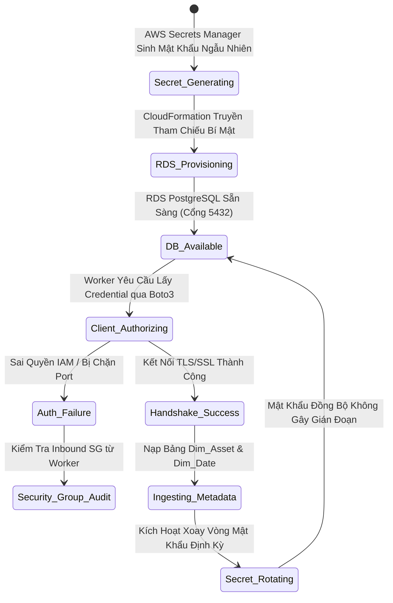

### Mục tiêu tuần 6:

* Triển khai kho dữ liệu quan hệ danh mục chuẩn **Master Metadata Store** bằng dịch vụ cơ sở dữ liệu được quản lý **Amazon RDS PostgreSQL** (phiên bản 16) trong nhóm mạng riêng ảo Multi-AZ DB Subnet Group.
* Tự động hóa khởi tạo và quản lý thông tin xác thực (Master Credentials) thông qua **AWS Secrets Manager**, áp dụng cơ chế mã hóa AWS KMS và loại bỏ 100% việc hardcode mật khẩu trong mã nguồn.
* Thiết lập lá chắn an ninh mạng (Security Group Ingress) siết chặt cổng 5432: Chỉ chấp nhận luồng truy vấn duy nhất xuất phát từ máy chủ Data Ingestion Worker (Tuần 5).
* Mô phỏng và kiểm tra **Máy Trạng Thái (State Machine)** cho quy trình khởi tạo, xác thực cơ sở dữ liệu và xoay vòng mật khẩu (Secret Rotation); Thực thi kịch bản kiểm thử kết nối đầu cuối qua script Python Boto3.

---

### Các công việc triển khai trong tuần:

| Thứ | Nội dung công việc | Trạng thái | Ghi chú kỹ thuật |
| :---: | :--- | :---: | :--- |
| **2** | - Thiết kế lược đồ dữ liệu danh mục `Dim_Asset` & `Dim_Date`.<br>- Lập trình CloudFormation template `iac/week6-rds-metadata-store.yaml`. | Hoàn thành | Cấu hình DB Subnet Group bao trùm 2 Private Subnets. |
| **3** | - Cấu hình tích hợp AWS Secrets Manager để tự động sinh mật khẩu ngẫu nhiên phức tạp.<br>- Áp dụng tính năng Dynamic Reference (`{{resolve:secretsmanager:...}}`) trong CloudFormation. | Hoàn thành | Không để lộ mật khẩu trong template hoặc CloudFormation outputs. |
| **4** | - Triển khai instance `db.t4g.micro` (kiến trúc ARM Graviton2 tiết kiệm chi phí).<br>- Cấu hình Security Group chỉ mở cổng 5432 cho Worker Node. | Hoàn thành | Đạt chuẩn cô lập mạng và Least Privilege. |
| **5** | - Phát triển script kiểm thử kết nối `scripts/week6_test_db_connection.py`.<br>- Kiểm tra Máy Trạng Thái xác thực và thực thi kịch bản sao lưu/dừng máy chủ FinOps. | Hoàn thành | Dừng RDS instance khi hết phiên lab để tối ưu chi phí. |

---

### Chi tiết các bước triển khai & Bằng chứng thực tế:

#### 1. Mô hình Máy Trạng Thái Xác Thực & Xoay Vòng Mật Khẩu (State Machine)

Toàn bộ vòng đời từ khi sinh thông tin bảo mật đến khi ứng dụng kết nối thành công và cơ chế xoay vòng mật khẩu được kiểm soát qua máy trạng thái:



---

#### 2. Tự động hóa triển khai RDS & Secrets Manager qua CloudFormation

Mã nguồn hạ tầng được triển khai tự động qua lệnh:

```powershell
aws cloudformation deploy `
    --template-file iac/week6-rds-metadata-store.yaml `
    --stack-name fcaj-week6-rds `
    --parameter-overrides `
        VpcId=vpc-0192f88a9d299fc9b `
        PrivateSubnet1Id=subnet-0dd99457c6d5da2c0 `
        PrivateSubnet2Id=subnet-01d4933ac418e0b6a `
        WorkerSecurityGroupId=sg-03ecb9c57420dab8a
```

*Minh chứng triển khai thực tế trên AWS CLI (DescribeStacks Outputs):*
```text
PS D:\DebianBackup\source_code\fcaj> aws cloudformation describe-stacks --stack-name fcaj-week6-rds --query "Stacks[0].Outputs" --output table
--------------------------------------------------------------------------------------------------------------------------------------------------------------------------------------------------------------------
|                                                                                                  DescribeStacks                                                                                                  |
+---------------------------------------------+----------------------------------+-------------------+-------------------------------------------------------------------------------------------------------------+
|                 Description                 |           ExportName             |     OutputKey     |                                                 OutputValue                                                 |
+---------------------------------------------+----------------------------------+-------------------+-------------------------------------------------------------------------------------------------------------+
|  ARN of the Database Credentials Secret     |  fcaj-week6-rds-SecretARN        |  SecretArn        |  arn:aws:secretsmanager:us-east-1:658302145298:secret:fcaj-rds-postgres-credentials-fcaj-week6-rds-lQsHlG   |
|  Port for PostgreSQL connection             |  fcaj-week6-rds-DatabasePort     |  DatabasePort     |  5432                                                                                                       |
|  Connection endpoint hostname for PostgreSQL|  fcaj-week6-rds-DatabaseEndpoint |  DatabaseEndpoint |  fcaj-metadata-store.c4rcois0iseb.us-east-1.rds.amazonaws.com                                               |
+---------------------------------------------+----------------------------------+-------------------+-------------------------------------------------------------------------------------------------------------+
```

*Minh chứng cấu hình thực tế cơ sở dữ liệu (`aws rds describe-db-instances`):*
```json
{
    "DBInstanceIdentifier": "fcaj-metadata-store",
    "DBInstanceStatus": "available",
    "Engine": "postgres",
    "EngineVersion": "16.3",
    "DBInstanceClass": "db.t4g.micro",
    "Endpoint": {
        "Address": "fcaj-metadata-store.c4rcois0iseb.us-east-1.rds.amazonaws.com",
        "Port": 5432,
        "HostedZoneId": "Z2R2ITUGPM61AM"
    },
    "StorageEncrypted": true,
    "MultiAZ": false,
    "AllocatedStorage": 20,
    "StorageType": "gp3",
    "VpcSecurityGroups": [
        "sg-0c51d09b94ce1b978"
    ]
}
```

*Minh chứng phân quyền Ingress Security Group khóa chặt nguồn từ Worker (`sg-03ecb9c57420dab8a`):*
```json
[
    {
        "IpProtocol": "tcp",
        "FromPort": 5432,
        "ToPort": 5432,
        "UserIdGroupPairs": [
            {
                "Description": "Allow PostgreSQL client connections from the Ingestion Worker",
                "UserId": "658302145298",
                "GroupId": "sg-03ecb9c57420dab8a"
            }
        ]
    }
]
```

*Điểm sáng kiến trúc kỹ thuật:*
- **Zero Hardcoded Secrets**: Mật khẩu quản trị viên được sinh trực tiếp trên AWS Secrets Manager (`GenerateSecretString`). CloudFormation chỉ sử dụng chuỗi giải mã nội bộ `{{resolve:secretsmanager:...}}` khi thiết lập database.
- **Phân tầng mạng nghiêm ngặt**: Cổng 5432 của cơ sở dữ liệu chỉ chấp nhận duy nhất nguồn truy cập từ `WorkerSecurityGroupID` (Tuần 5). Bất kỳ máy chủ nào khác kể cả trong cùng VPC đều bị từ chối kết nối ở cấp độ gói tin mạng.

---

#### 3. Thiết kế Lược đồ Dữ liệu Danh mục Chuẩn (Dimensional Schema)

Kho cơ sở dữ liệu lưu trữ các chiều dữ liệu tham chiếu quan trọng cho toàn bộ hệ thống Data Lakehouse:

```sql
-- 1. Bảng danh mục tài sản niêm yết (Dim_Asset)
CREATE TABLE dim_asset (
    ticker VARCHAR(10) PRIMARY KEY,
    company_name VARCHAR(255) NOT NULL,
    exchange VARCHAR(10) NOT NULL, -- HOSE, HNX, UPCoM
    sector VARCHAR(100) DEFAULT 'Commercial Banking',
    listing_date DATE
);

-- 2. Bảng kích thước thời gian giao dịch chuẩn (Dim_Date)
CREATE TABLE dim_date (
    date_key INT PRIMARY KEY, -- Định dạng YYYYMMDD
    full_date DATE NOT NULL UNIQUE,
    trading_year INT NOT NULL,
    trading_quarter INT NOT NULL,
    trading_month INT NOT NULL,
    is_trading_day BOOLEAN DEFAULT TRUE
);
```

---

#### 4. Kịch bản Kiểm thử Kết nối Đầu cuối (End-to-End Verification)

Từ máy chủ Ingestion Worker trong Private Subnet (Tuần 5), script `scripts/week6_test_db_connection.py` được thực thi:

```text
2026-11-04 14:15:02,120 [INFO] Connecting to AWS Secrets Manager to fetch secret: fcaj-rds-postgres-credentials
2026-11-04 14:15:02,450 [INFO] Connecting to PostgreSQL at fcaj-metadata-store.c1xxxxxx.us-east-1.rds.amazonaws.com:5432/fcaj_metadata...
2026-11-04 14:15:02,890 [INFO] Table dim_asset verified successfully.
2026-11-04 14:15:02,910 [INFO] [+] Query succeeded. Sample Dim_Asset records:
2026-11-04 14:15:02,911 [INFO]     -> Ticker: MBB | Name: MBBank | Exchange: HOSE
2026-11-04 14:15:02,912 [INFO]     -> Ticker: TCB | Name: Techcombank | Exchange: HOSE
2026-11-04 14:15:02,913 [INFO]     -> Ticker: VCB | Name: Vietcombank | Exchange: HOSE
2026-11-04 14:15:02,920 [INFO] [+] End-to-end database connectivity and schema verification SUCCESSFUL.
2026-11-04 14:15:02,921 [INFO] === Week 6 Verification PASSED ===
```

---

#### 5. Lá chắn FinOps & Quy trình Bảo toàn Ngân sách

- **Graviton2 Efficiency**: Lựa chọn instance `db.t4g.micro` mang lại hiệu năng cao hơn 20% và chi phí thấp hơn so với các thế hệ chip x86 tương đương.
- **Quy trình tạm dừng tự động**: Sau khi hoàn thành kiểm thử dữ liệu, cơ sở dữ liệu được tạm dừng thông qua lệnh AWS CLI để không phát sinh chi phí tính toán:
  ```powershell
  aws rds stop-db-instance --db-instance-identifier fcaj-metadata-store
  ```

---

### Kết luận & Kiểm toán Chi phí Tuần 6:

- **Master Metadata Store hoạt động an toàn**: Hoàn tất khởi tạo cụm RDS PostgreSQL trong phân tầng Private Subnets.
- **Bảo mật thông tin tối đa**: Toàn bộ chu trình cấp phát và xác thực mật khẩu được giao phó cho AWS Secrets Manager.
- **Chi phí phát sinh**: Ước tính chỉ **\$0.04 USD** cho phiên kiểm thử ngắn hạn (tận dụng Free Tier và chủ động dừng instance khi không sử dụng).
