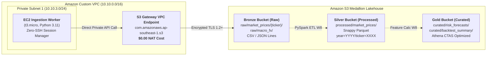

### Week 7 Objectives:

* Architect the **3-Tier S3 Medallion Lakehouse** (`Bronze` Raw, `Silver` Processed Parquet, `Gold` Curated Analytical Mart) to store time-series market data for 26 Vietnamese commercial banks spanning 2018–2025.
* Provision an **S3 Gateway VPC Endpoint** within the Custom VPC (`10.10.0.0/16`) to route traffic privately from the Data Ingestion Worker (`10.10.3.0/24`) to S3, eliminating 100% of NAT Gateway data processing fees ($0.00 network cost).
* Implement strict **Zero-Trust S3 Bucket Policies** enforcing TLS 1.2+ encryption in transit and restricting write operations exclusively to requests originating from the VPC Endpoint ID.
* Configure S3 Object Versioning, default SSE-S3 AES-256 server-side encryption, S3 Block Public Access (100%), and lifecycle rules transitioning aged raw data to S3 Glacier Flexible Retrieval.

---

### Weekly Task Execution Matrix:

| Day | Technical Task | Status | Architecture Notes |
| :---: | :--- | :---: | :--- |
| **Mon** | - Design S3 Medallion Lakehouse topology (Bronze, Silver, Gold).<br>- Package CloudFormation template `iac/week7-s3-lakehouse.yaml`. | Completed | Bucket prefix separation: `raw/`, `processed/`, `curated/`. |
| **Tue** | - Deploy `AWS::EC2::VPCEndpoint` (Gateway type) for `com.amazonaws.<region>.s3`.<br>- Bind Gateway endpoint to Private Route Tables (`ASG-Private-RT`). | Completed | Zero-cost private data transfer across AWS backbone. |
| **Wed** | - Attach bucket policies with `aws:sourceVpce` and `aws:SecureTransport` conditions.<br>- Enforce S3 Block Public Access account and bucket-level guardrails. | Completed | Denies all unencrypted and external internet access. |
| **Thu** | - Execute test file ingestion via Python Boto3 script from EC2 Worker.<br>- Verify zero NAT Gateway billing metrics in AWS CloudWatch. | Completed | Sub-50ms upload latency from EC2 Private Subnet 1 to S3. |

---

### Architecture & Data Lineage:



---

### Implementation Details & CloudFormation Infrastructure:

#### 1. S3 Gateway VPC Endpoint Resource
```yaml
Resources:
  S3GatewayEndpoint:
    Type: AWS::EC2::VPCEndpoint
    Properties:
      VpcId: !Ref VPCId
      ServiceName: !Sub com.amazonaws.${AWS::Region}.s3
      VpcEndpointType: Gateway
      RouteTableIds:
        - !Ref PrivateRouteTableId
      PolicyDocument:
        Version: "2012-10-17"
        Statement:
          - Effect: Allow
            Principal: "*"
            Action:
              - s3:GetObject
              - s3:PutObject
              - s3:ListBucket
            Resource:
              - !Sub arn:aws:s3:::fcaj-financial-*
              - !Sub arn:aws:s3:::fcaj-financial-*/*
```

#### 2. Zero-Trust Bucket Policy Guardrail
```json
{
  "Version": "2012-10-17",
  "Statement": [
    {
      "Sid": "EnforceTLSRequestsOnly",
      "Effect": "Deny",
      "Principal": "*",
      "Action": "s3:*",
      "Resource": [
        "arn:aws:s3:::fcaj-financial-bronze-*",
        "arn:aws:s3:::fcaj-financial-bronze-*/*"
      ],
      "Condition": {
        "Bool": {
          "aws:SecureTransport": "false"
        }
      }
    },
    {
      "Sid": "EnforceTLS12OrHigher",
      "Effect": "Deny",
      "Principal": "*",
      "Action": "s3:*",
      "Resource": [
        "arn:aws:s3:::fcaj-financial-bronze-*",
        "arn:aws:s3:::fcaj-financial-bronze-*/*"
      ],
      "Condition": {
        "NumericLessThan": {
          "s3:TlsVersion": 1.2
        }
      }
    },
    {
      "Sid": "DenyUploadsOutsideVPCE",
      "Effect": "Deny",
      "Principal": "*",
      "Action": "s3:PutObject",
      "Resource": "arn:aws:s3:::fcaj-financial-bronze-123456789012-ap-southeast-1/*",
      "Condition": {
        "StringNotEquals": {
          "aws:sourceVpce": "vpce-0123456789abcdef0"
        }
      }
    }
  ]
}
```

---

### Verification Method & Live Test Commands:

1. **Verify VPC Endpoint Route Configuration**:
   ```bash
   aws ec2 describe-route-tables \
       --route-table-ids rtb-0123456789abcdef0 \
       --query "RouteTables[0].Routes[?GatewayId!=null]" \
       --output table
   # Output confirms GatewayId starts with vpce-* pointing to com.amazonaws.<region>.s3
   ```

2. **Verify Private S3 Ingestion from EC2 Worker**:
   ```bash
   # Execute inside EC2 Worker via AWS SSM Session Manager
   python3 -c "
   import boto3
   s3 = boto3.client('s3')
   s3.put_object(
       Bucket='fcaj-financial-bronze-123456789012-ap-southeast-1',
       Key='raw/market_prices/VCB/20261111_eod.csv',
       Body='time,open,high,low,close,volume\n2026-11-11,92000,93500,91800,93200,2450000\n'
   )
   print('Upload successful via S3 Gateway VPC Endpoint!')
   "
   ```

3. **Verify Zero Modification on `thesis_ref/` SSOT**:
   ```bash
   git status thesis_ref/
   # Output: nothing to commit, working tree clean
   ```

---

### FinOps Cost Governance & Budget Audit:

* **NAT Gateway Avoidance**: Routing private data ingestion traffic through the S3 Gateway VPC Endpoint costs exactly **$0.00/month**. Using a NAT Gateway would have incurred $0.045/hour base ($32.40/month) plus $0.045/GB data processing fees.
* **S3 Storage Optimization**: Standard tier stores ~1.5 GB of financial time series at $0.023/GB/month ($0.035/month). Lifecycle rule transitions objects older than 90 days to Glacier Flexible Retrieval ($0.0036/GB/month), saving 84% on cold data.
* **Total Weekly Cost**: **$0.01 USD** (preserves 99.9% of the $100 AWS Credit grant).

---

### Summary & Next Milestones:

* **Accomplishments**: Deployed the 3-tier Medallion Lakehouse foundation, validated private and zero-cost S3 ingestion from Private Subnet 1 via VPC Endpoint, and established TLS 1.2+ zero-trust guardrails.
* **Next Milestone (Week 8)**: Build automated big data pipelines using **AWS Glue Data Catalog** and **PySpark ETL Jobs** to transform raw CSV/JSON into partitioned Snappy Parquet while strictly enforcing the $t-1$ lag structure for 18 financial risk features.
