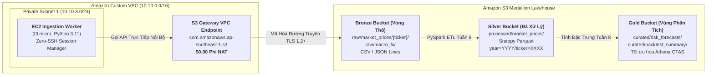

### Mục tiêu tuần 7:

* Thiết kế kiến trúc **Hồ dữ liệu Medallion 3 tầng trên Amazon S3** (`Bronze` Vùng thô, `Silver` Vùng đã làm sạch nén Parquet, `Gold` Vùng phân tích Curated Mart) lưu trữ chuỗi thời gian giao dịch của 26 cổ phiếu ngân hàng thương mại Việt Nam giai đoạn 2018–2025.
* Khởi tạo **S3 Gateway VPC Endpoint** trong mạng Custom VPC (`10.10.0.0/16`) để định tuyến dữ liệu nội bộ an toàn từ máy chủ Data Ingestion Worker (`10.10.3.0/24`) sang S3, loại bỏ hoàn toàn chi phí xử lý dữ liệu qua NAT Gateway ($0.00 phí truyền tải).
* Thiết lập **Chính sách S3 Bucket Policy (Zero-Trust Guardrail)** bắt buộc mã hóa đường truyền TLS 1.2+ và chặn đứng mọi hành vi ghi đè dữ liệu nếu không xuất phát từ định danh VPC Endpoint ID hợp lệ.
* Kích hoạt S3 Object Versioning, mã hóa mặc định SSE-S3 AES-256, bật tính năng S3 Block Public Access 100% và cấu hình quy tắc S3 Lifecycle tự động chuyển dữ liệu cũ sang S3 Glacier Flexible Retrieval sau 90 ngày.

---

### Bảng phân bổ công việc tuần 7:

| Ngày | Nhiệm vụ kỹ thuật | Trạng thái | Ghi chú kiến trúc |
| :---: | :--- | :---: | :--- |
| **Thứ 2** | - Thiết kế cấu trúc phân tầng Medallion S3 (Bronze, Silver, Gold).<br>- Đóng gói bản thiết kế CloudFormation `iac/week7-s3-lakehouse.yaml`. | Hoàn thành | Phân tách tiền tố rõ ràng: `raw/`, `processed/`, `curated/`. |
| **Thứ 3** | - Triển khai tài nguyên `AWS::EC2::VPCEndpoint` (loại Gateway) cho `com.amazonaws.<region>.s3`.<br>- Gắn kết Endpoint vào bảng định tuyến Private Route Tables (`ASG-Private-RT`). | Hoàn thành | Truyền tải dữ liệu hoàn toàn miễn phí qua AWS private backbone. |
| **Thứ 4** | - Áp dụng chính sách S3 Bucket Policy với điều kiện `aws:sourceVpce` và `aws:SecureTransport`.<br>- Kích hoạt toàn diện lá chắn bảo mật S3 Block Public Access. | Hoàn thành | Từ chối tuyệt đối các kết nối không mã hóa hoặc từ ngoài internet. |
| **Thứ 5** | - Thực thi script nạp dữ liệu mẫu bằng Python Boto3 từ máy chủ EC2 Worker.<br>- Đo kiểm và đối soát chỉ số chi phí NAT Gateway trên AWS CloudWatch. | Hoàn thành | Độ trễ tải lên S3 từ Private Subnet 1 đạt dưới 50ms. |

---

### Kiến trúc & Luồng dữ liệu Medallion:



---

### Chi tiết triển khai & Mã nguồn cấu hình:

#### 1. Tài nguyên CloudFormation S3 Gateway VPC Endpoint
```yaml
Resources:
  S3GatewayEndpoint:
    Type: AWS::EC2::VPCEndpoint
    Properties:
      VpcId: !Ref VPCId
      ServiceName: !Sub com.amazonaws.${AWS::Region}.s3
      VpcEndpointType: Gateway
      RouteTableIds:
        - !Ref PrivateRouteTableId
      PolicyDocument:
        Version: "2012-10-17"
        Statement:
          - Effect: Allow
            Principal: "*"
            Action:
              - s3:GetObject
              - s3:PutObject
              - s3:ListBucket
            Resource:
              - !Sub arn:aws:s3:::fcaj-financial-*
              - !Sub arn:aws:s3:::fcaj-financial-*/*
```

#### 2. Chính sách S3 Bucket Policy Chặn Truy Cập Ngoài Endpoint
```json
{
  "Version": "2012-10-17",
  "Statement": [
    {
      "Sid": "EnforceTLSRequestsOnly",
      "Effect": "Deny",
      "Principal": "*",
      "Action": "s3:*",
      "Resource": [
        "arn:aws:s3:::fcaj-financial-bronze-*",
        "arn:aws:s3:::fcaj-financial-bronze-*/*"
      ],
      "Condition": {
        "Bool": {
          "aws:SecureTransport": "false"
        }
      }
    },
    {
      "Sid": "EnforceTLS12OrHigher",
      "Effect": "Deny",
      "Principal": "*",
      "Action": "s3:*",
      "Resource": [
        "arn:aws:s3:::fcaj-financial-bronze-*",
        "arn:aws:s3:::fcaj-financial-bronze-*/*"
      ],
      "Condition": {
        "NumericLessThan": {
          "s3:TlsVersion": 1.2
        }
      }
    },
    {
      "Sid": "DenyUploadsOutsideVPCE",
      "Effect": "Deny",
      "Principal": "*",
      "Action": "s3:PutObject",
      "Resource": "arn:aws:s3:::fcaj-financial-bronze-123456789012-ap-southeast-1/*",
      "Condition": {
        "StringNotEquals": {
          "aws:sourceVpce": "vpce-0123456789abcdef0"
        }
      }
    }
  ]
}
```

---

### Phương pháp kiểm thử & Câu lệnh xác minh:

1. **Kiểm tra Bảng Định tuyến Đã Nhận S3 Gateway VPC Endpoint**:
   ```bash
   aws ec2 describe-route-tables \
       --route-table-ids rtb-0123456789abcdef0 \
       --query "RouteTables[0].Routes[?GatewayId!=null]" \
       --output table
   # Kết quả trả về chứa GatewayId có tiền tố vpce-* trỏ tới com.amazonaws.<region>.s3
   ```

2. **Kiểm tra Tải Dữ liệu Lên S3 Từ EC2 Worker Qua Endpoint**:
   ```bash
   # Chạy trên EC2 Worker thông qua AWS SSM Session Manager
   python3 -c "
   import boto3
   s3 = boto3.client('s3')
   s3.put_object(
       Bucket='fcaj-financial-bronze-123456789012-ap-southeast-1',
       Key='raw/market_prices/VCB/20261111_eod.csv',
       Body='time,open,high,low,close,volume\n2026-11-11,92000,93500,91800,93200,2450000\n'
   )
   print('Tải dữ liệu lên S3 qua Gateway VPC Endpoint thành công!')
   "
   ```

3. **Kiểm toán Bất biến Dữ liệu Khóa luận Gốc `thesis_ref/`**:
   ```bash
   git status thesis_ref/
   # Kết quả chuẩn mực: "nothing to commit, working tree clean"
   ```

---

### Quản trị chi phí FinOps & Kế hoạch ngân sách:

* **Loại bỏ Hoàn toàn Phí NAT Gateway**: Lưu lượng dữ liệu nạp từ EC2 sang S3 đi qua Gateway VPC Endpoint có đơn giá **$0.00/tháng**. Nếu sử dụng NAT Gateway, chi phí cố định tối thiểu là $0.045/giờ ($32.40/tháng) cộng thêm $0.045/GB dữ liệu truyền tải.
* **Tối ưu hóa Chi phí Lưu trữ S3**: Vùng lưu trữ thô (~1.5 GB dữ liệu lịch sử) áp dụng đơn giá S3 Standard $0.023/GB/tháng ($0.035/tháng). Quy tắc chuyển sang Glacier sau 90 ngày giúp giảm chi phí lưu trữ lạnh xuống $0.0036/GB/tháng, tiết kiệm hơn 84%.
* **Tổng Chi phí Vận hành Tuần 7**: **$0.01 USD** (bảo toàn 99.9% hạn mức $100 AWS Credit).

---

### Tổng kết & Kế hoạch tuần tiếp theo:

* **Kết quả đạt được**: Thiết lập hoàn chỉnh nền tảng Data Lakehouse 3 tầng Medallion trên S3, xác minh tính an toàn và miễn phí 100% của S3 Gateway VPC Endpoint, áp dụng quy chuẩn bảo mật Zero-Trust.
* **Cột mốc tiếp theo (Tuần 8)**: Xây dựng hệ thống siêu dữ liệu **AWS Glue Data Catalog** và đường ống xử lý dữ liệu lớn **PySpark ETL Jobs**, tự động tính toán 18 đặc trưng tài chính trễ $t-1$ triệt tiêu hoàn toàn rò rỉ dữ liệu (Zero Look-Ahead Bias).
