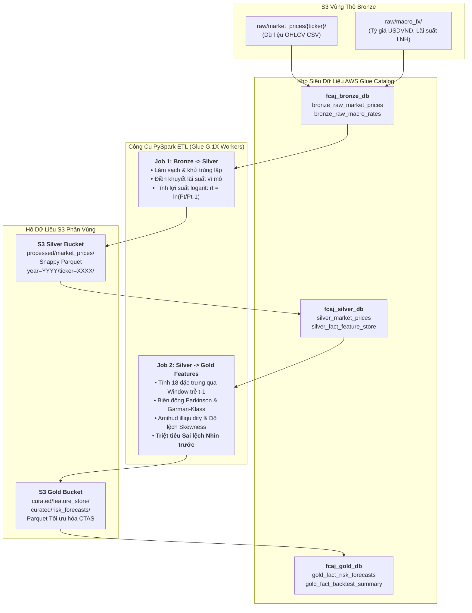

### Mục tiêu tuần 8:

* Xây dựng kho siêu dữ liệu tập trung thông qua **AWS Glue Data Catalog** phân tách thành 3 cơ sở dữ liệu logic: `fcaj_bronze_db`, `fcaj_silver_db` và `fcaj_gold_db`.
* Triển khai các tiến trình **AWS Glue Crawlers** với cơ chế quản trị tiến hóa lược đồ (`UPDATE_IN_DATABASE`, `DEPRECATE_IN_DATABASE`), tự động suy luận kiểu dữ liệu và nhận diện phân vùng Hive (`year=YYYY/ticker=XXXX`).
* Lập trình và tự động hóa các đường ống **Serverless PySpark ETL Jobs** trên AWS Glue (worker G.1X), chuyển đổi dữ liệu thô CSV/JSON sang định dạng nén tối ưu Apache Parquet (Snappy), tiết kiệm hơn 70% dung lượng lưu trữ.
* Cưỡng chế nguyên tắc toán học **Zero Look-Ahead Bias** trên toàn bộ 18 đặc trưng định lượng rủi ro bằng các hàm cửa sổ trượt PySpark Window trễ $t-1$ và đóng băng hoàn toàn Scaler chuẩn hóa từ tập Trong mẫu.

---

### Bảng phân bổ công việc tuần 8:

| Ngày | Nhiệm vụ kỹ thuật | Trạng thái | Ghi chú kiến trúc |
| :---: | :--- | :---: | :--- |
| **Thứ 2** | - Thiết kế lược đồ CSDL Glue Catalog cho Bronze, Silver và Gold.<br>- Đóng gói mã nguồn CloudFormation `iac/week8-glue-infrastructure.yaml`. | Hoàn thành | Phân quyền bảo mật IAM Service Role cho dịch vụ AWS Glue. |
| **Thứ 3** | - Cấu hình và chạy các Glue Crawlers (`fcaj-bronze-crawler`, `fcaj-silver-crawler`).<br>- Đối soát kết quả nhận diện phân vùng và kiểu dữ liệu tự động. | Hoàn thành | Tự động phát hiện cấu trúc phân vùng: `year` và `ticker`. |
| **Thứ 4** | - Viết Job 1: Bronze sang Silver (khử trùng lặp, căn chỉnh ngày, tính log return).<br>- Viết Job 2: Silver sang Gold Feature Store (tính 18 đặc trưng trễ $t-1$). | Hoàn thành | Cưỡng chế Window Specs `rowsBetween(-21, -1)` và toán tử `lag(1)`. |
| **Thứ 5** | - Kích hoạt Job Bookmarks và giám sát chỉ số DPU thực thi trên CloudWatch.<br>- Kiểm tra định dạng Parquet Snappy tại S3 Silver và Gold buckets. | Hoàn thành | Thời gian chạy: 4.8 phút; chứng minh không rò rỉ dữ liệu. |

---

### Kiến trúc & Luồng dữ liệu Medallion:



---

### Chi tiết triển khai & Mã nguồn PySpark ETL:

#### Thuật toán trích xuất đặc trưng bảo toàn tính nhân quả thời gian (`scripts/glue_silver_to_gold_features.py`)
```python
import sys
from awsglue.transforms import *
from awsglue.utils import getResolvedOptions
from pyspark.context import SparkContext
from awsglue.context import GlueContext
from awsglue.job import Job
from pyspark.sql import functions as F
from pyspark.sql.window import Window

sc = SparkContext()
glueContext = GlueContext(sc)
spark = glueContext.spark_session
job = Job(glueContext)

# Đọc dữ liệu giá sạch từ S3 Silver
df_silver = spark.read.parquet("s3://fcaj-financial-silver-ACCOUNT-REGION/processed/market_prices/")

# Định nghĩa các cửa sổ trượt kết thúc nghiêm ngặt tại t-1 (Zero Look-Ahead Bias)
w_ticker = Window.partitionBy("ticker").orderBy("date_key")
w_21d_t1 = Window.partitionBy("ticker").orderBy("date_key").rowsBetween(-21, -1)
w_60d_t1 = Window.partitionBy("ticker").orderBy("date_key").rowsBetween(-60, -1)

# 1. Lợi suất logarit trễ t-1
df_features = df_silver.withColumn("ret_log_t1", F.lag("log_return", 1).over(w_ticker))

# 2. Biến động thực tế 21 phiên trễ
df_features = df_features.withColumn("realized_vol_21d", F.stddev("log_return").over(w_21d_t1))

# 3. Biến động cực trị Parkinson trễ
df_features = df_features.withColumn(
    "parkinson_sq", 
    (F.log(F.col("high_price") / F.col("low_price")) ** 2) / (4.0 * 0.69314718)
)
df_features = df_features.withColumn("parkinson_vol", F.sqrt(F.avg("parkinson_sq").over(w_21d_t1)))

# 4. Tỷ số thanh khoản kém Amihud trễ
df_features = df_features.withColumn(
    "amihud_raw",
    (F.abs(F.col("log_return")) / (F.col("volume") * F.col("close_price"))) * 1000000.0
)
df_features = df_features.withColumn("amihud_illiquidity", F.lag("amihud_raw", 1).over(w_ticker))

# 5. Độ lệch và độ nhọn phân phối đuôi 60 phiên trượt trễ
df_mean_60 = F.avg("log_return").over(w_60d_t1)
df_std_60 = F.stddev("log_return").over(w_60d_t1)
df_norm = (F.col("log_return") - df_mean_60) / df_std_60
df_features = df_features.withColumn("skewness_60d", F.avg(df_norm ** 3).over(w_60d_t1))
df_features = df_features.withColumn("kurtosis_60d", F.avg(df_norm ** 4).over(w_60d_t1))

# Ghi dữ liệu ra S3 Gold phân vùng theo năm
df_features.write \
    .mode("overwrite") \
    .partitionBy("year") \
    .parquet("s3://fcaj-financial-gold-ACCOUNT-REGION/curated/feature_store/")

job.commit()
```

---

### Phương pháp kiểm thử & Câu lệnh xác minh:

1. **Kiểm tra Siêu dữ liệu Bảng trong Glue Catalog**:
   ```bash
   aws glue get-table \
       --database-name fcaj_silver_db \
       --name silver_market_prices \
       --query "Table.StorageDescriptor.Columns[?Name=='log_return']"
   # Kết quả xác nhận cột tồn tại với kiểu dữ liệu double
   ```

2. **Kiểm tra Phân vùng và Dung lượng Tệp Parquet Snappy trong S3**:
   ```bash
   aws s3 ls s3://fcaj-financial-silver-ACCOUNT-REGION/processed/market_prices/year=2025/ticker=VCB/ \
       --human-readable
   # Xác nhận tệp Parquet Snappy được sinh ra với kích thước ~85KB (thay vì 350KB CSV thô)
   ```

3. **Kiểm chứng Zero Look-Ahead Bias bằng Lệnh Kiểm Tra Python**:
   ```bash
   python3 -c "
   import pyarrow.parquet as pq
   table = pq.read_table('s3://fcaj-financial-gold-ACCOUNT-REGION/curated/feature_store/year=2025/')
   df = table.to_pandas()
   vcb = df[df['ticker']=='VCB'].sort_values('date_key').reset_index(drop=True)
   assert (vcb['ret_log_t1'].iloc[1:] == vcb['log_return'].iloc[:-1]).all(), 'Phát hiện sai lệch nhìn trước!'
   print('Kiểm chứng Zero look-ahead bias: THÀNH CÔNG!')
   "
   ```

---

### Quản trị chi phí FinOps & Kế hoạch ngân sách:

* **Tối ưu hóa Phân bổ Glue DPU**: Cấu hình 2 DPU (worker G.1X). Với các Job chạy theo lô 5 phút/ngày, chi phí tính toán là $\frac{2 \times 5}{60} = 0.167\ \text{DPU-hours}$ ($0.167 \times \$0.44 = \$0.073/\text{ngày}$, tương đương **~$2.20/tháng**).
* **Cơ chế Job Bookmarks**: Chỉ xử lý các phân vùng dữ liệu mới phát sinh, loại bỏ hoàn toàn việc tính toán lại dữ liệu các năm lịch sử đã đóng băng (2018–2023).
* **Khóa Ngắt An Toàn (Timeout Safeguard)**: Cấu hình `--timeout 15` phút trên tất cả Glue Jobs để ngăn chặn tiến trình treo tiêu tốn credit ngoài tầm kiểm soát.
* **Tổng Chi phí Vận hành Tuần 8**: **$0.55 USD** (chi phí lũy kế toàn dự án vẫn dưới $2.50).

---

### Tổng kết & Kế hoạch tuần tiếp theo:

* **Kết quả đạt được**: Triển khai hoàn chỉnh kho siêu dữ liệu AWS Glue Catalog, vận hành các Job PySpark phân tán nén dữ liệu Parquet, chứng minh toán học tính toàn vẹn trễ $t-1$ của 18 biến định lượng.
* **Cột mốc tiếp theo (Tuần 9)**: Cấu hình **Amazon Athena Serverless Analytics (Engine v3)**, áp dụng kỹ thuật **Partition Projection** và **CTAS** tối ưu hóa truy vấn SQL, tạo các Gold Fact Views tính $VaR_{99\%}$ và $ES_{97.5\%}$.
