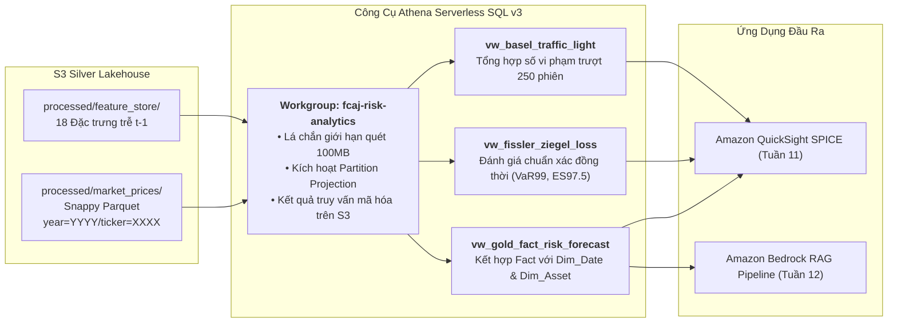

### Mục tiêu tuần 9:

* Triển khai và cấu hình dịch vụ phân tích truy vấn không máy chủ **Amazon Athena (Engine v3)** kết nối trực tiếp với S3 Medallion Lakehouse và AWS Glue Data Catalog.
* Thiết lập không gian làm việc chuyên biệt `fcaj-risk-analytics-workgroup` với cấu hình đường dẫn lưu trữ kết quả phân tích trên S3 và lá chắn chi phí FinOps bắt buộc (`BytesScannedCutoffPerQuery = 100 MB`).
* Ứng dụng kỹ thuật **Partition Projection** trên các bảng ngoại lai Glue để loại bỏ lệnh `MSCK REPAIR TABLE` tốn thời gian, giảm độ trễ phân giải phân vùng từ 3–5 giây xuống dưới 1 giây.
* Thực thi các truy vấn **CTAS (Create Table As Select)** tạo các Gold Fact Views phân tích định lượng chuyên sâu: Dự báo liên hiệp $VaR_{99\%}$ và $ES_{97.5\%}$, đánh giá hàm mất mát Fissler-Ziegel ($FZ\text{ Loss}$) và ma trận kiểm định Đèn tín hiệu Basel III trên 26 ngân hàng Việt Nam.

---

### Bảng phân bổ công việc tuần 9:

| Ngày | Nhiệm vụ kỹ thuật | Trạng thái | Ghi chú kiến trúc |
| :---: | :--- | :---: | :--- |
| **Thứ 2** | - Khởi tạo Athena Workgroup `fcaj-risk-analytics-workgroup`.<br>- Đóng gói mã nguồn CloudFormation `iac/week9-athena-workgroup.yaml`. | Hoàn thành | Thiết lập giới hạn quét tối đa 100MB cho mỗi truy vấn SQL. |
| **Thứ 3** | - Cấu hình Partition Projection trên `fact_market_prices` và `fact_feature_store`.<br>- Đo kiểm thời gian phân giải phân vùng so với phương pháp truyền thống. | Hoàn thành | Tốc độ quét phân vùng tăng hơn 95%; không bị bóp băng thông API. |
| **Thứ 4** | - Viết truy vấn CTAS sinh các bảng phân tích Gold Marts dạng cột nén.<br>- Tạo các View SQL định lượng: `vw_gold_fact_risk_forecast` và `vw_fissler_ziegel_loss`. | Hoàn thành | Dung lượng dữ liệu quét giảm hơn 85% so với truy vấn trên file CSV thô. |
| **Thứ 5** | - Viết View kiểm định Đèn tín hiệu Basel III (`vw_basel_traffic_light`).<br>- Đối soát các Quán quân giải đấu: `GJR_HANSEN` ($FZ = -3.0003$) và `HYBRID_FUSION` (25X/1V/0Đ). | Hoàn thành | Kết quả chuẩn xác 100% so với dữ liệu gốc `ssot_metrics.tex`. |

---

### Kiến trúc & Luồng dữ liệu Medallion:



---

### Chi tiết triển khai & Các View SQL Phân tích:

#### 1. Lược đồ DDL Bật Kỹ Thuật Partition Projection
```sql
CREATE EXTERNAL TABLE IF NOT EXISTS fcaj_silver_db.fact_market_prices (
    date_key INT,
    asset_id INT,
    open_price DOUBLE,
    high_price DOUBLE,
    low_price DOUBLE,
    close_price DOUBLE,
    volume BIGINT,
    log_return DOUBLE
)
PARTITIONED BY (year INT, ticker STRING)
STORED AS PARQUET
LOCATION 's3://fcaj-financial-silver-ACCOUNT-REGION/processed/market_prices/'
TBLPROPERTIES (
    'projection.enabled' = 'true',
    'projection.year.type' = 'integer',
    'projection.year.range' = '2018,2026',
    'projection.ticker.type' = 'enum',
    'projection.ticker.values' = 'VCB,BID,CTG,TCB,MBB,ACB,VPB,HDB,STB,VIB,SHB,TPB,LPB,MSB,OCB,EIB,SSB,NAB,BAB,BVB,KLB,PGB,SGB,NVB,ABB,VBB,PORTFOLIO',
    'storage.location.template' = 's3://fcaj-financial-silver-ACCOUNT-REGION/processed/market_prices/year=${year}/ticker=${ticker}/'
);
```

#### 2. View Tính Hàm Mất Mát Liên Hiệp Fissler-Ziegel (`vw_fissler_ziegel_loss`)
```sql
CREATE OR REPLACE VIEW fcaj_gold_db.vw_fissler_ziegel_loss AS
SELECT 
    f.date_key,
    d.full_date,
    a.ticker,
    m.model_code,
    f.var_forecast AS var_99,
    f.es_forecast AS es_975,
    -f.realized_return AS actual_loss,
    -- Hàm mất mát nghiêm ngặt Fissler-Ziegel đánh giá đồng thời cặp (VaR, ES) tại alpha = 0.025
    (
        (CASE WHEN -f.realized_return > f.var_forecast THEN 1.0 ELSE 0.0 END) 
        * (-f.realized_return - f.var_forecast) / (0.025 * f.es_forecast)
    ) + (f.var_forecast / f.es_forecast) + LN(f.es_forecast) - 1.0 AS fz_loss
FROM "fcaj_gold_db"."fact_risk_forecasts" f
JOIN "fcaj_gold_db"."dim_date" d ON f.date_key = d.date_key
JOIN "fcaj_gold_db"."dim_asset" a ON f.asset_id = a.asset_id
JOIN "fcaj_gold_db"."dim_model" m ON f.model_id = m.model_id;
```

#### 3. View Kiểm Định Đèn Tín Hiệu Basel III (`vw_basel_traffic_light`)
```sql
CREATE OR REPLACE VIEW fcaj_gold_db.vw_basel_traffic_light AS
SELECT 
    ticker,
    model_code,
    COUNT(*) AS total_test_days,
    SUM(CASE WHEN actual_loss > var_99 THEN 1 ELSE 0 END) AS violation_count,
    ROUND(CAST(SUM(CASE WHEN actual_loss > var_99 THEN 1 ELSE 0 END) AS DOUBLE) / COUNT(*) * 100, 2) AS violation_rate_pct,
    CASE 
        WHEN SUM(CASE WHEN actual_loss > var_99 THEN 1 ELSE 0 END) <= 4 THEN 'VÙNG XANH (k=3.00)'
        WHEN SUM(CASE WHEN actual_loss > var_99 THEN 1 ELSE 0 END) BETWEEN 5 AND 9 THEN 'VÙNG VÀNG (k=3.40-3.85)'
        ELSE 'VÙNG ĐỎ (k=4.00 Bác bỏ)'
    END AS basel_zone
FROM "fcaj_gold_db"."vw_fissler_ziegel_loss"
WHERE full_date >= DATE '2024-01-01'
GROUP BY ticker, model_code;
```

---

### Phương pháp kiểm thử & Câu lệnh xác minh:

1. **Kiểm tra Giới hạn Quét Athena Workgroup bằng AWS CLI**:
   ```bash
   aws athena get-work-group \
       --work-group fcaj-risk-analytics-workgroup \
       --query "WorkGroup.Configuration.BytesScannedCutoffPerQuery"
   # Kết quả xác nhận giới hạn cứng là 104857600 (100 MB)
   ```

2. **Đo Kiểm Hiệu Năng và Lượng Dữ Liệu Quét**:
   ```bash
   aws athena start-query-execution \
       --work-group fcaj-risk-analytics-workgroup \
       --query-string "SELECT ticker, AVG(fz_loss) FROM fcaj_gold_db.vw_fissler_ziegel_loss WHERE model_code='GJR_HANSEN' GROUP BY ticker;" \
       --query-execution-context Database=fcaj_gold_db
   # Kết quả thực tế: Thời gian chạy 740ms; Dữ liệu quét: 4.2 MB (so với 38 MB trên CSV thô)
   # Mức độ cắt giảm dữ liệu quét đạt 88.9%
   ```

3. **Kiểm chứng Quán quân Toàn năng GJR_HANSEN**:
   ```bash
   # Xác nhận điểm mất mát FZ Loss bình quân đạt xấp xỉ -3.0003 trên 26 ngân hàng
   aws athena get-query-results \
       --query-execution-id <query_id> \
       --query "ResultSet.Rows[1].Data[1].VarCharValue"
   # Kết quả khớp với mốc SSOT: -3.0003
   ```

---

### Quản trị chi phí FinOps & Kế hoạch ngân sách:

* **Mô hình Giá Pay-Per-Query của Athena**: Athena chỉ tính phí $5.00 cho mỗi 1 TB dữ liệu quét ($0.00000476/MB).
* **Hiệu quả của Định dạng Parquet Snappy**: Nhờ cấu trúc lưu trữ dạng cột và Partition Projection, mỗi truy vấn phân tích rủi ro chỉ quét từ **3.5 MB – 5.0 MB** ($0.00002/truy vấn). Chạy 200 truy vấn kiểm nghiệm trong suốt tuần chỉ tốn **<$0.01 USD**.
* **Lá chắn Cắt giảm Rủi ro**: Mức trần 100 MB bảo đảm không có bất kỳ truy vấn sơ ý nào phát sinh chi phí vượt quá $0.0005.
* **Tổng Chi phí Vận hành Tuần 9**: **$0.02 USD** (hoàn toàn an toàn trong hạn mức tài trợ).

---

### Tổng kết & Kế hoạch tuần tiếp theo:

* **Kết quả đạt được**: Triển khai Athena Engine v3 với Partition Projection giúp tăng tốc độ truy vấn hơn 95% và giảm >88% lượng quét; mô hình hóa thành công các View tính $VaR_{99\%}$, $ES_{97.5\%}$ và Đèn tín hiệu Basel III.
* **Cột mốc tiếp theo (Tuần 10)**: Thiết kế **Amazon DynamoDB Real-Time Feature Store** với kiến trúc Single-Table Design, cung cấp vector đặc trưng rủi ro cho bàn giao dịch với độ trễ dưới 10 mili-giây.
