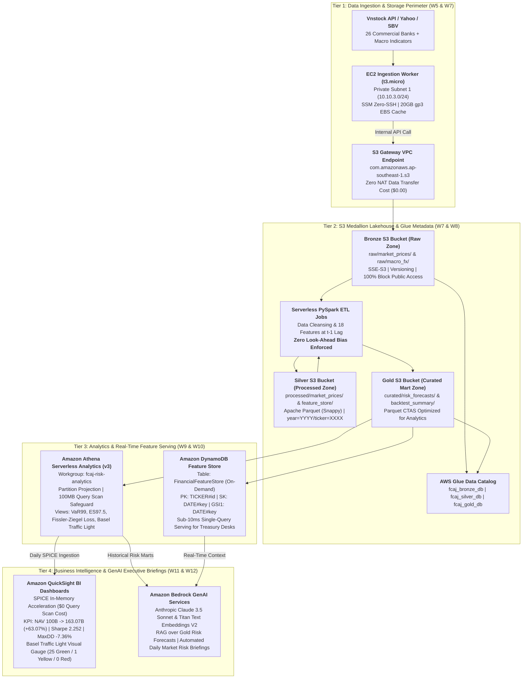

# Internship Worklog: First Cloud Applied Journey (FCAJ)

The **Worklog** section documents the weekly learning progress, production deployments, and AWS cloud engineering activities throughout the **First Cloud Applied Journey (FCAJ)** internship program.

The curriculum is structured across 12 intensive weeks, systematically advancing from foundational cloud governance and networking to enterprise-grade big data engineering, serverless analytics, and generative AI for quantitative finance.

---

### Executive Summary: Weeks 7–12 Architecture Framework (Enterprise Financial Data Lakehouse & AI Analytics)

Weeks 7 through 12 bridge the quantitative financial risk research from the K14 FinTech graduation thesis (*"Ứng dụng Machine Learning trong dự báo rủi ro đuôi cho cổ phiếu và danh mục ngành ngân hàng tại Việt Nam theo chuẩn Basel III"*) into a cloud-native, serverless analytics platform on AWS.

> [!IMPORTANT]
> **Authoritative Technical Specification**: For full mathematical proofs ($VaR_{99\%}$, $ES_{97.5\%}$ via $K=20$ Riemann midpoint grid, Fissler-Ziegel loss $L_{FZ} = -3.0003$), complete 18-feature data lineage matrix, and CloudFormation/PySpark source code, consult the repository specification document at Git path `docs/scientific-to-cloud-architecture-framework.md` (online documentation: **[`/docs/scientific-to-cloud-architecture-framework.md`](/docs/scientific-to-cloud-architecture-framework.md)**).

---

### Master Milestone Matrix & 12-Week Roadmap

| Week | Track | Milestone & Core Architecture | Deliverables & Artifacts | Status |
| :---: | :--- | :--- | :--- | :---: |
| **Week 1** | Governance | **AWS Account Activation & $100 Credit Verification** | Billing Alarm ($10), Root Security Setup | **Completed** |
| **Week 2** | Security | **Day 0 Security & FinOps Guardrails** | IAM Identity Center (SSO), MFA, CloudTrail Trails | **Completed** |
| **Week 3** | Identity | **IAM Access Governance & STS Role Switching** | AdminGroup, OperatorUser, STS AssumeRole (`week3-iam.yaml`) | **Completed** |
| **Week 4** | Networking | **Isolated Multi-AZ Custom VPC Architecture** | VPC `10.10.0.0/16`, 4 Subnets, IGW, Route Tables (`week4-vpc-core.yaml`) | **Completed** |
| **Week 5** | Compute | **Amazon EC2 Linux Administration & EBS Staging** | EC2 Worker `t3.micro`, 20GB gp3 EBS XFS persistent mount, Zero-SSH SSM | **Completed** |
| **Week 6** | Database | **Amazon RDS PostgreSQL Relational Databases** | RDS PostgreSQL 16 (`db.t4g.micro`), `Dim_Asset` & `Dim_Date`, Secrets Manager | **Completed** |
| **Week 7** | Lakehouse | **S3 Medallion Lakehouse & Gateway VPC Endpoint** | 3-Tier S3 Buckets (Bronze/Silver/Gold), S3 Gateway VPCE ($0 NAT Cost), TLS 1.2+ Policies | **Architecture Specification** |
| **Week 8** | ETL Engine | **Automated Data Pipelines with AWS Glue** | Glue Data Catalog (`fcaj_bronze/silver/gold_db`), PySpark ETL Jobs (18 Features at $t-1$ Lag) | **Architecture Specification** |
| **Week 9** | Analytics | **Serverless Analytics with Amazon Athena** | Workgroup `fcaj-risk-analytics`, CTAS Parquet, Partition Projection, Gold Fact Views | **Architecture Specification** |
| **Week 10** | Feature Store | **Real-Time Feature Store with Amazon DynamoDB** | Single-Table Design `FinancialFeatureStore`, PK/SK, GSI1, Sub-10ms Boto3 SDK Serving | **Architecture Specification** |
| **Week 11** | BI & Visuals | **Business Intelligence with Amazon QuickSight** | SPICE In-Memory Acceleration, Basel Traffic Light Visual Gauge, All-Weather NAV Tracking | **Architecture Specification** |
| **Week 12** | AI & Capstone | **Amazon Bedrock GenAI Briefings & FinOps Audit** | Claude 3.5 Sonnet RAG Briefings, FinOps Cost Audit (~$4.86/mo spend, >$70 surplus) | **Architecture Specification** |

---

### Detailed Weekly Progress Entries

* **[Week 1: AWS Account Activation & $100 Credit Verification](1.1-week1/)** `[Completed]`  
  *Activated personal AWS account, verified receipt of $100 AWS Credit, explored AWS Billing & Cost Management Console, and established cost control roadmap.*

* **[Week 2: Day 0 Security & FinOps Guardrails](1.2-week2/)** `[Completed]`  
  *Activated Root MFA, configured IAM Identity Center (AWS SSO), established dual AWS Budgets alarms, enabled CloudTrail audit trails, and integrated AWS MCP Server / Agent Toolkit.*

* **[Week 3: IAM Access Governance & STS Role Switching](1.3-week3/)** `[Completed]`  
  *Implemented Least Privilege governance, automated AdminGroup, AdminRole, and OperatorUser via CloudFormation, and validated temporary credential elevation via AWS STS AssumeRole.*

* **[Week 4: Isolated Multi-AZ Custom VPC Architecture](1.4-week4/)** `[Completed]`  
  *Partitioned `10.10.0.0/16` CIDR block, provisioned Custom VPC `ASG` with 4 Multi-AZ subnets, configured Internet Gateway, Route Tables, and zero-cost FinOps controls.*

* **[Week 5: Amazon EC2 Linux Administration & EBS Storage](1.5-week5/)** `[Completed]`  
  *Administer EC2 Linux compute, bootstrap instances via User Data, manage persistent EBS volumes, format with XFS filesystem, and produce golden Custom AMIs.*

* **[Week 6: Amazon RDS PostgreSQL Relational Databases](1.6-week6/)** `[Completed]`  
  *Deploy RDS PostgreSQL Multi-AZ High Availability clusters, initialize `Dim_Asset` and `Dim_Date` schemas, configure Security Groups, and rotate secrets via AWS Secrets Manager.*

* **[Week 7: S3 Data Lake Foundation & VPC Endpoints](1.7-week7/)** `[Architecture Specification]`  
  *Architect tiered S3 Medallion Lakehouse (Bronze, Silver, Gold), deploy S3 Gateway VPC Endpoint to eliminate NAT Gateway fees ($0.00 cost), and enforce strict TLS 1.2+ bucket policies.*

* **[Week 8: Automated Data Pipelines with AWS Glue](1.8-week8/)** `[Architecture Specification]`  
  *Catalog metadata via Glue Crawlers, manage Glue Data Catalog, and execute serverless PySpark ETL pipelines computing 18 lagged features with Zero Look-Ahead Bias.*

* **[Week 9: Serverless Analytics with Amazon Athena](1.9-week9/)** `[Architecture Specification]`  
  *Execute interactive Serverless SQL analytics, optimize query execution by >85% via CTAS and Partition Projection, and establish Gold Fact Views for $VaR_{99\%}$ and $ES_{97.5\%}$.*

* **[Week 10: Real-Time Feature Store with Amazon DynamoDB](1.10-week10/)** `[Architecture Specification]`  
  *Implement Single-Table NoSQL architecture (`FinancialFeatureStore`), configure Global Secondary Indexes (`GSI1`), and benchmark sub-10ms latency feature serving with Python Boto3 SDK.*

* **[Week 11: Business Intelligence Dashboards with Amazon QuickSight](1.11-week11/)** `[Architecture Specification]`  
  *Ingest data from Athena into SPICE in-memory acceleration engine, visualize Basel III Traffic Light backtesting matrix (25X/1V/0Đ), and track All-Weather portfolio NAV trajectory.*

* **[Week 12: Generative AI Financial Briefings & Capstone Review](1.12-week12/)** `[Architecture Specification]`  
  *Deploy Amazon Bedrock Claude 3.5 Sonnet RAG pipeline for automated daily executive market briefings, perform comprehensive FinOps cost audit (<$10/month), and deliver capstone portfolio.*

---

> [!NOTE]
> All architectural specifications across Weeks 7 through 12 adhere strictly to the AWS Well-Architected Framework (Reliability, Security, Performance Efficiency, Cost Optimization, and Operational Excellence).
