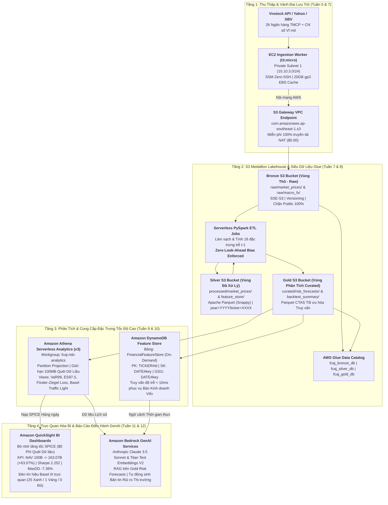

# Nhật ký công việc: First Cloud Applied Journey (FCAJ)

Chuyên mục **Nhật ký công việc (Worklog)** ghi lại chi tiết toàn bộ tiến trình học tập, triển khai thực địa và các hoạt động kỹ thuật đám mây AWS trong suốt chương trình thực tập **First Cloud Applied Journey (FCAJ)**.

Lộ trình thực tập được thiết kế bài bản qua 12 tuần chuyên sâu, phát triển có hệ thống từ quản trị định danh, an ninh mạng cô lập đến kỹ thuật xử lý dữ liệu lớn, phân tích không máy chủ và Trí tuệ Nhân tạo Tạo sinh ứng dụng cho lĩnh vực tài chính định lượng.

---

### Tóm Lược Điều Hành: Khung Kiến Trúc Tuần 7–12 (Data Lakehouse & Phân Tích Rủi Ro AI)

Từ Tuần 7 đến Tuần 12, dự án hiện thực hóa cầu nối chuyển giao nghiên cứu khoa học định lượng từ Khóa luận Tốt nghiệp K14 FinTech (*"Ứng dụng Machine Learning trong dự báo rủi ro đuôi cho cổ phiếu và danh mục ngành ngân hàng tại Việt Nam theo chuẩn Basel III"*) lên nền tảng đám mây AWS tiêu chuẩn doanh nghiệp.

> [!IMPORTANT]
> **Tài Liệu Đặc Tả Kỹ Thuật Gốc**: Toàn bộ chứng minh toán học ($VaR_{99\%}$, $ES_{97.5\%}$ qua lưới Riemann Midpoint $K=20$, hàm mất mát Fissler-Ziegel $L_{FZ} = -3.0003$), ma trận nguồn gốc 18 đặc trưng và mã nguồn PySpark/CloudFormation được trình bày đầy đủ tại đường dẫn kho lưu trữ `docs/scientific-to-cloud-architecture-framework.md` (truy cập trực tuyến: **[`/docs/scientific-to-cloud-architecture-framework.md`](/docs/scientific-to-cloud-architecture-framework.md)**).

---

### Ma Trận Tiến Độ Tổng Thể 12 Tuần

| Tuần | Chuyên Môn | Cột Mốc & Kiến Trúc Trọng Tâm | Sản Phẩm Giao Nộp & Bằng Chứng | Trạng Thái |
| :---: | :--- | :--- | :--- | :---: |
| **Tuần 1** | Quản trị | **Khởi tạo tài khoản AWS & Kích hoạt $100 Credit** | Cảnh báo ngân sách ($10), Thiết lập bảo mật Root | **Hoàn thành** |
| **Tuần 2** | An ninh | **Day 0 Security & FinOps Guardrails** | IAM Identity Center (SSO), MFA, Nhật ký CloudTrail | **Hoàn thành** |
| **Tuần 3** | Định danh | **Quản trị danh tính IAM & Chuyển đổi quyền STS** | AdminGroup, OperatorUser, STS AssumeRole (`week3-iam.yaml`) | **Hoàn thành** |
| **Tuần 4** | Hạ tầng mạng | **Kiến trúc mạng cô lập Custom VPC Multi-AZ** | VPC `10.10.0.0/16`, 4 Subnets, IGW, Route Tables (`week4-vpc-core.yaml`) | **Hoàn thành** |
| **Tuần 5** | Điện toán | **Quản trị Amazon EC2 Linux & Lưu trữ EBS Cache** | Máy chủ EC2 `t3.micro`, 20GB gp3 EBS XFS persistent mount, Zero-SSH SSM | **Hoàn thành** |
| **Tuần 6** | Cơ sở dữ liệu | **Cơ sở dữ liệu quan hệ Amazon RDS PostgreSQL** | RDS PostgreSQL 16 (`db.t4g.micro`), `Dim_Asset` & `Dim_Date`, Secrets Manager | **Hoàn thành** |
| **Tuần 7** | Hồ dữ liệu | **S3 Medallion Lakehouse & Gateway VPC Endpoint** | 3 Bucket phân tầng S3 (Bronze/Silver/Gold), S3 Gateway VPCE ($0 phí NAT), TLS 1.2+ | **Đặc tả Kiến trúc** |
| **Tuần 8** | Kỹ thuật ETL | **Tự động hóa đường ống dữ liệu với AWS Glue** | Glue Data Catalog (`fcaj_bronze/silver/gold_db`), PySpark ETL Jobs (18 biến trễ $t-1$) | **Đặc tả Kiến trúc** |
| **Tuần 9** | Phân tích | **Phân tích dữ liệu không máy chủ với Amazon Athena** | Workgroup `fcaj-risk-analytics`, CTAS Parquet, Partition Projection, Gold Views | **Đặc tả Kiến trúc** |
| **Tuần 10** | Kho đặc trưng | **Cơ sở dữ liệu NoSQL tốc độ cao Amazon DynamoDB** | Thiết kế Single-Table `FinancialFeatureStore`, PK/SK, GSI1, Sub-10ms Boto3 Serving | **Đặc tả Kiến trúc** |
| **Tuần 11** | BI & Giám sát | **Trực quan hóa dữ liệu kinh doanh với Amazon QuickSight** | Bộ nhớ tăng tốc SPICE, Đèn tín hiệu Basel III (25X/1V/0Đ), Theo dõi NAV All-Weather | **Đặc tả Kiến trúc** |
| **Tuần 12** | AI & Bàn giao | **Bản tin điều hành GenAI với Amazon Bedrock & FinOps** | Claude 3.5 Sonnet RAG Briefings, Kiểm toán FinOps (~$4.86/tháng, dư >$70) | **Đặc tả Kiến trúc** |

---

### Danh Mục Nhật Ký Chi Tiết Từng Tuần

* **[Tuần 1: Khởi tạo tài khoản AWS & Kích hoạt $100 Credit](1.1-week1/)** `[Hoàn thành]`  
  *Kích hoạt tài khoản AWS cá nhân, xác minh $100 AWS Credit tài trợ, tìm hiểu trang quản lý chi phí AWS Billing Console và lập mục tiêu kiểm soát ngân sách.*

* **[Tuần 2: Day 0 Security & FinOps Guardrails](1.2-week2/)** `[Hoàn thành]`  
  *Kích hoạt Root MFA, triển khai IAM Identity Center (AWS SSO), thiết lập lá chắn ngân sách AWS Budgets, kích hoạt AWS CloudTrail và tích hợp AWS MCP Server / Agent Toolkit.*

* **[Tuần 3: Quản trị danh tính IAM & STS Role Switching](1.3-week3/)** `[Hoàn thành]`  
  *Triển khai mô hình phân quyền Least Privilege, tạo AdminGroup, AdminRole và OperatorUser qua CloudFormation, thực thi nâng quyền tạm thời qua AWS STS AssumeRole.*

* **[Tuần 4: Kiến trúc mạng cô lập Custom VPC Multi-AZ](1.4-week4/)** `[Hoàn thành]`  
  *Phân hoạch dải địa chỉ CIDR `10.10.0.0/16`, khởi tạo VPC `ASG` với 4 Subnets Multi-AZ, cấu hình Internet Gateway, Route Tables và lá chắn FinOps Zero-Cost.*

* **[Tuần 5: Quản trị điện toán Amazon EC2 & Lưu trữ EBS](1.5-week5/)** `[Hoàn thành]`  
  *Quản trị máy chủ ảo EC2 Linux, User Data Bootstrap, cấu hình ổ đĩa lưu trữ đệm EBS 20GB định dạng XFS, khắc phục sự cố mất SSH Key Pair qua SSM Session Manager.*

* **[Tuần 6: Cơ sở dữ liệu quan hệ Amazon RDS PostgreSQL](1.6-week6/)** `[Hoàn thành]`  
  *Triển khai RDS PostgreSQL Multi-AZ High Availability, khởi tạo lược đồ dữ liệu `Dim_Asset` và `Dim_Date`, cô lập Security Group và quản lý xoay vòng mật khẩu với AWS Secrets Manager.*

* **[Tuần 7: Khởi tạo Data Lake & S3 VPC Endpoints](1.7-week7/)** `[Đặc tả Kiến trúc]`  
  *Xây dựng nền tảng Data Lake 3 tầng (Bronze, Silver, Gold), triển khai S3 Gateway VPC Endpoint loại bỏ hoàn toàn chi phí NAT ($0.00) và thực thi chính sách bảo mật TLS 1.2+.*

* **[Tuần 8: Tự động hóa ETL với AWS Glue](1.8-week8/)** `[Đặc tả Kiến trúc]`  
  *Tổ chức siêu dữ liệu với Glue Data Catalog, vận hành PySpark ETL Job tính toán 18 đặc trưng định lượng trễ $t-1$ triệt tiêu hoàn toàn rò rỉ dữ liệu (Zero Look-Ahead Bias).*

* **[Tuần 9: Phân tích dữ liệu không máy chủ với Amazon Athena](1.9-week9/)** `[Đặc tả Kiến trúc]`  
  *Thực thi truy vấn Serverless SQL tốc độ cao, tối ưu hóa giảm >85% dung lượng quét qua CTAS và Partition Projection, thiết lập các Gold Fact Views tính $VaR_{99\%}$ và $ES_{97.5\%}$.*

* **[Tuần 10: Cơ sở dữ liệu NoSQL tốc độ cao Amazon DynamoDB](1.10-week10/)** `[Đặc tả Kiến trúc]`  
  *Mô hình hóa Single-Table Design (`FinancialFeatureStore`), cấu hình Global Secondary Index (`GSI1`) và đo lường độ trễ truy vấn dưới 10ms phục vụ Bàn kinh doanh vốn.*

* **[Tuần 11: Trực quan hóa dữ liệu kinh doanh với Amazon QuickSight](1.11-week11/)** `[Đặc tả Kiến trúc]`  
  *Kết nối Athena và QuickSight SPICE Engine tối ưu chi phí, trực quan hóa Đèn tín hiệu Basel III (25X/1V/0Đ) và biểu đồ tăng trưởng NAV danh mục All-Weather ($100\ \text{Tỷ} \to 163.07\ \text{Tỷ}$).*

* **[Tuần 12: Ứng dụng GenAI với Amazon Bedrock & Tổng kết](1.12-week12/)** `[Đặc tả Kiến trúc]`  
  *Ứng dụng Trí tuệ Nhân tạo Tạo sinh Bedrock Claude 3.5 Sonnet RAG tự động hóa bản tin rủi ro thị trường hàng ngày, kiểm toán FinOps toàn diện (<$10/tháng) và hoàn tất hồ sơ năng lực.*

---

> [!NOTE]
> Mọi đặc tả kiến trúc từ Tuần 7 đến Tuần 12 tuân thủ nghiêm ngặt Khung Kiến trúc Chuẩn AWS Well-Architected Framework (Độ tin cậy, Bảo mật, Hiệu năng, Tối ưu chi phí và Vận hành xuất sắc).
