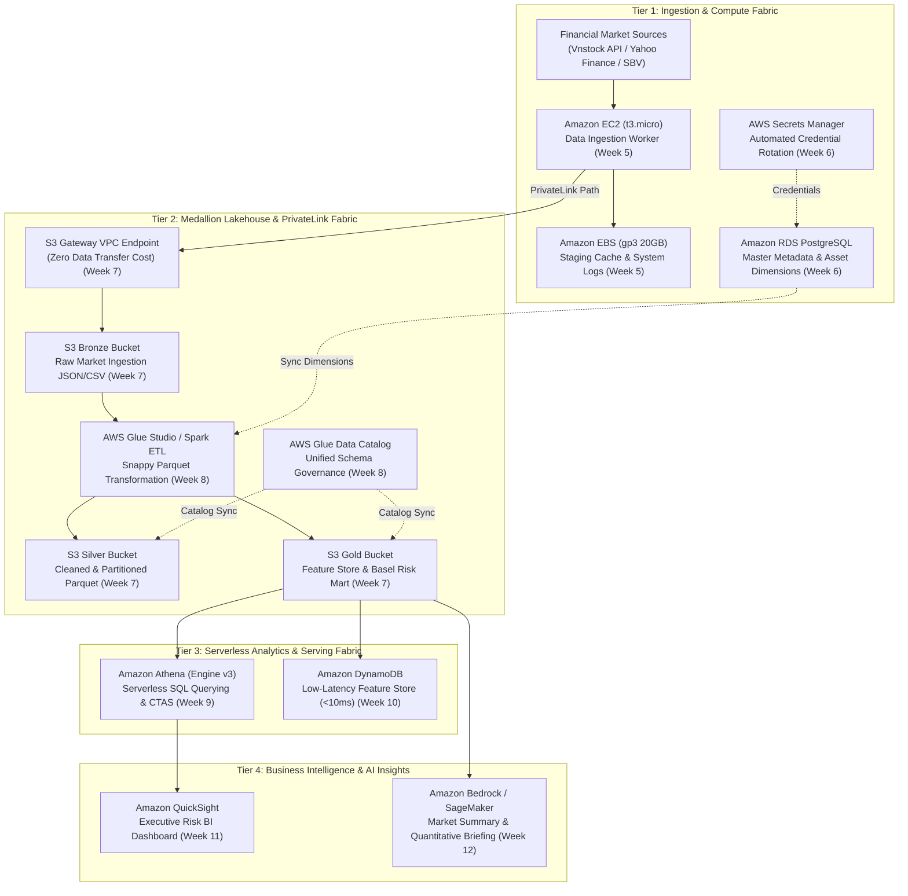

# Enterprise Financial Data Lakehouse & Serverless Analytics Platform on AWS
## Scalable, Multi-Tier Financial Data Lakehouse & High-Performance Serverless Analytics Engine on AWS Cloud

**Project Lead & Solutions Architect:** Nguyen Trung Hieu  
**Professional Role:** Lead Cloud Architect & Finance Analytics Engineer  
**Program Track:** First Cloud Applied Journey (FCAJ) – AWS Cloud Internship Portfolio  

---

### 1. Executive Summary

The project **"Enterprise Financial Data Lakehouse & Serverless Analytics Platform on AWS"** is designed to establish an enterprise-grade, cost-optimized, and highly secure cloud analytics foundation tailored for quantitative finance and risk analytics in Vietnam's capital market. 

Targeting financial institutions, brokerage firms, and investment funds, the platform addresses the challenge of ingesting, transforming, storing, and analyzing high-dimensional financial time-series data spanning 2017 to 2025. This encompasses trading data from 26 commercial banking stocks listed on HOSE/HNX/UPCoM, the VN-Index benchmark, and macroeconomic indicators (USD/VND exchange rates, overnight interbank rates). The platform integrates an end-to-end quantitative feature engineering pipeline computing 18 point-in-time features with **Zero Look-Ahead Bias**, facilitates Basel III regulatory tail-risk analytics ($VaR_{99\%}$ and $ES_{97.5\%}$), serves sub-10ms queries for algorithmic applications, and delivers executive visual insights via Business Intelligence dashboards.

Engineered strictly under the **AWS Well-Architected Framework**, the architecture leverages serverless and managed cloud-native paradigms within an isolated **Multi-AZ Custom VPC**. Operating on a pay-as-you-go financial model, the total projected infrastructure cost is **under $10 USD/month**, safely preserving the allocated $100 USD AWS Credit grant throughout the 12-week internship cycle.

---

### 2. Problem Statement & Return on Investment (ROI)

#### The Business & Technical Challenge
1. **Data Silos & High Infrastructure Overhead**: Traditional on-premises relational databases struggle to maintain decades of daily and intraday financial time series without costly SAN storage expansion and high database licensing fees.
2. **Performance Bottlenecks & Cost Inefficiencies**: Querying financial features or computing regulatory tail-risk metrics across wide denormalized tables necessitates frequent full-table scans, resulting in severe latency and excessive computational waste.
3. **Regulatory Compliance & Data Exfiltration Risks**: Financial data demands stringent zero-trust governance. Unrestricted public endpoints, long-lived hardcoded IAM credentials, and unencrypted transmission violate central banking guidelines (SBV Circular 41/2016 and Circular 13/2018).

#### The AWS Cloud-Native Solution
- **Medallion 3-Tier Lakehouse Architecture**: Built upon Amazon S3 (Bronze $\to$ Silver $\to$ Gold) using compressed columnar **Apache Parquet (Snappy)** partitioned by `year` and `ticker`, slashing analytical query scan volume by over **85%**.
- **Serverless SQL Engine with Amazon Athena (Engine v3)**: Eliminates idle compute capacity by charging exclusively per data scanned ($5.00/TB), combined with CTAS table optimization.
- **Sub-10ms Serving with Amazon DynamoDB**: Decouples analytical batch data from low-latency online feature serving via a specialized Single-Table design.
- **Perimeter Defense with AWS PrivateLink**: Replaces public internet paths with private **S3 Gateway VPC Endpoints**, completely removing NAT Gateway data processing fees while guaranteeing in-transit data confinement.

#### Return on Investment (ROI) & FinOps Efficiency
- **Infrastructure Savings**: Compared to traditional fixed-capacity data warehouses costing \$150–\$300 USD/month, the AWS Serverless architecture operates on demand, averaging only **\$0.25–\$0.30 USD/day** (~ \$8.50–\$9.50 USD/month).
- **Time-to-Delivery**: Fully managed services (AWS Glue, Athena, DynamoDB, QuickSight) compress data infrastructure onboarding time from months to weeks.

---

### 3. Target Solution Architecture

The platform architecture spans four isolated functional tiers fully encapsulated within Amazon VPC:

---

### 4. Technical Component Design

#### 4.1. Security, Identity & Network Fabric
- **Amazon VPC Network Design**: Built on top of the Multi-AZ Custom VPC deployed in Week 4 (`10.10.0.0/16`), isolating compute workloads across 2 Private Subnets while managing edge communication via 2 Public Subnets.
- **IAM Identity Governance**: Enforces Least Privilege access utilizing IAM Identity Center (SSO). Dedicated IAM Service Roles (`FCAJ-EC2-Ingestion-Role`, `FCAJ-Glue-ETL-Role`) replace long-lived static access keys.
- **Private Data Perimeter**: Communication between private compute resources and S3 buckets is routed exclusively through **S3 Gateway VPC Endpoints**, neutralizing external data theft vectors.

#### 4.2. Medallion Lakehouse & Serverless ETL Layer
Inheriting the verified star schema from the quantitative finance data model:
- **Bronze Zone (`s3://fcaj-financial-datalake-raw/`)**:
  - Raw financial time series of 26 Vietnamese banking equities and macroeconomic indicators (2017–2025).
- **Silver Zone (`s3://fcaj-financial-datalake-processed/`)**:
  - AWS Glue Crawlers automatically catalog metadata into the Glue Data Catalog.
  - Serverless PySpark ETL jobs cleanse, deduplicate, and convert datasets into Apache Parquet with Snappy compression, partitioned by `year=YYYY/ticker=XXXX`.
- **Gold Zone (`s3://fcaj-financial-datalake-curated/`)**:
  - Stores the normalized **Feature Store** comprising 18 point-in-time features lagged by $t-1$ (GARCH volatility, Garman-Klass, Parkinson, RSI, MACD, interbank rates).
  - Houses the **Basel III Tail-Risk Mart** containing 94,311 empirical $VaR_{99\%}$ and $ES_{97.5\%}$ out-of-sample forecasts and violation classification records.

#### 4.3. High-Speed Serving & Analytical Query Fabric
- **Serverless Analytics with Amazon Athena**:
  - Employs **CTAS** and **Partition Projection** to optimize query performance and cut cloud billing costs when analyzing historical systemic stress events (2020 COVID shock, 2022 liquidity crisis).
- **Sub-10ms Feature Serving with Amazon DynamoDB**:
  - Single-Table design using Partition Key `TICKER#<symbol>` and Sort Key `DATE#<date_key>`, augmented with a Global Secondary Index (`GSI1`) for querying cross-sectional sector metrics in a single network round-trip.

#### 4.4. Executive Business Intelligence
- **Amazon QuickSight**:
  - Direct connection to Athena Data Lake without intermediary warehouse staging.
  - Interactive executive dashboard featuring backtesting validation curves, Basel regulatory traffic-light indicators, and risk factor attribution views.

---

### 5. Implementation Roadmap (Aligned with 12-Week Worklog)

| Phase | Worklog Week | Technical Implementation Deliverable | Status |
| :--- | :---: | :--- | :---: |
| **Phase 1: Cloud Foundation & Day-0 Security** | Week 1 | AWS Account initialization, \$100 Credit activation, Billing Console setup. | **Completed** |
| | Week 2 | Day-0 Security Guardrails: IAM Identity Center (SSO), MFA, CloudWatch Billing Alarms. | **Completed** |
| | Week 3 | IAM Governance, Least Privilege role delegation, CloudFormation automation. | **Completed** |
| | Week 4 | Multi-AZ Custom VPC architecture design and deployment (`10.10.0.0/16`). | **Completed** |
| **Phase 2: Ingestion & Relational Metadata** | Week 5 | Deploy EC2 Data Ingestion Worker in Private Subnet, User Data automation, 20GB EBS cache volume, Key Pair recovery procedure. | **Completed** |
| | Week 6 | Provision Amazon RDS PostgreSQL for `Dim_Asset` & `Dim_Date`, secure credentials with AWS Secrets Manager rotation. | **Completed** |
| **Phase 3: Medallion Lakehouse & ETL** | Week 7 | S3 3-Tier Lakehouse setup (Bronze/Silver/Gold), S3 Gateway VPC Endpoint, strict bucket access policies. | *Planned* |
| | Week 8 | Automated schema discovery via AWS Glue Data Catalog, PySpark Glue ETL for Parquet conversion & partitioning. | *Planned* |
| **Phase 4: Serverless Analytics & Serving** | Week 9 | Quantitative SQL query optimization via Amazon Athena, CTAS modeling, >85% scan cost reduction benchmark. | *Planned* |
| | Week 10 | Real-Time Financial Feature Store on Amazon DynamoDB (Single-Table Design), Python Boto3 SDK CRUD operations. | *Planned* |
| **Phase 5: BI Dashboard, AI & Capstone Review** | Week 11 | Build Executive Financial Risk Dashboard on Amazon QuickSight connected to Athena/S3. | *Planned* |
| | Week 12 | Generative AI market briefing with Bedrock/SageMaker, comprehensive FinOps cost audit, capstone handover. | *Planned* |

---

### 6. FinOps & Budget Estimation

The platform adheres to strict FinOps discipline, maximizing the AWS Free Tier and serverless pay-per-use billing to ensure full financial solvency under the \$100 AWS Credit grant.

*Monthly Operational Budget Estimation (via AWS Pricing Calculator):*

| AWS Service | Configuration & Usage Profile | Estimated Monthly Cost (USD) |
| :--- | :--- | :---: |
| **Amazon EC2 & EBS** | 1 instance `t3.micro` (750 hours/month Free Tier) + 20 GB `gp3` EBS Volume | \$1.60 |
| **Amazon RDS PostgreSQL** | 1 Single-AZ `db.t4g.micro` (activated only during lab sessions, ~60 hours/month) | \$1.20 |
| **AWS Secrets Manager** | 1 Secret for RDS credentials, 10,000 API calls | \$0.45 |
| **Amazon S3** | ~15 GB Medallion storage (Standard) + 50,000 PUT/GET requests | \$0.40 |
| **S3 Gateway VPC Endpoint** | Free service charge and free intra-region data transfer | **\$0.00** |
| **AWS Glue ETL & Catalog** | 1 Million Metadata Requests (Free Tier) + 10 DPU-hours Glue Spark Job (batch) | \$4.40 |
| **Amazon Athena** | 100 GB data scanned (optimized Parquet & Partitioning) at \$5.00/TB | \$0.50 |
| **Amazon DynamoDB** | On-Demand capacity mode, < 1 GB storage, 200,000 WCU/RCU | \$0.25 |
| **Amazon CloudWatch** | 10 Alarms, 5 GB log ingestion & retention | \$0.60 |
| **Total Estimated Budget** | **Approx. \$9.40 USD / Month** (3-Month Total: **~ \$28.20 USD**) |

> [!TIP]
> The initial \$100 AWS Credit sponsorship comfortably supports the entire development, testing, and operational lifecycle across the 12-week internship (representing only ~28% total budget consumption).

---

### 7. Risk Analysis & Mitigation Strategies

| Potential Risk | Impact | Probability | Mitigation & Control Strategy |
| :--- | :---: | :---: | :--- |
| **Budget Overrun** | High | Low | Deploy CloudWatch Billing Alarms at thresholds \$30, \$60, and \$80. Automate teardown of non-essential resources (RDS, EC2) post-testing via cleanup scripts. |
| **Financial Data Exfiltration** | Critical | Low | Enforce S3 Block Public Access account-wide; restrict bucket policies exclusively to internal VPC Endpoints (`aws:sourceVpce`). |
| **Schema Drift** | Medium | Medium | Leverage AWS Glue Schema Registry and Glue Crawler automatic schema versioning to safely absorb upstream changes without breaking analytical jobs. |
| **EC2 Key Pair Loss** | Medium | Low | Mandate AWS Systems Manager (SSM) Session Manager via IAM instance profile, ensuring secure browser-based administrative access without SSH dependencies. |
