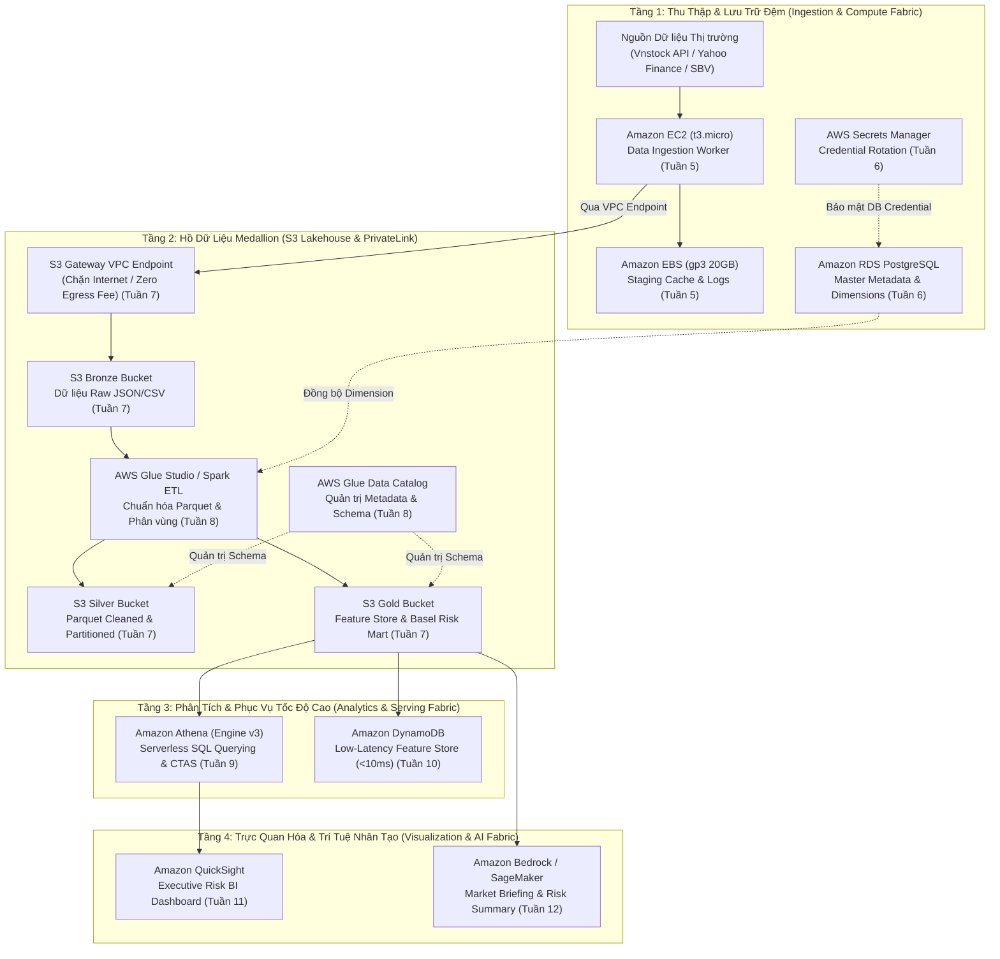

# Enterprise Financial Data Lakehouse & Serverless Analytics Platform on AWS
## Nền tảng Hồ dữ liệu Tài chính Doanh nghiệp & Công cụ Phân tích Serverless trên Điện toán Đám mây AWS

**Chủ nhiệm Đề án & Kiến trúc sư Giải pháp:** Nguyễn Trung Hiếu  
**Vai trò Chuyên môn:** Lead Cloud Architect & Finance Analytics Engineer  
**Chương trình:** First Cloud Applied Journey (FCAJ) – AWS Cloud Internship Portfolio  

---

### 1. Tóm tắt điều hành (Executive Summary)

Đề án **"Enterprise Financial Data Lakehouse & Serverless Analytics Platform on AWS"** được thiết kế nhằm xây dựng một nền tảng dữ liệu tài chính hiện đại, có khả năng mở rộng linh hoạt, bảo mật theo chuẩn doanh nghiệp và tối ưu hóa chi phí vận hành dựa trên kiến trúc **AWS Serverless & Medallion Data Lakehouse**. 

Hệ thống tập trung giải quyết bài toán cốt lõi của các định chế tài chính, công ty chứng khoán và quỹ đầu tư tại Việt Nam: Thu thập, lưu trữ, làm sạch và phân tích khối lượng lớn dữ liệu chuỗi thời gian giao dịch chứng khoán (26 cổ phiếu ngân hàng thương mại niêm yết trên HOSE/HNX/UPCoM, chỉ số VN-Index) kết hợp các biến số vĩ mô (Tỷ giá USD/VND, Lãi suất liên ngân hàng qua đêm) giai đoạn 2017–2025. Nền tảng tích hợp đầy đủ quy trình tính toán 18 đặc trưng tài chính định lượng không thiên kiến nhìn trước (*Zero Look-Ahead Bias*), hỗ trợ đo lường rủi ro đuôi chuẩn Basel III ($VaR_{99\%}$ và $ES_{97.5\%}$), đồng thời trực quan hóa qua Business Intelligence Dashboard và phục vụ tra cứu trực tuyến với độ trễ dưới 10ms.

Toàn bộ giải pháp được thiết kế tuân thủ nghiêm ngặt **AWS Well-Architected Framework**, vận hành hoàn toàn trong mạng ảo cô lập **Amazon VPC Multi-AZ**, ứng dụng mô hình chi trả theo mức sử dụng thực tế (Pay-as-you-go) với tổng chi phí ước tính **dưới $10 USD/tháng**, bảo toàn trọn vẹn khoản tài trợ $100 USD AWS Credit của chương trình thực tập.

---

### 2. Tuyên bố bài toán & Hiệu quả đầu tư (Problem Statement & ROI)

#### Vấn đề thực tế (The Business & Technical Challenge)
1. **Silo Dữ liệu & Chi phí Phần cứng Đắt đỏ**: Các hệ thống cơ sở dữ liệu quan hệ truyền thống (RDBMS On-Premises) gặp trở ngại nghiêm trọng khi lưu trữ dữ liệu lịch sử nhiều năm dạng Tick-by-Tick. Chi phí duy trì cụm máy chủ vật lý, hệ thống lưu trữ SAN và bản quyền phần mềm phân tích rất tốn kém, nhưng lại thường xuyên bị nghẽn cổ chai khi chạy các thuật toán tổng hợp định kỳ.
2. **Nghẽn Hiệu Năng & Chi Phí Truy Vấn Lớn**: Các truy vấn SQL tính toán chỉ số kỹ thuật hoặc đo lường rủi ro trên bảng phẳng (Flat Wide Tables) phải quét toàn bộ dữ liệu (Full Table Scan), gây lãng phí tài nguyên và kéo dài thời gian phản hồi cho các bộ phận quản trị rủi ro danh mục.
3. **Tuân thủ Pháp lý & Rủi ro Rò rỉ Dữ liệu**: Dữ liệu tài chính là tài sản tối mật. Việc phân quyền truy cập thiếu chặt chẽ, sử dụng Access Key tĩnh và truyền tải dữ liệu qua Internet công cộng tiềm ẩn nguy cơ mất an toàn thông tin và vi phạm các quy định bảo mật của Ngân hàng Nhà nước (Thông tư 41/2016 và Thông tư 13/2018).

#### Giải pháp Đề xuất trên Nền tảng AWS
- **Kiến trúc Hồ dữ liệu Medallion 3 tầng** trên Amazon S3 (Bronze $\to$ Silver $\to$ Gold) kết hợp định dạng lưu trữ dạng cột nén **Apache Parquet (Snappy)** và phân vùng logic (`year/ticker`), giảm tới hơn **85%** khối lượng dữ liệu quét khi truy vấn.
- **Động cơ phân tích phi máy chủ Amazon Athena (Engine v3)**, loại bỏ hoàn toàn chi phí máy chủ nhàn rỗi (Zero Idle Cost).
- **Phân tách tầng lưu trữ phân tích (S3) và tầng phục vụ trực tuyến tốc độ cao (Amazon DynamoDB Single-Table Design)**, đáp ứng các truy vấn Feature Store với độ trễ cực thấp ($< 10\text{ ms}$).
- **Lá chắn bảo mật mạng riêng ảo Amazon VPC Endpoints (AWS PrivateLink)**, AWS IAM Identity Center (SSO) và mã hóa dữ liệu mặc định (SSE-S3 / AWS KMS) cả khi lưu trữ (at-rest) lẫn khi truyền tải (in-transit).

#### Phân tích Hiệu quả Đầu tư (ROI) & Tối ưu Chi phí FinOps
- **Tiết kiệm chi phí hạ tầng**: So với các cụm máy chủ truyền thống hoặc dịch vụ kho dữ liệu provisioning cố định (tiêu tốn từ \$150 – \$300 USD/tháng), kiến trúc Serverless trên AWS chỉ phát sinh chi phí khi có tác vụ chạy, tổng chi phí thực tế chỉ khoảng **\$0.25 – \$0.30 USD/ngày** (~ \$8.50 – \$9.50 USD/tháng).
- **Rút ngắn thời gian triển khai (Time-to-Market)**: Nhờ các dịch vụ được quản lý hoàn toàn (Fully Managed Services) như AWS Glue, Athena và DynamoDB, thời gian thiết lập hạ tầng phân tích rút ngắn từ vài tháng xuống chỉ còn vài tuần.

---

### 3. Kiến trúc Giải pháp (Target Solution Architecture)

Nền tảng được cấu trúc theo 4 tầng chức năng khép kín trong mạng riêng ảo Amazon VPC:

---

### 4. Thiết kế Cấu phần Kỹ thuật Chi tiết (Technical Component Design)

#### 4.1. Tầng Hạ tầng & Quản trị Danh tính (Security & Network Fabric)
- **Hạ tầng Mạng (Amazon VPC)**: Kế thừa trực tiếp kiến trúc mạng Multi-AZ đã hoàn thiện tại Tuần 4 (`10.10.0.0/16`), bao gồm 2 Public Subnets và 2 Private Subnets. Tách biệt hoàn toàn máy chủ xử lý dữ liệu khỏi không gian mạng công cộng.
- **Quản trị Danh tính (IAM Governance)**: Triển khai IAM Roles chuyên biệt cho EC2 Instance Profile (`FCAJ-EC2-Ingestion-Role`) và Glue Service Role (`FCAJ-Glue-ETL-Role`), ngăn chặn tuyệt đối việc sử dụng AWS Access Keys cố định.
- **Bảo mật Đường truyền (S3 Gateway VPC Endpoint)**: Toàn bộ lưu lượng truyền tải giữa các máy chủ trong Private Subnet và S3 Data Lake đi ngầm qua đường trục mạng của AWS, không qua Internet Gateway, triệt tiêu nguy cơ tấn công đánh cắp dữ liệu và tiết kiệm 100% chi phí truyền dữ liệu qua NAT Gateway.

#### 4.2. Tầng Hồ Dữ liệu Medallion & ETL Pipeline (Data Lakehouse Engine)
Áp dụng mô hình chuẩn hóa dữ liệu định lượng chuyên sâu:
- **Bronze Zone (`s3://fcaj-financial-datalake-raw/`)**:
  - Tiếp nhận dữ liệu thô chuỗi thời gian giá OHLCV của 26 mã ngân hàng Việt Nam (2017–2025) và các biến số vĩ mô (Tỷ giá USD/VND, Lãi suất liên ngân hàng).
- **Silver Zone (`s3://fcaj-financial-datalake-processed/`)**:
  - Dữ liệu được AWS Glue Crawler quét và lập chỉ mục vào AWS Glue Data Catalog.
  - Tác vụ AWS Glue ETL chuyển đổi toàn bộ bản ghi sang định dạng Apache Parquet nén Snappy, phân vùng logic theo cấu trúc `year=YYYY/ticker=XXXX`.
- **Gold Zone (`s3://fcaj-financial-datalake-curated/`)**:
  - Lưu trữ bảng dữ liệu đặc trưng tài chính (`Fact_Feature_Store`) gồm 18 biến kỹ thuật đã được trễ hóa $t-1$ (GARCH volatility, Garman-Klass, Parkinson, RSI, MACD) nhằm bảo đảm nguyên tắc không rò rỉ dữ liệu tương lai (*Zero Look-Ahead Bias*).
  - Lưu trữ kết quả dự báo rủi ro đuôi Basel III (`Fact_Risk_Forecasts`) gồm 94,311 bản ghi $VaR_{99\%}$, $ES_{97.5\%}$ và phân loại Basel Zones (Green, Yellow, Red).

#### 4.3. Tầng Phân tích & Phục vụ (Serving & Analytics Layer)
- **Truy vấn Serverless với Amazon Athena**:
  - Ứng dụng kỹ thuật **CTAS (Create Table As Select)** và **Partition Projection** để tối ưu hóa tốc độ thực thi các câu lệnh truy vấn phân tích định lượng (ví dụ: truy vấn danh sách cổ phiếu vi phạm ngưỡng rủi ro $VaR$ trong các đợt khủng hoảng 2020, 2022).
- **Feature Store Tốc độ cao với Amazon DynamoDB**:
  - Thiết kế bảng đơn (Single-Table Design) với Partition Key `TICKER#<symbol>` và Sort Key `DATE#<date_key>`, kèm theo Global Secondary Index (`GSI1`) cho phép ứng dụng Web hoặc hệ thống giao dịch tự động tra cứu bộ đặc trưng của toàn bộ 26 ngân hàng trong phiên giao dịch với độ trễ dưới 10ms.

#### 4.4. Tầng Trực quan hóa & Báo cáo Điều hành (Business Intelligence)
- **Amazon QuickSight**:
  - Kết nối trực tiếp vào Amazon Athena Data Lake.
  - Xây dựng **Executive Financial Risk Dashboard** trực quan hóa các chỉ số quan trọng: Biểu đồ đường kiểm định Backtesting vi phạm $VaR$, Heatmap phân bổ tỷ trọng danh mục tối ưu, và Tháp chỉ số rủi ro thanh khoản ngân hàng.

---

### 5. Lộ trình Triển khai Chi tiết (12-Week Implementation Roadmap)

Lộ trình triển khai được phân bổ và đối chiếu trực tiếp với 12 tuần thực hành của đề án. Từ Tuần 7 đến Tuần 12, đề án đã được tổng hợp hoàn chỉnh với nền tảng tài chính định lượng của Khóa luận Tốt nghiệp K14 FinTech (*"Ứng dụng Machine Learning trong dự báo rủi ro đuôi cho cổ phiếu và danh mục ngành ngân hàng tại Việt Nam theo chuẩn Basel III"*) thành bản đặc tả kiến trúc đám mây chuẩn mực tại đường dẫn kho `docs/scientific-to-cloud-architecture-framework.md` (truy cập trực tuyến: **[`/docs/scientific-to-cloud-architecture-framework.md`](/docs/scientific-to-cloud-architecture-framework.md)**).

| Giai đoạn | Tuần Worklog | Nội dung Triển khai Kỹ thuật | Trạng thái |
| :--- | :---: | :--- | :---: |
| **Giai đoạn 1: Nền tảng Đám mây & Bảo mật** | Tuần 1 | Khởi tạo tài khoản AWS, kích hoạt thành công \$100 AWS Credit, thiết lập cấu hình quản trị ngân sách ban đầu. | **Hoàn thành** |
| | Tuần 2 | Thiết lập Day-0 Security Guardrails: Kích hoạt IAM Identity Center (SSO), MFA, CloudWatch Billing Alarms. | **Hoàn thành** |
| | Tuần 3 | Quản trị định danh và phân quyền Least Privilege, tự động hóa IaC qua AWS CloudFormation. | **Hoàn thành** |
| | Tuần 4 | Thiết kế và triển khai kiến trúc mạng ảo Amazon Custom VPC Multi-AZ phân tầng bảo mật. | **Hoàn thành** |
| **Giai đoạn 2: Thu thập Dữ liệu & Lưu trữ Quan hệ** | Tuần 5 | Khởi tạo EC2 Data Ingestion Worker trong Private Subnet, cấu hình User Data tự động hóa, gắn thêm EBS Volume 20GB lưu cache staging, thực hành quy trình phục hồi Key Pair. | **Hoàn thành** |
| | Tuần 6 | Triển khai Master Dimension Store (Amazon RDS PostgreSQL) lưu trữ `Dim_Asset` & `Dim_Date`, bảo mật thông tin đăng nhập tự động qua AWS Secrets Manager. | **Hoàn thành** |
| **Giai đoạn 3: Xây dựng Medallion Data Lakehouse** | Tuần 7 | Xây dựng kiến trúc Data Lake S3 3 tầng (Bronze/Silver/Gold), cấu hình Gateway VPC Endpoint ($0 phí NAT) và siết chặt Bucket Policy TLS 1.2+. | **Đặc tả Kiến trúc** |
| | Tuần 8 | Tự động hóa trích xuất metadata với AWS Glue Data Catalog, triển khai Glue PySpark ETL tính toán 18 đặc trưng trễ $t-1$ (Zero Look-Ahead Bias). | **Đặc tả Kiến trúc** |
| **Giai đoạn 4: Phân tích Serverless & Phục vụ Real-time** | Tuần 9 | Tối ưu hóa truy vấn phân tích định lượng tài chính với Amazon Athena, áp dụng CTAS, Partition Projection và tiết kiệm dung lượng quét (>85%). | **Đặc tả Kiến trúc** |
| | Tuần 10 | Xây dựng Real-Time Financial Feature Store trên Amazon DynamoDB (Single-Table Design), nạp và phục vụ truy vấn Boto3 độ trễ <10ms. | **Đặc tả Kiến trúc** |
| **Giai đoạn 5: Trực quan hóa, AI & Nghiệm thu** | Tuần 11 | Thiết kế Executive Financial Risk Dashboard trên Amazon QuickSight kết nối trực tiếp Athena/SPICE (Đèn tín hiệu Basel 25X/1V/0Đ & theo dõi NAV). | **Đặc tả Kiến trúc** |
| | Tuần 12 | Ứng dụng Generative AI Amazon Bedrock Claude 3.5 Sonnet RAG tóm tắt rủi ro thị trường, kiểm toán FinOps tổng thể (<$10/tháng), hoàn thiện hồ sơ FCAJ. | **Đặc tả Kiến trúc** |

---

### 6. Ước tính Ngân sách & Tối ưu Chi phí (FinOps & Budget Estimation)

Dự án được tối ưu hóa theo nguyên tắc FinOps nghiêm ngặt, tận dụng tối đa gói AWS Free Tier và cơ chế thanh toán theo nhu cầu thực tế (Pay-per-use), bảo đảm không vượt quá hạn mức \$100 Credit tài trợ.

*Bảng ước tính chi phí hàng tháng (Dựa trên AWS Pricing Calculator):*

| Dịch vụ AWS | Cấu hình & Mức độ sử dụng ước tính | Chi phí ước tính / Tháng (USD) |
| :--- | :--- | :---: |
| **Amazon EC2 & EBS** | 1 instance `t3.micro` (Free Tier 750 giờ/tháng) + 20 GB `gp3` EBS Volume | \$1.60 |
| **Amazon RDS PostgreSQL** | 1 Single-AZ `db.t4g.micro` (bật trong các phiên lab thực hành, ~60 giờ/tháng) | \$1.20 |
| **AWS Secrets Manager** | 1 Secret lưu thông tin đăng nhập RDS, 10,000 lượt API calls | \$0.45 |
| **Amazon S3** | Lưu trữ ~15 GB dữ liệu Medallion (Standard) + 50,000 PUT/GET requests | \$0.40 |
| **S3 Gateway VPC Endpoint** | Miễn phí dịch vụ và miễn phí truyền dữ liệu trong cùng Region | **\$0.00** |
| **AWS Glue ETL & Catalog** | 1 Million Metadata Requests (Free Tier) + 10 giờ DPU Glue Spark Job chạy theo batch | \$4.40 |
| **Amazon Athena** | 100 GB dữ liệu quét (nhờ tối ưu Parquet và Partitioning) ở mức \$5.00/TB | \$0.50 |
| **Amazon DynamoDB** | Chế độ On-Demand, lưu trữ < 1 GB, 200,000 WCU/RCU | \$0.25 |
| **Amazon CloudWatch** | 10 Alarms, 5 GB Logs lưu vết hệ thống | \$0.60 |
| **Tổng chi phí ước tính** | **Khoảng \$9.40 USD / Tháng** (Tổng 3 tháng thực tập: **~ \$28.20 USD**) |

> [!TIP]
> Khoản tài trợ \$100 AWS Credit ban đầu hoàn toàn dư giả để chi trả cho toàn bộ quá trình phát triển, kiểm thử và vận hành đề án trong suốt 12 tuần thực tập (chỉ chiếm ~28% hạn mức).

---

### 7. Đánh giá Rủi ro & Chiến lược Giảm thiểu (Risk Matrix & Mitigation)

| Rủi ro tiềm ẩn | Mức độ ảnh hưởng | Xác suất xảy ra | Chiến lược Kiểm soát & Giảm thiểu |
| :--- | :---: | :---: | :--- |
| **Chi phí vượt hạn mức Credit** | Cao | Thấp | Thiết lập CloudWatch Billing Alarms cảnh báo tại ngưỡng \$30, \$60 và \$80. Tự động hóa tắt/xóa các tài nguyên nhàn rỗi (RDS, EC2) sau mỗi phiên thực hành qua script. |
| **Rò rỉ dữ liệu tài chính nhạy cảm** | Rất cao | Thấp | Bật cấu hình S3 Block Public Access ở cấp độ tài khoản; cấu hình S3 Bucket Policy chỉ cho phép truy cập từ định danh VPC Endpoint nội bộ (`aws:sourceVpce`). |
| **Lệch cấu trúc dữ liệu (Schema Drift)** | Trung bình | Trung bình | Tận dụng AWS Glue Schema Registry và cơ chế tự động phát hiện phiên bản schema của Glue Crawler để cập nhật Catalog an toàn mà không làm gãy pipeline. |
| **Mất kết nối SSH/Key Pair máy chủ EC2** | Trung bình | Thấp | Thiết lập sẵn AWS Systems Manager (SSM) Session Manager kết hợp IAM Instance Profile, cho phép truy cập dòng lệnh trực tiếp từ trình duyệt an toàn không phụ thuộc SSH Key. |
