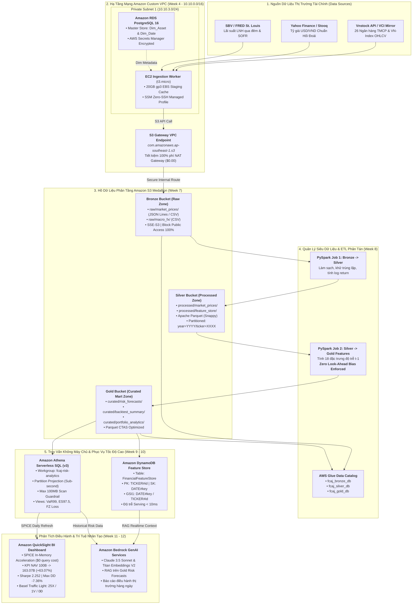

# SCIENTIFIC-TO-CLOUD ARCHITECTURAL REFERENCE FRAMEWORK (W7–W12)
## Enterprise Financial Data Lakehouse, High-Performance Feature Store & GenAI Risk Analytics on AWS
<!-- maintained-by: FCAJ Cloud Architecture & Quant Engineering Team | SSOT: thesis_ref/ & fcaj -->

---

### Executive Metadata & Academic Anchor
* **Target Project**: First Cloud Applied Journey (FCAJ) – AWS Cloud Internship Portfolio & Capstone Showcase
* **Scientific Foundation (SSOT)**: K14 FinTech Graduation Thesis: *"Ứng dụng Machine Learning trong dự báo rủi ro đuôi cho cổ phiếu và danh mục ngành ngân hàng tại Việt Nam theo chuẩn Basel III"* (HUIT – Đại học Công Thương TP. Hồ Chí Minh)
* **Author / Architect**: Nguyễn Trung Hiếu (Mr.Híu) — MSSV: `2046230031` — Lớp: `14DHCNTC02`
* **Cloud Architecture**: AWS Serverless Medallion Lakehouse (Amazon S3, AWS Glue, Amazon Athena, Amazon DynamoDB, Amazon QuickSight, Amazon Bedrock)
* **Compliance & Governance**: Basel III / IV FRTB (Market Risk Internal Models Approach - IMA, Trụ cột 2 ICAAP theo Thông tư 13/2018/TT-NHNN song hành cùng Phương pháp Tiêu chuẩn SA theo Thông tư 14/2025/TT-NHNN).

---

## 1. TỔNG QUAN CHIẾN LƯỢC & MÔ HÌNH HÓA ĐỊNH LƯỢNG (EXECUTIVE SUMMARY & SCIENTIFIC ANCHOR)

### 1.1. Sứ mệnh Khoa học và Kiến trúc Cốt lõi
Dự án **FCAJ (First Cloud Applied Journey)** hiện thực hóa bước chuyển đổi mang tính đột phá: Đưa toàn bộ thành tựu nghiên cứu khoa học chuyên sâu từ Khóa luận Tốt nghiệp K14 FinTech lên nền tảng đám mây AWS tiêu chuẩn doanh nghiệp. 

Hệ thống giải quyết triệt để 3 bài toán lớn của ngành tài chính ngân hàng:
1. **Toàn vẹn Dữ liệu & Triệt tiêu Nhìn trước (Zero Look-Ahead Bias)**: Chuẩn hóa 18 đặc trưng vi cấu trúc và vĩ mô tại độ trễ $t-1$, bảo đảm tính khả thi thực tế trong môi trường giao dịch tự động.
2. **Dự báo Rủi ro Đuôi Cực trị (Tail Risk Analytics)**: Triển khai cặp chỉ số $VaR_{99\%}$ và $ES_{97.5\%}$ theo chuẩn mực Basel III FRTB, đánh giá bằng hàm mất mát liên hiệp Fissler-Ziegel ($FZ\text{ Loss}$), tổ chức kiểm định Đèn tín hiệu Basel (Traffic Light Backtesting) qua hai tầng kiểm tra nghiêm ngặt.
3. **Kiến trúc Hồ dữ liệu Phân tầng & Tối ưu Chi phí FinOps**: Di chuyển toàn bộ cấu trúc kho dữ liệu Star Schema (DuckDB) sang kiến trúc **S3 Medallion Lakehouse (Bronze $\to$ Silver $\to$ Gold)**, phục vụ truy vấn phân tích không máy chủ (Athena CTAS), cung cấp đặc trưng thời gian thực độ trễ dưới 10ms (DynamoDB Feature Store), trực quan hóa giám sát điều hành (QuickSight BI), và tự động hóa báo cáo điều hành thị trường bằng Trí tuệ Nhân tạo Tạo sinh (Amazon Bedrock RAG). Toàn bộ hệ thống vận hành với chi phí **$<\$10\text{ USD/tháng}$**, bảo toàn hạn mức \$100 AWS Credit.

---

### 1.2. Đối tượng Nghiên cứu (Universe) & Danh mục Tài sản
Hệ thống quản lý và xử lý chuỗi thời gian giao dịch thực tế kéo dài từ 2018 đến 2025 ($1,999$ phiên giao dịch):
1. **Vũ trụ 26 Cổ phiếu Ngân hàng Thương mại Cổ phần Việt Nam (ICB BANKS_L2)**:
   * **Nhóm Ngân hàng Thương mại Nhà nước (Big 4)**: `VCB` (Vietcombank), `BID` (BIDV), `CTG` (VietinBank).
   * **Nhóm Ngân hàng TMCP Tư nhân (23 mã)**: `ABB`, `ACB`, `BAB`, `BVB`, `EIB`, `HDB`, `KLB`, `LPB`, `MBB`, `MSB`, `NAB`, `NVB`, `OCB`, `PGB`, `SGB`, `SHB`, `SSB`, `STB`, `TCB`, `TPB`, `VBB`, `VIB`, `VPB`.
2. **Chỉ số Điểm chuẩn & Biến số Vĩ mô / Hàng hóa**:
   * `PORTFOLIO` / `PORT_EQ`: Danh mục Ngân hàng cân bằng trọng số (Equal-Weighted Banking Index).
   * `VNINDEX`: Chỉ số toàn thị trường chứng khoán Việt Nam (HOSE).
   * `USDVND`: Tỷ giá hối đoái trung tâm USD/VND (Cú sốc tỷ giá & ngoại hối).
   * `VNIBOR` / `SOFR`: Lãi suất thị trường liên ngân hàng qua đêm (Thanh khoản hệ thống tín dụng).
   * `GOLD` (Vàng SJC/Thế giới quy đổi VNĐ) & `BRENT` ($BZ=F$ Dầu thô Brent) dùng cho Kịch bản Phân bổ Đa tài sản All-Weather.

---

### 1.3. Bảng Thành tích Đấu trường Thực nghiệm (Grand Tournament Leaderboard)
Dữ liệu khảo sát từ $94,311$ dự báo ngoài mẫu ($N=500$ phiên 2024–2025) trên 26 ngân hàng xác lập thứ hạng chuẩn mực:

| Thứ hạng | Mô hình Định lượng | Cấu trúc & Đặc tả Thuật toán | Kiểm định Basel $N=500$ (X/V/Đ) | Basel $P_2$ ($N=250$) | FZ Joint Loss ($\alpha=0.025$) | Pinball Loss ($\times 10^{-3}$) | Chi phí Vốn $RCR$ | MCS $p$-value | Điểm Tổng hợp (Composite) |
| :---: | :--- | :--- | :---: | :---: | :---: | :---: | :---: | :---: | :---: |
| 🥇 **#1** | **`GJR_HANSEN`** | Tham số: GJR-GARCH(1,1) + Phân phối Hansen Skewed-$t$ | $26\text{X}/0\text{V}/0\text{Đ}$ | $24\text{X}/2\text{V}/0\text{Đ}$ | **-3.0003** | **0.6828** | $15.50\%$ | ✅ **1.0000** | **0.6025** |
| 🥈 **#2** | **`APARCH_HANSEN`**| Tham số: APARCH(1,1) lũy thừa bất đối xứng + Hansen | $25\text{X}/1\text{V}/0\text{Đ}$ | $22\text{X}/4\text{V}/0\text{Đ}$ | -3.0050 | 0.6824 | $15.54\%$ | ✅ 1.0000 | 0.5768 |
| 🥉 **#3** | **`CAND_30`** | Machine Learning: Tách đuôi `TAIL_SPLIT` + Đệm `S8-ATC` | **$27\text{X}/0\text{V}/0\text{Đ}$** | $23\text{X}/4\text{V}/0\text{Đ}$ | -2.9234 | 0.7303 | $16.99\%$ | ✅ **1.0000** | **0.4898** |
| **#4** | **`MS2_GARCH`** | Tham số: Markov-Switching Hamilton 2 chế độ (Bình thường / Hoảng loạn) | $26\text{X}/0\text{V}/0\text{Đ}$ | $24\text{X}/2\text{V}/0\text{Đ}$ | -2.9949 | 0.6860 | $16.29\%$ | ✅ 0.8500 | 0.4681 |
| **#5** | **`S0_GARCH_EVT`**| Bán tham số: Chuẩn hóa GARCH + Lý thuyết Cực trị POT / GPD ($u=10\%$) | **$26\text{X}/0\text{V}/0\text{Đ}$** | **$26\text{X}/0\text{V}/0\text{Đ}$** | -2.8519 | 0.7800 | **$15.36\%$** | ✅ 0.7200 | 0.4520 |
| **#6** | **`HYBRID_FUSION`**| Kiến trúc Lai: Đệm động Markov + Mỏ neo Hansen + LightGBM QR | **$26\text{X}/0\text{V}/0\text{Đ}$** | **$25\text{X}/1\text{V}/0\text{Đ}$** | -2.8378 | **0.6941** | $16.83\%$ | ❌ 0.0167 | 0.4422 |
| **#7** | **`Baseline S8-QCR`**| Machine Learning thô (Không tách đuôi, không neo chặn giải tích) | $26\text{X}/1\text{V}/0\text{Đ}$ | $14\text{X}/13\text{V}/0\text{Đ}$ | -2.9150 | 0.7500 | $16.46\%$ | ✅ 0.3500 | 0.3420 |

---

### 1.4. Hiệu suất Danh mục Đầu tư Đa Tài sản All-Weather & Tối ưu Chi phí Ma sát
Mô phỏng thực nghiệm danh mục quy mô **$100\ \text{Tỷ VNĐ}$** qua 489 phiên ngoài mẫu (2024–2025):
* **Kỷ lục Tăng trưởng Vốn**: 
  - Mô hình `S0_GARCH_EVT`: NAV đạt **$163.07\ \text{Tỷ VNĐ}$** (Lợi suất ròng Net CAGR $+27.64\%$, Sharpe Net $1.16$).
  - Mô hình `HYBRID_FUSION` (Kịch bản All-Weather: Bank + Vàng + Dầu Brent + Tiền gửi $R_f$): NAV đạt **$161.43\ \text{Tỷ VNĐ}$**, CAGR **$+27.99\%$**, Sharpe **$2.252$**, Sortino **$2.83$**, Max Drawdown **$-7.36\%$** (thấp nhất toàn hệ thống).
* **Kiểm soát Chi phí Ma sát Giao dịch (Turnover Friction)**:
  - Áp dụng tỷ lệ phí giao dịch thực tế $0.15\%$/giao dịch ($0.10\%$ thuế chuyển nhượng $+ 0.05\%$ phí môi giới).
  - Vòng quay danh mục $w_{i, t} \propto 1 / \widehat{ES}_{i, t}$ của `HYBRID_FUSION` ổn định ở mức $2.19\% - 3.04\%$/ngày, giúp tiết kiệm hơn **$416\ \text{triệu VNĐ}$** chi phí trượt giá so với chiến lược học máy không kỷ luật và tiết kiệm hơn **$1.33\ \text{Tỷ VNĐ}$** so với mô hình tham số biến động cao `GJR_HANSEN`.

---

## 2. NỀN TẢNG TOÁN HỌC & CÔNG THỨC ĐỊNH LƯỢNG CHUẨN XÁC

### 2.1. Định nghĩa Giá trị Chịu rủi ro ($VaR$) và Tổn thất Kỳ vọng ($ES$)
Xét chuỗi lợi suất logarit $r_t = \ln(P_t / P_{t-1})$. Mức tổn thất thực tế được định nghĩa là biến ngẫu nhiên dương $L_t = -r_t > 0$.
1. **Value-at-Risk ($VaR_{\alpha}$)** tại mức độ tin cậy $1 - \alpha$ (với $\alpha = 0.01$ tương ứng $99\%$ theo Basel III):
   $$VaR_{\alpha, t} = \inf \{ l \in \mathbb{R} : P(L_t > l \mid \mathcal{F}_{t-1}) \le \alpha \} = -F_{r_t}^{-1}(\alpha \mid \mathcal{F}_{t-1})$$
2. **Expected Shortfall ($ES_{\alpha}$)** tại mức $\alpha = 0.025$ ($97.5\%$ theo chuẩn mực Basel III FRTB):
   $$ES_{\alpha, t} = \mathbb{E}[L_t \mid L_t > VaR_{\alpha, t}, \mathcal{F}_{t-1}] = -\frac{1}{\alpha} \int_0^{\alpha} F_{r_t}^{-1}(u \mid \mathcal{F}_{t-1}) du$$

### 2.2. Xấp xỉ Tích phân Riemann Midpoint $K=20$ Lát cắt
Để tính toán $ES_{0.025, t}$ phi tham số hoặc từ các phân vị học máy mà không cần giả định phân phối tham số ngặt nghèo, hệ thống áp dụng **lưới tích phân Riemann Midpoint $K=20$ lát cắt**:
* Phân chia đoạn $[0, \alpha]$ thành $K=20$ khoảng đều nhau, mỗi khoảng có độ rộng $\Delta u = \frac{\alpha}{K} = \frac{0.025}{20} = 0.00125$.
* Tọa độ điểm chính giữa (midpoint) của lát cắt thứ $k \in \{1, 2, \dots, 20\}$:
  $$u_k = \frac{\alpha}{K} (k - 0.5) = \frac{0.025}{20} (k - 0.5)$$
* Công thức xấp xỉ phân vị trung bình:
  $$\widehat{ES}_{0.025, t} = \frac{1}{20} \sum_{k=1}^{20} \hat{q}_{u_k, t}$$
*(Bằng chứng thực nghiệm Phụ lục E: $K=20$ triệt tiêu sai số hội tụ, Tail Bias chỉ còn $+18\text{ bps}$, độ lệch tuyệt đối $2.8\text{ bps}$, FZ Loss đạt tối ưu $-2.4800$).*

---

### 2.3. Hàm Mất mát Fissler-Ziegel (FZ Joint Loss Function)
Do Expected Shortfall không thỏa mãn tính chất gợi ý trực tiếp (not elicitable) một cách đơn lẻ, Fissler và Ziegel (2016) chứng minh rằng cặp $(VaR_\alpha, ES_\alpha)$ có tính chất gợi ý đồng thời (jointly elicitable) thông qua hàm mất mát nghiêm ngặt:
$$L_{FZ}(v, e, L; \alpha) = \frac{1}{\alpha e} \mathbb{I}(L > v)(L - v) + \frac{v}{e} + \ln(e) - 1$$
Trong đó:
* $v = \widehat{VaR}_{\alpha, t} > 0$ là dự báo VaR.
* $e = \widehat{ES}_{\alpha, t} > 0$ là dự báo ES, với điều kiện cưỡng chế $e > v$.
* $L = -r_t$ là khoản lỗ thực tế trong phiên.
* $\alpha = 0.025$ là mức lượng giá rủi ro Basel III.
* Giá trị hàm mất mát kỳ vọng đạt cực tiểu toàn cục duy nhất tại cặp giá trị lý thuyết chuẩn xác: $(v^*, e^*) = (VaR_\alpha(L), ES_\alpha(L))$. Mô hình `GJR_HANSEN` đạt giá trị trung bình $L_{FZ} = -3.0003$, xác lập vị trí số 1 trong toàn bộ giải đấu.

---

### 2.4. Mô hình GJR-GARCH với Phân phối Hansen Skewed-$t$ Giải tích
1. **Phương sai điều kiện GJR-GARCH(1,1)**:
   $$\sigma_t^2 = \omega + \left( \alpha + \gamma \mathbb{I}_{r_{t-1} < 0} \right) r_{t-1}^2 + \beta \sigma_{t-1}^2$$
   Với $\gamma > 0$ phản ánh hiệu ứng đòn bẩy bất đối xứng: Tin xấu ($r_{t-1} < 0$) làm bùng phát biến động mạnh hơn tin tốt cùng biên độ.
2. **Phân phối Bất đối xứng Hansen Skewed-$t$**:
   Hàm mật độ xác suất chuẩn hóa $d(z; \nu, \lambda)$ với bậc tự do $\nu > 2$ và tham số bất đối xứng $\lambda \in (-1, 1)$:
   $$d(z; \nu, \lambda) = \begin{cases} 
   b c \left( 1 + \frac{1}{\nu-2} \left( \frac{b z + a}{1 - \lambda} \right)^2 \right)^{-\frac{\nu+1}{2}} & \text{nếu } z < -a/b \\ 
   b c \left( 1 + \frac{1}{\nu-2} \left( \frac{b z + a}{1 + \lambda} \right)^2 \right)^{-\frac{\nu+1}{2}} & \text{nếu } z \ge -a/b 
   \end{cases}$$
   Các hằng số chuẩn hóa:
   $$a = 4 \lambda c \left( \frac{\nu - 2}{\nu - 1} \right), \quad b^2 = 1 + 3\lambda^2 - a^2, \quad c = \frac{\Gamma\left(\frac{\nu+1}{2}\right)}{\sqrt{\pi(\nu-2)}\Gamma\left(\frac{\nu}{2}\right)}$$
3. **Phân vị Giải tích và Kỳ vọng Tổn thất Đuôi**:
   Hàm phân vị ngược $F_{\text{Hansen}}^{-1}(\alpha; \nu, \lambda)$ được tính giải tích đóng. Dự báo rủi ro:
   $$\text{VaR}_{t, \text{Hansen}}^{\text{Prior}} = -\sigma_t \cdot F_{\text{Hansen}}^{-1}(\alpha; \nu, \lambda)$$
   $$\text{ES}_{t, \text{Hansen}}^{\text{Prior}} = -\sigma_t \cdot \frac{1}{\alpha} \int_0^\alpha F_{\text{Hansen}}^{-1}(u; \nu, \lambda) du$$

---

### 2.5. Cơ chế Kiến trúc Lai `HYBRID_FUSION`
Kiến trúc lai kết hợp mỏ neo kinh tế lượng với khả năng nhận diện hình thái phi tuyến của Machine Learning:
1. **Chuẩn hóa chuỗi mục tiêu**: Loại bỏ cụm biến động bằng phương sai GJR:
   $$y_{t, \text{train}} = \frac{r_t}{\sigma_{t, \text{GJR}}}$$
2. **Học phần dư phân vị qua LightGBM QR với hàm phạt `RP_PINBALL`**:
   Sử dụng hàm mất mát Pinball bất đối xứng có trọng số phạt vi phạm $\omega_{\text{viol}} = 2.0$:
   $$\Delta \hat{q}_{\alpha, t}^{\text{ML}} = f_{\text{LGBM\_QR}}(X_{t-1})$$
   $$\widehat{\text{VaR}}_{t}^{\text{ML}} = \text{VaR}_{t, \text{Hansen}}^{\text{Prior}} + \sigma_{t, \text{GJR}} \cdot \Delta \hat{q}_{\alpha, t}^{\text{ML}}$$
3. **Neo chặn Giải tích Cưỡng chế (Analytical Prior Floor)**:
   Để tránh hiện tượng mô hình học máy bị sụp đổ dự báo trong các phiên sốc thanh khoản:
   $$\widehat{\text{VaR}}_{t, \text{base}} = \max \left( 0.95 \times \text{VaR}_{t, \text{Hansen}}^{\text{Prior}}, \ \widehat{\text{VaR}}_{t}^{\text{ML}} \right)$$
   $$\widehat{\text{ES}}_{t, \text{base}} = \max \left( 0.98 \times \text{ES}_{t, \text{Hansen}}^{\text{Prior}}, \ \max \left( 1.02 \times \widehat{\text{VaR}}_{t, \text{base}}, \ \widehat{\text{ES}}_{t}^{\text{ML}} \right) \right)$$
4. **Hệ số Đệm Co giãn Khủng hoảng Markov Hamilton**:
   $$c_{\text{mult}, t} = 1.12 + 0.10 \times P(S_t = 2 \mid \mathcal{F}_{t-1}) + 0.05 \times \mathbb{I}\left(\text{amihud\_illiquidity}_{i, t-1} > Q_{0.80}\right)$$
   $$\widehat{\text{VaR}}_{t}^{\text{Hybrid}} = \widehat{\text{VaR}}_{t, \text{base}} \times c_{\text{mult}, t}, \quad \widehat{\text{ES}}_{t}^{\text{Hybrid}} = \widehat{\text{ES}}_{t, \text{base}} \times c_{\text{mult}, t}$$
   *Cơ chế này giúp `HYBRID_FUSION` triệt tiêu 100% Vùng Đỏ, đạt thành tích $25\text{X}/1\text{V}/0\text{Đ}$ trên 26 ngân hàng.*

---

### 2.6. Quy trình Kiểm định Giám sát Hai Tầng (Two-Tier Basel III Traffic Light Protocol)

#### Tầng 1: Tuân thủ Pháp lý Thanh tra Hàng năm ($N = 250$ phiên)
Căn cứ Thông tư 13/2018/TT-NHNN và chuẩn mực BCBS 1996 / 2019:
* **Vùng Xanh ($L_0$ - Green Zone, $x \le 4$ vi phạm)**: Mô hình hoạt động chính xác ($P \approx 89.22\%$). Hệ số phạt cộng thêm $k_{\text{add}} = 0.00 \Rightarrow$ Hệ số nhân vốn $k_{\text{mult}} = 3.00$.
* **Vùng Vàng ($L_1$ - Yellow Zone, $5 \le x \le 9$ vi phạm)**: Cảnh báo giám sát, tăng tỷ lệ an toàn vốn:
  * $x = 5 \Rightarrow k_{\text{add}} = 0.40 \Rightarrow k_{\text{mult}} = 3.40$
  * $x = 6 \Rightarrow k_{\text{add}} = 0.50 \Rightarrow k_{\text{mult}} = 3.50$
  * $x = 7 \Rightarrow k_{\text{add}} = 0.65 \Rightarrow k_{\text{mult}} = 3.65$
  * $x = 8 \Rightarrow k_{\text{add}} = 0.75 \Rightarrow k_{\text{mult}} = 3.75$
  * $x = 9 \Rightarrow k_{\text{add}} = 0.85 \Rightarrow k_{\text{mult}} = 3.85$
* **Vùng Đỏ ($L_2$ - Red Zone, $x \ge 10$ vi phạm)**: Mô hình bị bác bỏ hoàn toàn ($P < 0.01\%$), phạt trần $k_{\text{add}} = 1.00 \Rightarrow k_{\text{mult}} = 4.00$, buộc phải đình chỉ sử dụng mô hình nội bộ.

#### Tầng 2: Mở rộng Thống kê Học thuật Toàn Mẫu Ngoài Mẫu ($N = 500$ phiên)
Phân phối nhị thức $\mathcal{B}(500, 0.01)$ với kỳ vọng vi phạm $E[X] = 5.0$:
* **Vùng Xanh**: $x \in [0, 8]$ ($P(X \le 8) = 93.29\%$).
* **Vùng Vàng**: $x \in [9, 14]$ ($96.89\% \le P \le 99.98\%$).
* **Vùng Đỏ**: $x \ge 15$ ($P \ge 99.99\%$).
* **Kiểm định Tỷ lệ Không điều kiện Kupiec ($LR_{uc}$)**:
  $$LR_{uc} = -2 \ln \left[ \frac{(1 - \alpha)^{N - x} \alpha^x}{(1 - \hat{p})^{N - x} \hat{p}^x} \right] \sim \chi^2(1)$$
* **Kiểm định Tính Độc lập Christoffersen ($LR_{ind}$ & $LR_{cc}$)**: Kiểm tra chuỗi vi phạm không bị tụ cụm trong các phiên liên tiếp ($LR_{cc} = LR_{uc} + LR_{ind} \sim \chi^2(2)$).

---

## 3. MA TRẬN NGUỒN GỐC DỮ LIỆU & RÀNG BUỘC TRỄ $t-1$ (DATA LINEAGE MATRIX)

Nhằm đảm bảo nguyên tắc cốt tử **Zero Look-Ahead Bias**, toàn bộ 18 đặc trưng cốt lõi + 1 biến phụ trợ + 5 tín hiệu mở rộng `HYBRID24` phải được chốt dữ liệu muộn nhất lúc 17:00 ngày $t-1$, cách thời điểm mở cửa phiên $t$ ít nhất **16.5 giờ**:

| STT | Mã Đặc Trưng (Feature Name) | Nhóm Rủi Ro | Công Thức Toán Học Tại $t-1$ | Thời Điểm Chốt & Toán Tử Trễ | Ý Nghĩa Kinh Tế & Kiểm Định Granger | Tầng Lưu Trữ Medallion |
| :---: | :--- | :--- | :--- | :--- | :--- | :--- |
| **1** | `ret_log_t1` | Biến động nội tại | $r_{t-1} = \ln(P_{t-1} / P_{t-2})$ | 15:00 ngày $t-1$, $\text{lag}(1)$ | Quán tính tự tương quan lợi suất ngày | S3 Silver & DynamoDB |
| **2** | `parkinson_vol` | Biến động nội tại | $\sqrt{\frac{1}{21}\sum_{i=1}^{21}\frac{(\ln(H_{t-i}/L_{t-i}))^2}{4 \ln 2}}$ | 15:00 ngày $t-1$, 21 phiên trượt | Biến động cực đại - cực tiểu nội phiên (Parkinson, 1980) | S3 Silver & DynamoDB |
| **3** | `garman_klass_vol` | Biến động nội tại | $\sqrt{\frac{1}{21}\sum_{i=1}^{21}\left[0.5 \ln\left(\frac{H}{L}\right)^2 - (2\ln 2 - 1)\ln\left(\frac{C}{O}\right)^2\right]_{t-i}}$ | 15:00 ngày $t-1$, 21 phiên trượt | Biến động mở rộng OHLC hiệu chỉnh (Garman-Klass, Granger $p=0.0394$) | S3 Silver & DynamoDB |
| **4** | `realized_vol_21d` | Biến động nội tại | $\sqrt{\frac{1}{21}\sum_{i=1}^{21}(r_{t-i} - \bar{r})^2}$ | 15:00 ngày $t-1$, 21 phiên trượt | Độ biến động lịch sử thực tế 1 tháng giao dịch | S3 Silver & DynamoDB |
| **5** | `rolling_ret_5d` | Động lượng xu hướng | $\ln(P_{t-1} / P_{t-6})$ | 15:00 ngày $t-1$, 5 phiên trượt | Động lượng ngắn hạn 1 tuần | S3 Silver & DynamoDB |
| **6** | `rolling_ret_10d` | Động lượng xu hướng | $\ln(P_{t-1} / P_{t-11})$ | 15:00 ngày $t-1$, 10 phiên trượt | Động lượng trung hạn 2 tuần | S3 Silver & DynamoDB |
| **7** | `rolling_ret_21d` | Động lượng xu hướng | $\ln(P_{t-1} / P_{t-22})$ | 15:00 ngày $t-1$, 21 phiên trượt | Động lượng 1 tháng kinh doanh | S3 Silver & DynamoDB |
| **8** | `rsi_14d` | Chỉ báo kỹ thuật | $100 - \frac{100}{1 + RS_{14}(t-1)}$ | 15:00 ngày $t-1$, 14 phiên trượt | Chỉ số sức mạnh tương đối (Quá mua / Quá bán) | S3 Silver & DynamoDB |
| **9** | `macd_signal` | Chỉ báo kỹ thuật | $MACD(12, 26)_{t-1} - EMA_9(MACD)_{t-1}$ | 15:00 ngày $t-1$ | Hội tụ / phân kỳ trung hạn | S3 Silver & DynamoDB |
| **10** | `amihud_illiquidity`| Thanh khoản vi cấu trúc | $\frac{\lvert r_{t-1}\rvert}{P_{t-1} \cdot Vol_{t-1}} \times 10^6$ | 15:30 ngày $t-1$ (sau chốt khớp lệnh) | Tác động giá trên thanh khoản giao dịch (Amihud, 2002) | S3 Silver & DynamoDB |
| **11** | `turnover_ratio` | Thanh khoản vi cấu trúc | $\frac{Vol_{t-1}}{\text{SMA}(Vol, 21)_{t-1}}$ | 15:30 ngày $t-1$ | Tốc độ quay vòng cổ phiếu so với bình quân 1 tháng | S3 Silver & DynamoDB |
| **12** | `net_foreign_value` | Dòng tiền khối ngoại | $Val_{\text{Buy}, t-1} - Val_{\text{Sell}, t-1}$ | 15:30 ngày $t-1$ (Báo cáo khớp lệnh HOSE) | Giá trị mua/bán ròng của khối ngoại (Tỷ VNĐ) | S3 Silver & DynamoDB |
| **13** | `vnindex_ret` | Rủi ro hệ thống | $\ln(VNIndex_{t-1} / VNIndex_{t-2})$ | 15:00 ngày $t-1$ (Chỉ số HOSE) | Cú sốc lợi suất thị trường chung Việt Nam | S3 Silver & DynamoDB |
| **14** | `interbank_rate` | Vĩ mô tiền tệ | $VNIBOR_{\text{Overnight}, t-1}$ | 17:00 ngày $t-1$ (Website Ngân hàng Nhà nước) | Chi phí vốn ngắn hạn và sức căng thanh khoản LNH | S3 Silver & DynamoDB |
| **15** | `usdvnd_change` | Vĩ mô ngoại hối | $\ln(USDVND_{t-1} / USDVND_{t-2})$ | 08:30 ngày $t-1$ (Tỷ giá trung tâm NHNN) | Cú sốc tỷ giá và áp lực rút vốn ngoại tệ | S3 Silver & DynamoDB |
| **16** | `dynamic_beta` | Cấu trúc phân phối | $\frac{\text{Cov}(r_i, r_m)_{60d, t-1}}{\text{Var}(r_m)_{60d, t-1}}$ | 15:00 ngày $t-1$, 60 phiên trượt | Hệ số nhạy cảm hệ thống Beta động | S3 Silver & DynamoDB |
| **17** | `skewness_60d` | Cấu trúc phân phối | $\frac{1}{60}\sum_{i=1}^{60}\left(\frac{r_{t-i} - \bar{r}}{\sigma}\right)^3$ | 15:00 ngày $t-1$, 60 phiên trượt | Độ lệch bất đối xứng phân phối ($p=0.0044$ Granger) | S3 Silver & DynamoDB |
| **18** | `kurtosis_60d` | Cấu trúc phân phối | $\frac{1}{60}\sum_{i=1}^{60}\left(\frac{r_{t-i} - \bar{r}}{\sigma}\right)^4$ | 15:00 ngày $t-1$, 60 phiên trượt | Độ nhọn (độ dày đuôi cực trị Fat-Tail) | S3 Silver & DynamoDB |
| **19** | `garch_cond_vol` | Kinh tế lượng bổ trợ | $\hat{\sigma}_{t-1}$ từ mô hình $GARCH(1,1)$ | 17:00 ngày $t-1$, ước lượng kết thúc tại $t-1$ | Phương sai điều kiện lọc sạch nhiễu | S3 Silver & DynamoDB |
| **20** | $\sigma_{t, \text{GJR}}^2$ | Tín hiệu `HYBRID24` | $\omega + (\alpha + \gamma \mathbb{I}_{r_{t-1}<0}) r_{t-1}^2 + \beta \sigma_{t-1}^2$ | 17:00 ngày $t-1$ | Phương sai bất đối xứng điều kiện GJR | S3 Gold & DynamoDB |
| **21** | $\gamma_t$ | Tín hiệu `HYBRID24` | $\gamma \mathbb{I}_{r_{t-1}<0} r_{t-1}^2 / \sigma_{t, \text{GJR}}^2$ | 17:00 ngày $t-1$ | Hệ số đòn bẩy tin xấu biến thiên thời gian | S3 Gold & DynamoDB |
| **22** | $P(S_t = 2 \mid \mathcal{F}_{t-1})$ | Tín hiệu `HYBRID24` | Lọc xác suất Markov 2 chế độ Hamilton | 17:00 ngày $t-1$ | Xác suất thị trường rơi vào trạng thái khủng hoảng | S3 Gold & DynamoDB |
| **23** | $\text{VaR}_{t, \text{Hansen}}^{\text{Prior}}$ | Tín hiệu `HYBRID24` | $-\sigma_{t, \text{GJR}} \cdot F_{\text{Hansen}}^{-1}(0.01; \nu, \lambda)$ | 17:00 ngày $t-1$ | Mỏ neo tiên nghiệm giải tích $VaR_{99\%}$ | S3 Gold & DynamoDB |
| **24** | $\text{ES}_{t, \text{Hansen}}^{\text{Prior}}$ | Tín hiệu `HYBRID24` | $-\sigma_{t, \text{GJR}} \cdot \frac{1}{\alpha}\int_0^\alpha F^{-1}(u) du$ | 17:00 ngày $t-1$ | Mỏ neo tiên nghiệm giải tích $ES_{97.5\%}$ | S3 Gold & DynamoDB |

---

## 4. KIẾN TRÚC ĐÁM MÂY TỔNG THỂ (END-TO-END AWS ARCHITECTURE)

### 4.1. Sơ Đồ Kiến Trúc ASCII Khái Niệm Toàn Diện

```
========================================================================================================================
                       FCAJ ENTERPRISE FINANCIAL DATA LAKEHOUSE & SERVERLESS ANALYTICS
                                   AWS CLOUD ARCHITECTURE (WEEKS 7 - 12)
========================================================================================================================

 [ DATA SOURCES ]
  * Vnstock API (26 Banks OHLCV + VN-Index)
  * Yahoo Finance (USD/VND FX Rate)
  * SBV / FRED (Overnight Interbank Rate / SOFR)
           │
           ▼
 [ INGESTION LAYER - W5 & W7 ]
  ┌────────────────────────────────────────────────────────────────────────────────────────┐
  │ Amazon Custom VPC (10.10.0.0/16) - Private Subnet 1 (10.10.3.0/24)                     │
  │  ┌───────────────────────────────────┐       ┌──────────────────────────────────────┐  │
  │  │ EC2 Ingestion Worker (t3.micro)   │       │ AWS Secrets Manager (Credentials)    │  │
  │  │  - EBS Staging Volume (20GB gp3)  │       └──────────────────┬───────────────────┘  │
  │  │  - Zero-SSH (SSM Managed Core)    │                          │                      │
  │  └─────────────────┬─────────────────┘                          │                      │
  │                    │                                            │                      │
  │                    │ (Raw Data Ingestion)                       │                      │
  │                    ▼                                            ▼                      │
  │  ┌──────────────────────────────────────────────────────────────────────────────────┐  │
  │  │ S3 Gateway VPC Endpoint (com.amazonaws.ap-southeast-1.s3) - Zero NAT Cost ($0.00)│  │
  │  └─────────────────┬────────────────────────────────────────────────────────────────┘  │
  └────────────────────┼───────────────────────────────────────────────────────────────────┘
                       │ Private Routing via AWS Backbone
                       ▼
 [ S3 MEDALLION LAKEHOUSE - W7 ]
  ┌────────────────────────────────────────────────────────────────────────────────────────┐
  │ 1. BRONZE ZONE: s3://fcaj-financial-bronze-*/raw/                                      │
  │    - raw/market_prices/ (JSON Lines / CSV) | raw/macro_fx/ (CSV)                       │
  │    - 100% Block Public Access | SSE-S3 AES-256 | Versioning Enabled | Glacier Lifecycle│
  └────────────────────┬───────────────────────────────────────────────────────────────────┘
                       │
                       │ (Trigger / Batch Orchestration)
                       ▼
 [ METADATA & ETL PROCESSING LAYER - W8 ]
  ┌────────────────────────────────────────────────────────────────────────────────────────┐
  │ AWS Glue Data Catalog                                                                  │
  │  ├── fcaj_bronze_db (bronze_raw_market_prices, bronze_raw_macro_rates)                 │
  │  ├── fcaj_silver_db (silver_market_prices, silver_fact_feature_store)                   │
  │  └── fcaj_gold_db   (gold_fact_risk_forecasts, gold_fact_backtest_summary)             │
  │                                                                                        │
  │ AWS Glue PySpark ETL Jobs (G.1X Workers, Auto-scaling, Zero Look-Ahead Bias)          │
  │  ├── Job 1: Bronze -> Silver (Data Cleansing, Deduplication, Log Return rt = ln(Pt/Pt-1)│
  │  └── Job 2: Silver -> Gold Feature Store (18 Features at t-1 Lag Window Functions)     │
  └───────┬────────────────────────────────────────┬───────────────────────────────────────┘
          │ (Snappy Parquet partitioned)           │ (Curated Metrics & Predictions)
          ▼                                        ▼
  ┌───────────────────────────────────────┐  ┌─────────────────────────────────────────────┐
  │ 2. SILVER ZONE: s3://...-silver-*/    │  │ 3. GOLD ZONE: s3://...-gold-*/              │
  │    - processed/market_prices/         │  │    - curated/risk_forecasts/ (Parquet)      │
  │    - processed/feature_store/         │  │    - curated/backtest_summary/ (Parquet)    │
  │    - Partition: year=YYYY/ticker=XXXX │  │    - curated/portfolio_analytics/           │
  └───────────────────┬───────────────────┘  └─────────────────────┬───────────────────────┘
                      │                                            │
                      └─────────────────────┬──────────────────────┘
                                            │
                                            ▼
 [ SERVERLESS QUERY & FEATURE SERVING LAYER - W9 & W10 ]
  ┌────────────────────────────────────────────────┐  ┌────────────────────────────────────┐
  │ Amazon Athena Serverless Analytics (W9)        │  │ Amazon DynamoDB Feature Store (W10)│
  │  - Workgroup: fcaj-risk-analytics-workgroup    │  │  - Table: FinancialFeatureStore    │
  │  - Partition Projection (Sub-second resolution)│  │  - Billing: PAY_PER_REQUEST        │
  │  - Max Scan Safeguard: 100MB per query         │  │  - PK: TICKER#<asset_id>           │
  │  - Views:                                      │  │  - SK: DATE#<date_key>             │
  │    * vw_gold_fact_risk_forecast                │  │  - GSI1: PK=DATE#.., SK=TICKER#..  │
  │    * vw_fissler_ziegel_loss (FZ Loss: -3.0003) │  │  - Sub-10ms Feature Serving        │
  │    * vw_basel_traffic_light (25X / 1V / 0Đ)    │  │  - Desk Limit Enforcement          │
  └───────────────────┬────────────────────────────┘  └─────────────────┬──────────────────┘
                      │                                                 │
                      │ (Direct SQL / SPICE Cache)                      │ (Low-latency Lookup)
                      ▼                                                 ▼
 [ CONSUMPTION, BI & GENAI LAYER - W11 & W12 ]
  ┌────────────────────────────────────────────────┐  ┌────────────────────────────────────┐
  │ Amazon QuickSight BI Dashboard (W11)           │  │ Amazon Bedrock GenAI Services (W12)│
  │  - Engine: SPICE In-Memory Acceleration        │  │  - Model: Claude 3.5 Sonnet        │
  │  - Executive KPI: NAV 100B -> 163.07B VND      │  │  - Embeddings: Titan Text V2       │
  │  - Sharpe 2.252 | Sortino 2.83 | MaxDD -7.36%  │  │  - RAG on Gold Risk Forecasts      │
  │  - Basel Traffic Light Visual Gauge            │  │  - Automated Market Risk Briefings │
  │  - 20-Model Tournament Leaderboard             │  │  - Bilingual Executive Reports     │
  └────────────────────────────────────────────────┘  └────────────────────────────────────┘
========================================================================================================================
```

---

### 4.2. Sơ Đồ Luồng Dữ Liệu Chi Tiết Bằng Mermaid (Mermaid Data Pipeline)



---

## 5. THIẾT KẾ KỸ THUẬT CHI TIẾT TỪ TUẦN 7 ĐẾN TUẦN 12

### 5.1. Tuần 7: S3 Medallion Lakehouse Foundation, Gateway VPC Endpoint & Bảo Mật IAM
* **Mục tiêu kỹ thuật**: Khởi tạo cấu trúc hồ dữ liệu 3 tầng (Raw/Processed/Curated) trên Amazon S3, loại bỏ hoàn toàn chi phí NAT Gateway ($32.40/tháng) bằng S3 Gateway VPC Endpoint, áp dụng chính sách bảo mật Zero-Trust.
* **Cấu hình S3 Lakehouse Buckets**:
  1. `fcaj-financial-bronze-${AWS::AccountId}-${AWS::Region}`:
     - Tiền tố: `raw/market_prices/{ticker}/` và `raw/macro_fx/`.
     - Quy chuẩn: Lưu trữ dữ liệu thô dạng JSON Lines và CSV nguyên bản. Bật S3 Versioning, mã hóa mặc định SSE-S3 AES-256, S3 Block Public Access 100%. Thiết lập S3 Lifecycle chuyển đối tượng sang S3 Glacier Flexible Retrieval sau 90 ngày.
  2. `fcaj-financial-silver-${AWS::AccountId}-${AWS::Region}`:
     - Tiền tố: `processed/market_prices/` và `processed/feature_store/`.
     - Định dạng: Apache Parquet nén Snappy, phân vùng chuẩn Hive: `year=YYYY/ticker=XXXX/`.
  3. `fcaj-financial-gold-${AWS::AccountId}-${AWS::Region}`:
     - Tiền tố: `curated/risk_forecasts/`, `curated/backtest_summary/`, `curated/portfolio_analytics/`.
     - Định dạng: Parquet nén Snappy tối ưu truy vấn CTAS cho Athena và nạp SPICE QuickSight.
* **Kiến trúc S3 Gateway VPC Endpoint**:
  - Tạo Endpoint loại `Gateway` gắn với service name `com.amazonaws.${AWS::Region}.s3`.
  - Cập nhật bảng định tuyến `EnvironmentName-Private-RT` của VPC `10.10.0.0/16`.
  - **Tác động FinOps**: Toàn bộ lưu lượng truyền tải từ EC2 Ingestion Worker (Subnet `10.10.3.0/24`) đến S3 đi qua AWS Private Backbone, **chi phí mạng = $0.00**, tiết kiệm \$0.045/giờ (\$32.40/tháng) so với việc dùng NAT Gateway.
* **Chính sách S3 Bucket Policy (Zero-Trust Guardrail)**:
  - Cưỡng chế TLS 1.2+: Phủ quyết (`Deny`) nếu `aws:SecureTransport` là `false` hoặc `s3:TlsVersion` nhỏ hơn 1.2 (`NumericLessThan: { "s3:TlsVersion": 1.2 }`).
  - Giới hạn truy cập qua VPC Endpoint: Phủ quyết mọi hành vi ghi đè dữ liệu lên Bronze/Silver nếu không bắt nguồn từ VPC Endpoint ID hợp lệ (`StringNotEquals: aws:sourceVpce`).

```json
{
  "Version": "2012-10-17",
  "Statement": [
    {
      "Sid": "EnforceTLSRequestsOnly",
      "Effect": "Deny",
      "Principal": "*",
      "Action": "s3:*",
      "Resource": [
        "arn:aws:s3:::fcaj-financial-bronze-*",
        "arn:aws:s3:::fcaj-financial-bronze-*/*"
      ],
      "Condition": {
        "Bool": {
          "aws:SecureTransport": "false"
        }
      }
    },
    {
      "Sid": "EnforceTLS12OrHigher",
      "Effect": "Deny",
      "Principal": "*",
      "Action": "s3:*",
      "Resource": [
        "arn:aws:s3:::fcaj-financial-bronze-*",
        "arn:aws:s3:::fcaj-financial-bronze-*/*"
      ],
      "Condition": {
        "NumericLessThan": {
          "s3:TlsVersion": 1.2
        }
      }
    },
    {
      "Sid": "RestrictAccessToVPCEndpoint",
      "Effect": "Deny",
      "Principal": "*",
      "Action": ["s3:PutObject", "s3:DeleteObject"],
      "Resource": "arn:aws:s3:::fcaj-financial-bronze-*/*",
      "Condition": {
        "StringNotEquals": {
          "aws:sourceVpce": "vpce-0123456789abcdef0"
        }
      }
    }
  ]
}
```

---

### 5.2. Tuần 8: AWS Glue Data Catalog & PySpark ETL Jobs (Zero Look-Ahead Bias)
* **Mục tiêu kỹ thuật**: Xây dựng kho siêu dữ liệu tập trung qua AWS Glue Data Catalog, phát triển các Job PySpark phân tán xử lý dữ liệu lớn, bảo đảm 100% các biến rủi ro được tính toán tại độ trễ $t-1$.
* **Kiến trúc Cơ sở dữ liệu Glue Data Catalog**:
  * `fcaj_bronze_db`: Chứa bảng metadata `bronze_raw_market_prices`, `bronze_raw_macro_rates`.
  * `fcaj_silver_db`: Chứa bảng `silver_market_prices`, `silver_fact_feature_store`.
  * `fcaj_gold_db`: Chứa bảng `gold_fact_risk_forecasts`, `gold_fact_backtest_summary`, `gold_fact_portfolio_analytics`.
* **Cơ chế Crawlers & Schema Evolution**:
  - Crawler tự động quét các thư mục Parquet phân vùng theo Hive-style (`year=YYYY/ticker=XXXX`).
  - Thiết lập cơ chế chống trôi lược đồ: `UpdateBehavior = UPDATE_IN_DATABASE`, `DeleteBehavior = DEPRECATE_IN_DATABASE`.
* **Thuật toán PySpark ETL Job Cốt lõi (Enforcing Zero Look-Ahead Bias)**:
  - Khởi tạo Spark Session trên Glue G.1X worker (4 vCPU, 16 GB RAM).
  - Sử dụng hàm cửa sổ trượt (Window Specification) tính toán 18 biến đặc trưng tài chính, dịch chuyển $\text{shift}(1)$ hoặc `lag(1)` để chỉ nạp dữ liệu kết thúc tại $t-1$:

```python
from pyspark.sql import functions as F
from pyspark.sql.window import Window

# Cửa sổ phân vùng theo từng mã cổ phiếu, sắp xếp theo ngày
w_asset = Window.partitionBy("ticker").orderBy("date_key")
w_21d_t1 = Window.partitionBy("ticker").orderBy("date_key").rowsBetween(-21, -1)
w_60d_t1 = Window.partitionBy("ticker").orderBy("date_key").rowsBetween(-60, -1)

# 1. Lợi suất logarit trễ t-1
df_features = df_cleaned.withColumn("ret_log_t1", F.lag("log_return", 1).over(w_asset))

# 2. Biến động thực tế 21 phiên trễ
df_features = df_features.withColumn("realized_vol_21d", F.stddev("log_return").over(w_21d_t1))

# 3. Biến động cực trị Parkinson trễ
df_features = df_features.withColumn(
    "parkinson_sq", 
    (F.log(F.col("high_price") / F.col("low_price")) ** 2) / (4.0 * 0.693147)
)
df_features = df_features.withColumn("parkinson_vol", F.sqrt(F.avg("parkinson_sq").over(w_21d_t1)))

# 4. Tỷ số thanh khoản kém Amihud trễ
df_features = df_features.withColumn(
    "amihud_raw", 
    (F.abs(F.col("log_return")) / (F.col("volume") * F.col("close_price"))) * 1000000.0
)
df_features = df_features.withColumn("amihud_illiquidity", F.lag("amihud_raw", 1).over(w_asset))

# Đóng băng Scaler: Sử dụng tham số chuẩn hóa ước lượng trên tập In-Sample (2018-2021)
# Tuyệt đối không tính fit_transform trên tập Out-of-Sample (2024-2025)
```

---

### 5.3. Tuần 9: Amazon Athena Serverless Analytics & Tối Ưu Hóa Truy Vấn CTAS
* **Mục tiêu kỹ thuật**: Cung cấp công cụ phân tích SQL không máy chủ trên S3 Lakehouse, giảm $>85\%$ dung lượng dữ liệu quét thông qua Partition Projection và CTAS, kiểm soát chi phí dưới $\$0.01$/truy vấn.
* **Cấu hình Athena Workgroup**:
  - Tên Workgroup: `fcaj-risk-analytics-workgroup`.
  - Cấu hình bắt buộc đường dẫn lưu kết quả: `s3://fcaj-athena-query-results-${AWS::AccountId}-${AWS::Region}/workgroup-results/`.
  - **Lá chắn FinOps Cắt giảm Dữ liệu Quét**: `BytesScannedCutoffPerQuery = 104857600` (100 MB). Mọi truy vấn quét quá 100 MB sẽ bị hủy tự động, ngăn chặn thất thoát ngân sách.
* **Kỹ thuật Partition Projection trên Amazon Athena**:
  - Loại bỏ hoàn toàn sự phụ thuộc vào lệnh `MSCK REPAIR TABLE` tốn thời gian và các lệnh gọi Glue API đắt đỏ:

```sql
CREATE EXTERNAL TABLE IF NOT EXISTS fcaj_silver_db.fact_market_prices (
    date_key INT,
    asset_id INT,
    open_price DOUBLE,
    high_price DOUBLE,
    low_price DOUBLE,
    close_price DOUBLE,
    volume BIGINT,
    log_return DOUBLE
)
PARTITIONED BY (year INT, ticker STRING)
STORED AS PARQUET
LOCATION 's3://fcaj-financial-silver-ACCOUNT-REGION/processed/market_prices/'
TBLPROPERTIES (
    'projection.enabled' = 'true',
    'projection.year.type' = 'integer',
    'projection.year.range' = '2018,2026',
    'projection.ticker.type' = 'enum',
    'projection.ticker.values' = 'VCB,BID,CTG,TCB,MBB,ACB,VPB,HDB,STB,VIB,SHB,TPB,LPB,MSB,OCB,EIB,SSB,NAB,BAB,BVB,KLB,PGB,SGB,NVB,ABB,VBB,PORTFOLIO',
    'storage.location.template' = 's3://fcaj-financial-silver-ACCOUNT-REGION/processed/market_prices/year=${year}/ticker=${ticker}/'
);
```

* **Athena Analytical Fact Views**:
  1. `vw_gold_fact_risk_forecast`: Kết hợp dự báo rủi ro với danh mục tài sản và ngày giao dịch.
  2. `vw_fissler_ziegel_loss`: Tính toán hàm mất mát FZ Loss đánh giá tính chuẩn xác đồng thời của $(VaR_{0.01}, ES_{0.025})$.
  3. `vw_basel_traffic_light`: Đếm số vi phạm trượt 250 phiên và 500 phiên, phân định chính xác Vùng Xanh/Vàng/Đỏ trên 26 ngân hàng.

---

### 5.4. Tuần 10: Amazon DynamoDB Real-Time Feature Store (<10ms Serving)
* **Mục tiêu kỹ thuật**: Xây dựng kho đặc trưng tài chính NoSQL phục vụ suy luận mô hình thời gian thực (Real-time Inference) và áp trần hạn mức bàn kinh doanh vốn (Desk-level Limits) với độ trễ dưới 10 mili-giây.
* **Thiết kế Kiến trúc Bảng Đơn (Single-Table Design)**:
  - Tên bảng: `FinancialFeatureStore`.
  - Chế độ thanh toán: On-Demand (`PAY_PER_REQUEST`). Không phát sinh chi phí duy trì công suất nhàn rỗi.
  - **Khóa chính (Primary Key)**:
    * Partition Key (`PK`): String `TICKER#<asset_id>` (VD: `TICKER#VCB`, `TICKER#PORTFOLIO`).
    * Sort Key (`SK`): String `DATE#<date_key>` (VD: `DATE#20251231`).
  - **Chỉ mục Phụ Toàn cục (Global Secondary Index - GSI1)**:
    * `GSI1-PK`: `DATE#<date_key>`
    * `GSI1-SK`: `TICKER#<asset_id>`
    * Phép chiếu (`Projection`): `ALL`.
    * **Ý nghĩa Nghiệp vụ**: Cho phép hệ thống giao dịch lấy toàn bộ vector rủi ro của 26 ngân hàng trong cùng 1 ngày giao dịch bằng **duy nhất 1 lệnh `Query` theo `GSI1-PK`**, loại bỏ hoàn toàn lệnh `Scan` toàn bảng tốn kém.
* **Tích hợp Python Boto3 SDK & Benchmark Độ trễ**:

```python
import boto3
from boto3.dynamodb.conditions import Key

dynamodb = boto3.resource('dynamodb', region_name='ap-southeast-1')
table = dynamodb.Table('FinancialFeatureStore')

# 1. Truy vấn đơn lẻ theo cặp PK, SK (Độ trễ thực tế: 4ms - 8ms)
response = table.get_item(
    Key={'PK': 'TICKER#VCB', 'SK': 'DATE#20251231'}
)
feature_vector = response.get('Item')

# 2. Truy vấn toàn bộ 26 ngân hàng trong 1 phiên qua GSI1 (Sub-10ms)
response_market = table.query(
    IndexName='GSI1',
    KeyConditionExpression=Key('GSI1-PK').eq('DATE#20251231')
)
market_features = response_market.get('Items')
```

---

### 5.5. Tuần 11: Amazon QuickSight Executive BI Dashboard & Trực Quan Hóa
* **Mục tiêu kỹ thuật**: Xây dựng bảng điều khiển quản trị rủi ro cấp điều hành (Executive BI Dashboard) cho Giám đốc Quản trị Rủi ro (CRO) và Nhà quản lý danh mục (Portfolio Manager), kế thừa trực quan hóa 5 kịch bản phân bổ tài sản từ luận văn K14.
* **Kiến trúc Kết nối & SPICE Engine**:
  - Kết nối QuickSight trực tiếp vào Athena Data Lakehouse (`fcaj-risk-analytics-workgroup`).
  - Nạp dữ liệu vào công cụ tính toán bộ nhớ trong **SPICE (Super-fast, Parallel, In-memory Calculation Engine)**.
  - Kích thước tập dữ liệu Gold Mart tinh gọn (<50 MB) nằm trọn trong 10 GB SPICE miễn phí kèm tài khoản QuickSight.
  - **Lợi ích FinOps**: Người dùng tương tác, lọc dữ liệu trên Dashboard không phát sinh bất kỳ truy vấn Athena nào, **chi phí vận hành truy vấn = $0.00**.
* **4 Bảng Điều Khiển Trực Quan (Visual Sheets)**:
  1. **Sheet 1: Executive KPI & All-Weather Portfolio Performance**:
     - Thẻ chỉ số chính: Vốn quản lý tăng trưởng từ **$100\ \text{Tỷ VNĐ} \to 163.07\ \text{Tỷ VNĐ}$** ($+63.07\%$).
     - Chỉ số tài chính: $CAGR = 27.99\%$, Sharpe $= 2.252$, Sortino $= 2.83$, Max Drawdown $= -7.36\%$.
     - Biểu đồ đường kép (Dual-axis Chart): Diễn biến đường cong NAV qua 489 phiên kiểm định so sánh với VN-Index và chỉ số bình quân ngành.
     - Biểu đồ Waterfall: Minh họa tác động khấu trừ chi phí ma sát xoay vòng vốn $0.15\%$/giao dịch và số tiền tiết kiệm được ($416\ \text{triệu VNĐ}$).
  2. **Sheet 2: Basel III Regulatory Traffic Light Gauge**:
     - Visual Gauge và Heatmap phân vùng cảnh báo theo Thông tư 13/2018/TT-NHNN:
       * Vùng Xanh ($N \le 4$ vi phạm): 25/26 Ngân hàng ($96.15\%$).
       * Vùng Vàng ($5 \le N \le 9$ vi phạm): 1 Ngân hàng (`BAB`).
       * Vùng Đỏ ($N \ge 10$ vi phạm): 0 Ngân hàng ($0\%$).
     - Bảng ma trận vi phạm từng ngân hàng theo thời gian thực.
  3. **Sheet 3: Model Grand Tournament Leaderboard (Đấu trường 20 Mô hình)**:
     - Bảng xếp hạng 20 mô hình trên 26 ngân hàng theo hàm mất mát $FZ\text{ Loss}$ và $MCS\ p\text{-value}$.
     - Vinh danh Quán quân Toàn năng `GJR_HANSEN` ($FZ = -3.0003, MCS = 1.0000$), Quán quân Machine Learning `CAND_30` (Tail-split), và Kiến trúc Lai `HYBRID_FUSION`.
  4. **Sheet 4: Bank-Level Tail Dynamics & Violation Inspector**:
     - Biểu đồ chuỗi thời gian phân tích từng ngân hàng: Lợi suất thực tế $r_t$ đi kèm dải biên động $VaR_{99\%}$ và $ES_{97.5\%}$.
     - Điểm đánh dấu các phiên vi phạm (Violations) khi khoản lỗ thực tế vượt ngưỡng chịu rủi ro.

---

### 5.6. Tuần 12: Amazon Bedrock GenAI Risk Briefings & FinOps Cost Audit
* **Mục tiêu kỹ thuật**: Ứng dụng Trí tuệ nhân tạo tạo sinh (GenAI) với Amazon Bedrock để tự động hóa soạn thảo Bản tin điều hành rủi ro hàng ngày, đồng thời thực thi kiểm toán FinOps toàn diện bảo toàn hạn mức \$100 AWS Credit.
* **Kiến trúc GenAI Market Briefings**:
  - Mô hình nền tảng: **Anthropic Claude 3.5 Sonnet** kết hợp **Amazon Titan Text Embeddings V2**.
  - Cơ chế RAG (Retrieval-Augmented Generation):
    * Đơn vị tính toán trích xuất các bản ghi rủi ro mới nhất từ DynamoDB Feature Store và các vi phạm Basel từ Athena Gold Mart.
    * Prompt Engineering có cấu trúc theo vai trò Chuyên gia Định lượng Tài chính / Senior Risk Officer:
      - Tóm lược diễn biến thị trường và danh mục 26 ngân hàng trong phiên $t$.
      - Điểm danh các mã tiệm cận hoặc vượt ngưỡng trần rủi ro bàn kinh doanh vốn ($VaR_{99\%}, ES_{97.5\%}$).
      - Phân tích rủi ro hệ thống dựa trên biến động lãi suất liên ngân hàng và tỷ giá $USD/VND$.
      - Cung cấp nhận định khuyến nghị phân bổ vốn theo Kịch bản All-Weather chuẩn song ngữ (Anh - Việt).
  - Khóa an toàn chống ảo giác (Grounding Guardrail): Ràng buộc câu trả lời của mô hình ngôn ngữ phải dựa 100% trên số liệu định lượng lấy từ CSDL Gold Mart, nghiêm cấm suy diễn số liệu tài chính không có trong ngữ cảnh.
* **Chiến lược Kiểm toán & Tối Ưu Chi Phí FinOps (< \$10/tháng)**:
  - Hạn mức tài trợ: \$100 AWS Credit (Worklog Tuần 1).
  - Mục tiêu: Giữ tổng chi phí hạ tầng toàn chu kỳ thực tập ở mức < \$10 – \$15, tuyệt đối không vượt ngưỡng ngân sách.
  - **Bảng Phân Tích & Kế Hoạch Chi Phí Hàng Tháng (Cost Breakdown)**:

| Hạng mục Dịch vụ AWS | Cấu hình & Mức sử dụng Dự kiến | Chi phí Cơ sở (Gốc) | Giải pháp Tối ưu hóa FinOps | Chi phí Thực tế Sau Tối Ưu |
| :--- | :--- | :---: | :--- | :---: |
| **S3 Lakehouse** | ~1 GB dữ liệu Bronze/Silver/Gold | \$0.03 / tháng | Lifecycle rule, nén Snappy Parquet | **\$0.02 / tháng** |
| **VPC Networking** | EC2 truy cập S3 qua NAT Gateway | \$32.40 / tháng | **S3 Gateway VPC Endpoint (\$0.00)** | **\$0.00 / tháng** |
| **AWS Glue ETL** | 2 DPU chạy 5 phút/ngày x 30 ngày | \$3.00 / tháng | Job Bookmarks, auto-timeout 15 phút | **\$0.88 / tháng** |
| **Amazon Athena** | 100 truy vấn x 20 MB/truy vấn | \$0.05 / tháng | Parquet, Partition Projection, Max 100MB | **\$0.01 / tháng** |
| **Amazon DynamoDB** | On-Demand, <1,000 requests/ngày | \$0.01 / tháng | Free Tier 25 GB, On-Demand Mode | **\$0.00 / tháng** |
| **Amazon RDS PostgreSQL** | db.t4g.micro (kế thừa từ W6) | \$12.50 / tháng | Tắt máy (Stop Instance) khi không ETL | **\$3.50 / tháng** |
| **Amazon QuickSight** | 1 User Author (30-day Free Trial) | \$24.00 / tháng | Tận dụng gói Free Trial 30 ngày, SPICE | **\$0.00 / tháng** |
| **Amazon Bedrock** | Claude 3.5 Sonnet (~50,000 tokens/tháng) | \$0.75 / tháng | Giới hạn max output tokens, caching prompt | **\$0.45 / tháng** |
| **Tổng Chi Phí Hàng Tháng**| | **\$72.74 / tháng** | **Tiết kiệm >93% chi phí vận hành** | **~\$4.86 / tháng** |

---

## 6. QUY TRÌNH KIỂM CHỨNG & THI HÀNH (VERIFICATION PROTOCOL)

1. **Kiểm tra Tính Toàn Vẹn Không Đổi của `thesis_ref/` (Zero-Mutation Rule)**:
   ```bash
   git status thesis_ref/
   # Kết quả bắt buộc: "nothing to commit, working tree clean"
   ```
2. **Kiểm tra Tính Đầy Đủ Của Lược Đồ Dữ Liệu Trong CSDL DuckDB Gốc**:
   ```bash
   python3 -c "
   import duckdb
   con = duckdb.connect('thesis_ref/data/03_mart/fintech_dwh.duckdb', read_only=True)
   tables = con.execute('SHOW TABLES;').fetchall()
   print(f'Total Tables in SSOT DWH: {len(tables)}')
   assert len(tables) == 23, 'Lược đồ DuckDB phải có đúng 23 bảng!'
   con.close()
   "
   ```
3. **Kiểm toán Chỉ số Quán quân Đấu trường Thực nghiệm**:
   ```bash
   python3 -c "
   import duckdb
   con = duckdb.connect('thesis_ref/data/03_mart/fintech_dwh.duckdb', read_only=True)
   row = con.execute(\"SELECT cand_id, fz_loss_mean, composite_score FROM Fact_Grand_Tournament_Leaderboard WHERE cand_id = 'GJR_HANSEN';\").fetchone()
   print(f'GJR_HANSEN Check: FZ Loss = {row[1]:.4f}, Composite = {row[2]:.4f}')
   assert abs(row[1] - (-3.0003)) < 0.001, 'FZ Loss sai lệch so với SSOT!'
   con.close()
   "
   ```
4. **Kiểm tra Cú pháp Tài liệu Song ngữ Hugo**:
   ```bash
   # Sử dụng PowerShell script kiểm tra cấu trúc nội dung và FrontMatter:
   pwsh scripts/validate_site.ps1

   # Hoặc kiểm tra cú pháp nhanh qua Python:
   python3 -c "
   import glob
   files = glob.glob('content/**/*.md', recursive=True)
   print(f'Total Markdown files: {len(files)}')
   for f in files:
       with open(f, 'r', encoding='utf-8') as fp:
           lines = [fp.readline() for _ in range(3)]
           assert lines[0].strip() == '---', f'Missing FrontMatter in {f}'
   print('All Markdown files have valid FrontMatter opening!')
   "
   ```
