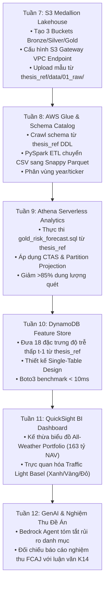

# BẢN THIẾT KẾ DI CHUYỂN DỮ LIỆU & MÔ HÌNH KHÓA LUẬN LÊN AWS (THESIS-TO-AWS MIGRATION MANIFEST)
<!-- maintained-by: antigravity-ide | domain: enterprise-financial-data-lakehouse -->

Tài liệu này xác lập **cầu nối di chuyển kiến trúc (Architectural Migration Bridge)** giữa công trình nghiên cứu Khóa luận Tốt nghiệp K14 Fintech và Đề án Hạ tầng Đám mây **FCAJ (First Cloud Applied Journey)** của **Mr.Híu**.

---

## 1. THÔNG TIN KHÓA CỨNG ĐỊNH DANH (GROUND TRUTH CANONICAL ANCHOR)

| Thuộc tính | Định danh Khóa luận (Nghiên cứu gốc) | Định danh Đề án AWS (Hạ tầng sản phẩm) |
| :--- | :--- | :--- |
| **Tên công trình** | **ỨNG DỤNG MACHINE LEARNING TRONG DỰ BÁO RỦI RO ĐUÔI CHO CỔ PHIẾU VÀ DANH MỤC NGÀNH NGÂN HÀNG TẠI VIỆT NAM THEO CHUẨN BASEL III** | **Enterprise Financial Data Lakehouse & Serverless Analytics Platform on AWS** |
| **Tác giả / Chủ nhiệm** | Nguyễn Trung Hiếu (Mr.Híu) — MSSV: `2046230031` | Nguyễn Trung Hiếu (Lead Cloud Architect & Finance Analytics Engineer) |
| **Đơn vị đào tạo** | Ngành Công nghệ Tài chính (Fintech) — HUIT | AWS First Cloud Applied Journey (FCAJ) |
| **Đường dẫn cục bộ (Linux)** | `/home/wane/Drive_F/thuc-tap-2026/03_Khoa_Luan_Tot_Nghiep/` | `/media/wane/4E9EB2099EB1E99B/DebianBackup/source_code/fcaj/` |
| **Đường dẫn cục bộ (Windows)**| `F:\thuc-tap-2026\03_Khoa_Luan_Tot_Nghiep\` | `D:\DebianBackup\source_code\fcaj\` |
| **Cơ chế liên kết (Symlink)** | `thesis_ref` (Root) & `.agents/thesis` (Agents Hub) | Trực tiếp tham chiếu Read-Only |

---

## 2. BẢN ĐỒ ÁNH XẠ KIẾN TRÚC MEDALLION: DUCKDB $\to$ AWS S3 LAKEHOUSE

Hệ thống kế thừa toàn bộ cấu trúc dữ liệu 3 tầng đã kiểm toán từ Khóa luận và di chuyển lên nền tảng Serverless trên AWS:

```
[ Khóa Luận: DuckDB Local ]                      [ FCAJ: AWS Serverless Lakehouse ]
├── data/01_raw/ (JSON/CSV)       ──(W7: Ingest)──>   s3://fcaj-financial-bronze-*/raw/
├── data/02_processed/ (Parquet)  ──(W8: Glue)────>   s3://fcaj-financial-silver-*/processed/
└── data/03_mart/ (Basel Risk)    ──(W9: Athena)──>   s3://fcaj-financial-gold-*/curated/
```

### Chi Tiết Đối Chiếu Từng Phân Tầng Dữ Liệu:

| Tầng Dữ liệu | Thư mục Khóa Luận (`thesis_ref/`) | Tài nguyên AWS Tương ứng (`fcaj/`) | Định dạng & Tối ưu hóa |
| :--- | :--- | :--- | :--- |
| **Bronze (Raw)** | `data/01_raw/`<br>• `eod_prices/` (26 NHTM)<br>• `macro_indicators/` | `fcaj-financial-bronze-${AWS::AccountId}-${AWS::Region}`<br>Tiếp nhận từ EC2 Ingestion Worker qua S3 Gateway Endpoint | JSON Lines, Raw CSV.<br>Khóa 100% Private, SSE-S3. |
| **Silver (Cleaned)** | `data/02_processed/`<br>• `cleaned_returns.parquet`<br>• `macro_aligned.parquet` | `fcaj-financial-silver-${AWS::AccountId}-${AWS::Region}`<br>Xử lý bởi AWS Glue Studio / PySpark ETL Job | Apache Parquet (Snappy compression).<br>Phân vùng: `year=YYYY/ticker=TICKER/`. |
| **Gold (Curated / Mart)** | `data/03_mart/`<br>• `gold_risk_forecast.sql`<br>• `simulation_7y_atc_*.parquet` | `fcaj-financial-gold-${AWS::AccountId}-${AWS::Region}`<br>Quản lý bởi Amazon Athena v3 & DynamoDB Feature Store | Parquet tối ưu truy vấn CTAS.<br>Phục vụ Basel III Metrics ($VaR_{99\%}, ES_{97.5\%}$). |
| **Metadata & Dimensions** | `data/baseline_snapshot.txt`<br>`data/warehouse.duckdb` | **Amazon RDS PostgreSQL 16** (`Dim_Asset`, `Dim_Date`) & **AWS Glue Data Catalog** | Lưu trữ danh mục Master, khóa an toàn qua AWS Secrets Manager. |

---

## 3. LỘ TRÌNH DI CHUYỂN THEO WORKLOG MATRIX (W7 $\to$ W12)



---

## 4. QUY TẮC AN TOÀN KHI TRUY CẬP `thesis_ref` (READ-ONLY GUARDRAILS)

1. **Zero-Mutation**: Agent và các công cụ trong `fcaj` **chỉ được phép đọc (`read`) hoặc sao chép (`clone/copy`)** tài sản từ `thesis_ref`. Tuyệt đối không thực thi các lệnh sửa đổi (`rm`, `mv`, `write`, `sed`) lên cây thư mục Khóa luận.
2. **Git Isolation**: Thư mục `thesis_ref` và `.agents/thesis` đã được đưa vào `.gitignore` để tránh đẩy dữ liệu nhị phân hoặc symlink hệ điều hành lên remote repository của FCAJ.
3. **SSOT Ground Truth**: Bất cứ khi nào cần kiểm tra công thức tính toán tài chính ($VaR_{99\%}$, $ES_{97.5\%}$, FZ Loss, Hansen Skewed-$t$, Basel Traffic Light), danh sách 26 mã ngân hàng, hoặc cấu trúc biến `HYBRID24`: **Luôn tra cứu trực tiếp tại `thesis_ref/00_HANDOVER_K14_FINTECH.md`**.
